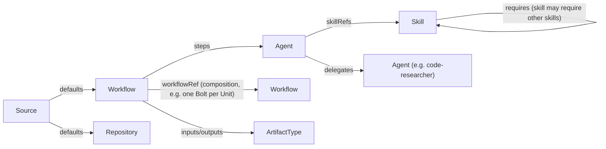

# Software Factory: AI-DLC as Code

A declarative software factory built around the **AI-Driven Development Lifecycle (AI-DLC)**:

| Phase            | Intent                                              | Key artifacts                        |
|------------------|-----------------------------------------------------|--------------------------------------|
| **Inception**    | Turn an *Intent* into requirements & Units of Work  | user stories, NFRs, units, risks     |
| **Construction** | Build each Unit in short *Bolts* (hours/days)       | domain model, design, code, tests    |
| **Operations**   | Deploy, observe, and feed learnings back            | IaC, deploy plan, runbooks, metrics  |

The rule is simple: **AI proposes, a human validates at each gate.**

## Resource model

Every artifact is a resource with the same envelope: `apiVersion`, `kind`, `metadata`, `spec`.
This gives every artifact a uniform address, so resources can reference each other.

| Kind         | Format                         | Location        | Purpose                                  |
|--------------|--------------------------------|-----------------|------------------------------------------|
| `Agent`      | Markdown + YAML frontmatter    | `agents/`       | Persona, responsibilities, skills it uses |
| `Skill`      | Markdown + YAML frontmatter    | `skills/`       | Reusable capability / procedure           |
| `Workflow`   | YAML custom resource           | `workflows/`    | Phases → stages → steps, gates, artifacts |
| `ArtifactType` | YAML custom resource         | `artifacts/`    | Typed outputs that flow between steps     |

`apiVersion: factory.ai-dlc.io/v1alpha1` for all kinds. Schemas are in `schemas/`.

### References

References follow the Kubernetes `*Ref` convention:

```yaml
agentRef:     { name: product-owner }          # → agents/product-owner.md
skillRefs:    [{ name: user-story-writing }]   # → skills/user-story-writing.md
workflowRef:  { name: construction-bolt }      # → sub-workflow
inputs:       [{ artifactRef: { name: user-stories } }]
```

Reference graph:



## Layout

```
agents/       Agent definitions (*.md)
skills/       Skill definitions (*.md)
workflows/    Workflow CRs (*.yaml)
artifacts/    ArtifactType CRs (*.yaml)
schemas/      JSON Schemas per kind
tools/        validate.py: checks schemas + resolves every reference
```

## Run it (MVP v0.1)

```bash
cd web
npm install
cp .env.example .env.local   # optional: OPENAI_API_KEY / ANTHROPIC_API_KEY / GITHUB_TOKEN
npm run dev                  # http://localhost:3000
npm test                     # node:test, store + control plane + agent pipeline
npm run typecheck
```

Without an LLM key, the factory still runs end to end. Classification and code research use deterministic
skill handlers (ripgrep over the `software-factory` repository itself), and the other agents are simulated.
Set `FACTORY_SIMULATION=wait` to keep agent runs waiting until an LLM is configured instead of producing placeholders.
Use **Restart** on an item to run it again (e.g. after adding a key). Earlier output stays as superseded history.
Data lives in `web/data/factory.db`. Delete the file to reset.

Behind an HTTP proxy, Node's `fetch` ignores `HTTPS_PROXY` unless you opt in. Start the server with
`NODE_USE_ENV_PROXY=1 npm run dev`. Otherwise source sync and LLM calls fail with `fetch failed: Connect Timeout Error`.

## MCP (ADR-0034)

The factory is an MCP server for your local agent harness, and its agents can use MCP servers.

- **Server:** set `FACTORY_MCP_TOKEN` in `web/.env.local` and restart. Endpoint: `http://localhost:3000/api/mcp`
  (Streamable HTTP, `Authorization: Bearer <token>`). Tools: list/get/create work items, set context, restart, answer
  the current questions, list/sync sources, search and propose knowledge. Approving gates and knowledge stays in the UI.
  VS Code (`.vscode/mcp.json`):
  ```json
  {
    "inputs": [{ "id": "factory-token", "type": "promptString", "description": "FACTORY_MCP_TOKEN", "password": true }],
    "servers": {
      "software-factory": {
        "type": "http",
        "url": "http://localhost:3000/api/mcp",
        "headers": { "Authorization": "Bearer ${input:factory-token}" }
      }
    }
  }
  ```
- **Agents as clients:** define a `ToolServer` in `tool-servers/` (`http` url, or `stdio` command with the `host`
  runtime only), list the `allowedTools`, and add it to an agent's `toolServerRefs`. Tools appear as `<server>__<tool>`.

## Validation

```bash
pip install pyyaml jsonschema
python tools/validate.py
```

## Extending

1. Add a skill → `skills/<name>.md`
2. Give it to an agent via `spec.skillRefs`
3. Use the agent in a workflow step via `agentRef`
4. Run `tools/validate.py`. Broken references fail the build, so this can run in CI.
