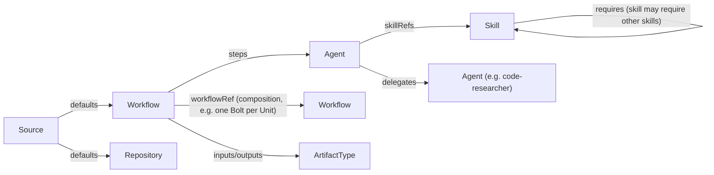

# Software Factory: AI-DLC as Code

A declarative software factory built around the **AI-Driven Development Lifecycle (AI-DLC)**:

| Phase            | Intent                                              | Key artifacts                        |
|------------------|-----------------------------------------------------|--------------------------------------|
| **Inception**    | Turn an *Intent* into requirements & Units of Work  | user stories, NFRs, units, risks     |
| **Construction** | Build each Unit in short *Bolts* (hours/days)       | domain model, design, code, tests    |
| **Operations**   | Deploy, observe, and feed learnings back            | IaC, deploy plan, runbooks, metrics  |

The rule is simple: **AI proposes, a human validates at each gate.**

## Resource model

Every artifact is a resource with the same envelope: `apiVersion`, `kind`, `metadata`, `spec`.
This gives every artifact a uniform address, so resources can reference each other.

| Kind         | Format                         | Location        | Purpose                                  |
|--------------|--------------------------------|-----------------|------------------------------------------|
| `Agent`      | Markdown + YAML frontmatter    | `agents/`       | Persona, responsibilities, skills it uses |
| `Skill`      | Markdown + YAML frontmatter    | `skills/`       | Reusable capability / procedure           |
| `Workflow`   | YAML custom resource           | `workflows/`    | Phases → stages → steps, gates, artifacts |
| `ArtifactType` | YAML custom resource         | `artifacts/`    | Typed outputs that flow between steps     |

`apiVersion: factory.ai-dlc.io/v1alpha1` for all kinds. Schemas are in `schemas/`.

### References

References follow the Kubernetes `*Ref` convention:

```yaml
agentRef:     { name: product-owner }          # → agents/product-owner.md
skillRefs:    [{ name: user-story-writing }]   # → skills/user-story-writing.md
workflowRef:  { name: construction-bolt }      # → sub-workflow
inputs:       [{ artifactRef: { name: user-stories } }]
```

Reference graph:



## Layout

```
agents/       Agent definitions (*.md)
skills/       Skill definitions (*.md)
workflows/    Workflow CRs (*.yaml)
artifacts/    ArtifactType CRs (*.yaml)
schemas/      JSON Schemas per kind
tools/        validate.py: checks schemas + resolves every reference
```

## Run it (MVP v0.1)

```bash
cd web
npm install
cp .env.example .env.local   # optional: OPENAI_API_KEY / ANTHROPIC_API_KEY / GITHUB_TOKEN
npm run dev                  # http://localhost:3000
npm test                     # node:test, store + control plane + agent pipeline
npm run typecheck
```

Without an LLM key, the factory still runs end to end. Classification and code research use deterministic
skill handlers (ripgrep over the `software-factory` repository itself), and the other agents are simulated.
Set `FACTORY_SIMULATION=wait` to keep agent runs waiting until an LLM is configured instead of producing placeholders.
Use **Restart** on an item to run it again (e.g. after adding a key). Earlier output stays as superseded history.
Data lives in `web/data/factory.db`. Delete the file to reset.

Behind an HTTP proxy, Node's `fetch` ignores `HTTPS_PROXY` unless you opt in. Start the server with
`NODE_USE_ENV_PROXY=1 npm run dev`. Otherwise source sync and LLM calls fail with `fetch failed: Connect Timeout Error`.

## Agent retrospectives (ADR-0041)

Open **Retrospectives** to inspect workflow observations, their pinned versions, supporting items/roles, exclusions
and counterevidence. Triager, code-researcher and reviewer opt in through `spec.retrospectiveFeedback`; most runs
should produce no feedback. Observations are untrusted claims, never automatically reusable knowledge.

Three distinct items and two agent roles within 14 days trigger one proposal-only investigation per issue/version.
Operators can supply a versioned `retrospectivePolicy` to `createFactory` to configure the issue-code allowlist,
origin/role thresholds and window. Unknown codes require human classification. Humans may investigate below
threshold; later cycles always require an explicit request.

The two retrospective agents produce a proposal and independent challenge, then stop at human review. If the
proposal or supporting evidence changes, use **Restart → analyze** for fresh review. Close/defer never applies a
change. Record implementation, the definition version actually loaded, and observed benefit separately on the item.
Use **Create follow-up** for implementation; explicitly authorize a publishing workflow's behavior. Approval of a
retrospective alone never edits definitions, grants tools, starts implementation, or publishes changes.

## Direct agent chats (ADR-0036)

Open **Agent chats** in the sidebar, select **support-engineer**, and **Start chat** (also available on the agent's
definition page). Describe the cluster issue and namespace; the agent can discover supported CRs, inspect their
current state/hierarchy and search knowledge using its explicitly allowed MCP tools. Conversations resume from the
chat list. Tool activity, failures and model-quota waits are visible; missing models wait instead of simulating.
The model must explicitly complete its answer (ADR-0038): announcements stay interim while investigation continues.
Models that repeatedly fail to complete hit a visible step limit instead of silently marking the turn answered.
Send with **Ctrl+Enter** (or **Cmd+Enter** on macOS); plain Enter inserts a new line.

For an existing item, use **Chat with agent** on its detail page, or choose **Work item context** when starting
a chat. The selected chat-enabled agent receives the item's details, runs, artifacts and human input plus its usual
read-only MCP tools. Evidence refreshes each turn and is recorded with resource versions (ADR-0037). Resume these
chats from the item or chat list. **Open work item** returns to the original; no duplicate item is created.
**Ask about this item** remains the recorded-evidence-only explanation mode.

This mode is read-only: no shell, repository workspace, publication or gate actions. For code research or a workflow,
finish the investigation, click **Create work item**, review the findings and choose the workflow/repositories.
The item links back to the conversation and keeps normal human approvals. No item is created automatically.
Live cluster tools still require the [Kubernetes MCP setup](components/kubernetes-cr-mcp/README.md), including the
host stdio opt-in. Other agents must explicitly opt in with `spec.chat.allowedTools`.

## Follow-up work items (ADR-0039)

On an item page, select **Create follow-up** to carry an investigation into another workflow. Choose the workflow
and repositories, edit the new title/objective, and add free-text **Additional context / instructions** (for example,
"Address this with a feature that does XYZ"). Refresh and review the inherited context, then **Create & start workflow**.

The original item and its pending reviews stay unchanged. The new manual item starts its own workflow and human
gates, links back to the origin, and keeps an immutable, redacted evidence snapshot. New instructions stay separate
and reach every agent. The combined context limit is 20,000 characters: inherited evidence is shortened first,
with a warning; your instructions are never silently truncated. Later origin edits do not change the snapshot.
If the creation response is lost, **Retry original request** recovers the same item rather than creating a duplicate.

## Reviewed Jira replies and status changes (ADR-0040)

The service-desk workflow now ends with **response-review → publish-response**. The first review approves the draft;
the new publication review shows the exact reply and requires an explicit **Public** (customer-visible) or **Internal**
selection. Optionally select a Jira transition to apply after delivery, confirm the review, and **Approve & publish**.
The workflow completes only when the reply and selected transition are delivered. Rejecting returns to drafting.

For an already completed service-desk item, use **Jira ticket actions → Start publication review**. It reuses the
existing response without repeating investigation. Old approvals never publish automatically after an upgrade.
The same panel supports **Change ticket status independently → Review status change** without posting a comment.
Transitions come from Jira's current allowed transitions, not hardcoded statuses. Transitions requiring extra Jira
form fields must be performed in Jira. Account permissions still apply.

`Source.spec.writeBack.replyVisibilities` and `.transitions` explicitly allow these human-reviewed actions;
`jira-servicedesk` keeps `sync.bidirectional: false`, so automatic questions and comment-answer sync remain disabled.
Delivery receipts and errors appear on the item. A visible factory receipt marker is appended to replies.
Interrupted delivery is checked against Jira before recovery; uncertain/failed writes are not blindly repeated.
If a reply succeeds but its status change fails, the receipt remains visible—inspect Jira and use a fresh reviewed
status-only action rather than publishing the reply again.

## Reliable verification (ADR-0042)

Use **Use verified workflow** on a stopped item's detail page to explicitly migrate to `factory-verified`.
This preserves its workspace/history, restarts validation planning and disables publication. Deployment alone
never migrates or restarts existing items.

Review the JSON validation plan and its criterion/check mappings at the fresh spec-review gate. Only after human
approval do configured same-environment preflights and construction start. Required checks run as durable CheckRuns;
timeout/setup/unknown failures request bounded recovery and then human attention, not blind code rewrites.
Human code review binds the candidate; subsequent changes invalidate it. Logs show truncation/interruption explicitly.
Configured candidate preparation runs before AI and human review, including Controlplane's build/generation
(ADR-0043). Preparation is not final verification evidence. Active jobs are awaited before checking candidate
freshness; later drift returns to fresh code-review with a bounded recovery budget, never approval by chat reply.
The **Check evidence** card identifies preparation, preflight, verification and standalone jobs.

Controlplane's named build/test checks automatically select modules changed since the pinned workspace baseline
plus transitive dependents from its CI graph (ADR-0044). This covers committed and dirty changes, and applies to
preparation, gates, agent requests and manual checks. Documentation does not expand code scope; shared tooling,
dependency changes or unknown paths retain full validation. The card shows the exact command and scope.
`full-build` / `full-tests` remain available when acceptance requires the whole monorepo. Other repositories can
opt in with `moduleScope: {graph, sharedPaths, nonBuildPaths}` and `moduleScoped: true` on named `make <target>` checks.
Policy changes require a fresh human-reviewed validation plan; deploying this does not restart existing items.

Missing required evidence blocks verification. Policy-permitted exceptions require an explicit, reasoned,
revision-bound waiver and remain **Waived**, not Passed. Migrated items retain their publication hold even after
approvals. The legacy `factory-loop` workflow is unchanged.

## MCP (ADR-0034)

The factory is an MCP server for your local agent harness, and its agents can use MCP servers.

- **Server:** set `FACTORY_MCP_TOKEN` in `web/.env.local` and restart. Endpoint: `http://localhost:3000/api/mcp`
  (Streamable HTTP, `Authorization: Bearer <token>`). Tools: list/get/create work items, set context, restart, answer
  the current questions, list/sync sources, search and propose knowledge. Approving gates and knowledge stays in the UI.
  VS Code (`.vscode/mcp.json`):
  ```json
  {
    "inputs": [{ "id": "factory-token", "type": "promptString", "description": "FACTORY_MCP_TOKEN", "password": true }],
    "servers": {
      "software-factory": {
        "type": "http",
        "url": "http://localhost:3000/api/mcp",
        "headers": { "Authorization": "Bearer ${input:factory-token}" }
      }
    }
  }
  ```
- **Agents as clients:** define a `ToolServer` in `tool-servers/` (`http` url, or `stdio` command with the `host`
  runtime only), list the `allowedTools`, and add it to an agent's `toolServerRefs`. Tools appear as `<server>__<tool>`.
- **Kubernetes CR investigation:** [standalone Kubernetes CR MCP server](components/kubernetes-cr-mcp/README.md)
  (ADR-0035). Runs without the app; the support engineer uses it over stdio to discover configured CR types,
  list by namespace/labels, read spec/status and follow configured reference hierarchies. Requires separate component
  installation, a local YAML catalog and a read-only kubeconfig; no cluster writes.

## Validation

```bash
pip install pyyaml jsonschema
python tools/validate.py
```

## Extending

1. Add a skill → `skills/<name>.md`
2. Give it to an agent via `spec.skillRefs`
3. Use the agent in a workflow step via `agentRef`
4. Run `tools/validate.py`. Broken references fail the build, so this can run in CI.
