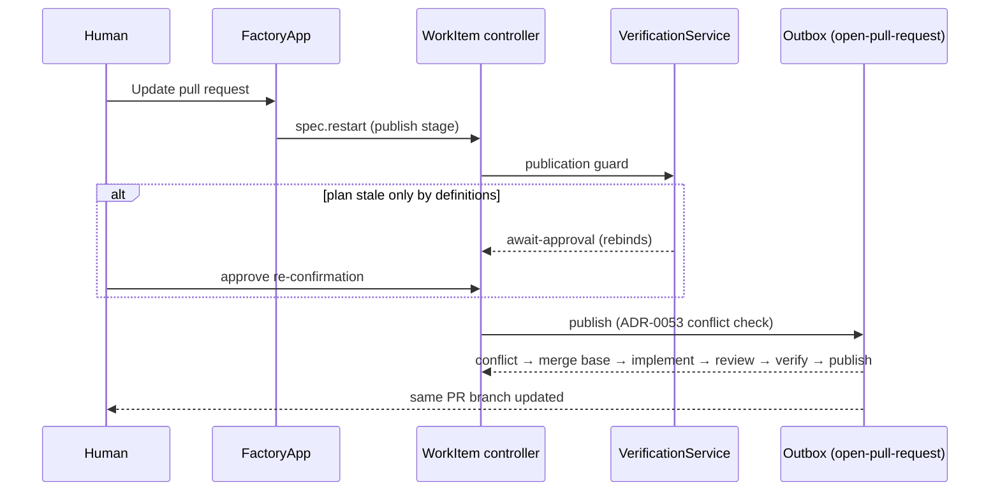

# ADR-0054: Update published pull requests and re-confirm plans in place

- **Status:** Accepted
- **Date:** 2026-11-14
- **Deciders:** Maintainers

## Context
ADR-0053 resolves base conflicts *before* a pull request is published. A PR that was already published can still
become unmergeable later, when parallel work lands on the base branch. There was no supported way to bring such a PR
up to date: the only tool was "Restart from …", and restarting from the publish stage often stopped with a
clarification "current plan, workflow and repository policy need fresh human approval".

That stop came from the plan binding (ADR-0042): the plan fingerprint includes the workflow and repository definition
versions, so *any* edit to a workflow or repository file invalidates the plan approval of every in-flight item. Answering
the clarification cannot help, because an answer is never an approval (ADR-0043). The only way out was a restart from
plan review, which re-runs construction and discards evidence even though the specification and validation plan did
not change.

## Decision
- **"Update pull request" re-publishes.** `PullRequestMaintenance.updatePullRequest` restarts the item from the
  workflow's publish stage (the stage with `publish.pullRequest`). It is allowed for items that are `Done` or at/after
  that stage and have published a PR. Publication then follows ADR-0053: detect the conflict, merge the base into the
  workspace, route to `onConflict.next` (the developer resolves the markers), and pass code review and verification
  again. The push goes to the same branch, so the existing PR is updated; no new PR is opened.
- **On-demand PR status.** `publishedPullRequests` compares each delivered PR's workspace with the freshly fetched base
  through the existing `BaseConflictDetector` (read-only). The item page shows "Check for conflicts" and "Update pull
  request". No polling controller.
- **Plan re-confirmation in place.** A new `PlanReconfirmation` port (implemented by the verification service) is asked
  whenever a gate or the publication guard would block the item. If the latest human-approved plan approval at the
  review stage covers the *same* specification and validation plan (approvals now store a `content` digest without
  definition versions; older approvals qualify only if both artifacts were last written before the decision, compared
  by the global monotonic `resourceVersion`, so any later in-place edit fails closed), the controller creates an
  `Approval` with `verification.rebinds = <approved fingerprint>` at the current stage instead of a clarification. Its
  approvers are the plan-review stage's approvers, not the current stage's. Its criteria say what changed and what
  approving means. Items already blocked by such a gate clarification are converted on their next reconcile; the
  replaced clarification stays as inert history, like an earlier round's clarification after a restart (ADR-0029).
  - **Approve:** the current fingerprint is an alias for the approved one. `plan()` returns the approved fingerprint,
    so candidate approvals and CheckRun evidence bound to it stay valid, while current definitions (checks, repository
    versions, environment) are still enforced. The stage re-runs in a new round.
  - **Reject:** the item returns to the planning revision stage.
  - A changed specification, validation plan or planning revision never qualifies; it still needs full plan review.
- **Publication routes before it blocks.** Merging the base changes the candidate, so the publication guard would
  reject it before the conflict reached its `onConflict` route. The publish stage now handles, in order: this round's
  delivery result (conflict → merge → route); a base merge that no earlier stage has worked on since (e.g. the item was
  restarted at the publish stage after the merge, or the merge happened in an earlier round), which also goes to the
  route (or to a human once the budget is spent; an answered base-conflict clarification counts as handled); then the
  guard. When the guard fails only because the candidate changed after review or a check is still running, a new
  `PublicationRecovery` port returns the stage policy's own route (back to code review, or wait) instead of a
  clarification nobody can answer.
- The remaining stale-plan message now says what is missing and where to restart.

## Consequences
- Conflicting published PRs are a one-click, reviewed update; human gates (code review, verification, ship) still apply
  to the resolved candidate.
- Editing workflow or repository definitions no longer forces in-flight items back to plan review; a human still
  explicitly re-confirms, and the plan's content must be unchanged.
- Re-confirmation re-runs the current stage (like an answered clarification), so a stage's agent steps may run again.
- PR status is local (workspace vs. remote base), not the code host's mergeability; it needs the workspace to exist.
