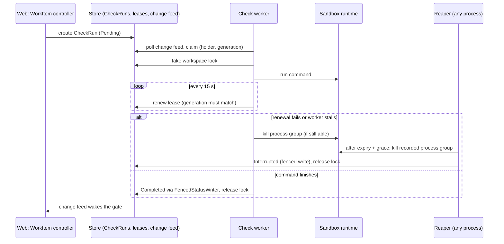

# ADR-0062: Check worker and cross-process coordination

- **Status:** Accepted
- **Date:** 2026-11-17
- **Deciders:** project owner
- **Amends:** ADR-0042 §2 (restart recovery), ADR-0010 (ends the "single process, no leases" MVP simplification
  for check execution; an explicit scope change)
- **Related:** ADR-0061 (verification tiers, proposed)

## Context
Checks (`make test-all`, builds) run as child processes of the Next.js web server. They compete with the UI and the
controllers for CPU, and nothing limits how many run at once. Every server restart interrupts them, after which
ADR-0042 records Interrupted and schedules a bounded rerun. Profile resource limits (`cpu`, `memory`) exist but the
host runtime does not enforce them.

Moving execution into another process is not just a deployment change. Several guarantees rely on everything running
in one process today:
- `ResourceWatcher` delivers changes only to listeners in the same process. A status written by another process would
  not wake the WorkItem controller, the gates or the UI's live updates.
- The CheckRun controller interrupts every `Running` run it isn't executing itself (its in-memory job set,
  re-checked every 2 s). A web-side controller would interrupt every check a worker runs.
- `SerializedWorkspaceJobs` serializes checks and agent mutations per work item in process memory. ADR-0042 §4 and
  ADR-0047 require that serialization, and agent runs stay in the web process.
- Definitions load once per process at startup. Two processes can hold different definition versions.

## Decision
### 1. Shared state stays in the store; four new narrow ports
- **`ChangeFeed`** (read side): an ordered sequence of changes to store-backed resources (kind, namespace, name,
  resourceVersion; deletions as tombstones). Each entry is written in the same transaction as the resource write.
  Entries are kept for a retention period. A consumer whose cursor is older than the retained range re-lists the
  kinds it watches (a full resync) instead of guessing. Consumers re-read the current object, so `ResourceWatcher`
  stays the in-process interface on top of it, fed by every process's poller. Git-loaded definitions are read-only and
  per process; the feed doesn't cover them.
- **`WorkspaceLock`**: an exclusive, store-backed lease per (namespace, WorkItem UID) with the same fencing as §2.
  `WorkspaceJobCoordinator` keeps its current behavior, now across processes: `submit` and `mutate` still reject
  with `Conflict` while a CheckRun for the item is Pending or Running (a store query that already works across
  processes). Nothing waits in a process on a lock (rule 6). The lock protects the actual execution window.
- **`CheckRunClaims`**: claim, renew and release a CheckRun's execution lease. Only the worker and the reaper use it.
- **`FencedStatusWriter`**: `updateStatusIf(object, lease)`, which writes a status only if `resourceVersion`, lease
  holder and generation all still match, in one transaction. Worker results and the reaper's `Interrupted` write go
  through it. `StatusWriter` stays unchanged for everyone else.

Each port does one job (rule 2). Implementations are SQLite now, Postgres later (v1.0); nothing else assumes one
process. `factory.ts` becomes a shared builder plus two thin composition roots (web and worker); wiring stays in
composition roots (rule 3).

### 2. Leases are fenced
- A lease records `holder`, `generation` (incremented on every claim), `expiresAt` (from the store's clock, never the
  holder's) and, for running commands, the process-group ID (or container ID). Defaults: TTL 60 s, renewal every
  15 s. Renewals go to a lease table, not the CheckRun status, so they don't produce a change event every 15 s.
- A worker whose renewal fails kills the command's process group, then stops writing. A stale worker's late writes
  are rejected by `FencedStatusWriter`.
- The **reaper** (any process) handles expired leases after `expiresAt` plus a grace period:
  - it kills the recorded process group (workers share the host and OS user) or stops the container;
  - if it can't confirm the command is gone, the run needs attention instead of a rerun;
  - otherwise it marks the CheckRun `Interrupted` and releases the workspace lock, and ADR-0042's bounded rerun rules
    apply.
- **Agent mutations** in the web process take the `WorkspaceLock` with the same lease. Each web process has an
  incarnation ID. A starting web process releases a previous incarnation's locks only after killing that
  incarnation's agent processes (OpenCode and tool-loop commands record their process groups the same way).
- Worker identity is a self-reported label for diagnostics, not a credential. A worker has exactly the web process's
  trust (same OS user, same database file), which changes nothing about how API entry points take a `Principal`
  (rule 9). Multi-host workers with separate trust need their own ADR.

### 3. The check worker
- Today's CheckRun controller is split. The **execution controller** is registered only in the worker's composition
  root. The **reaper** may run in any process. The web composition root keeps admission, scheduling (creating
  CheckRuns), gates and the UI, and registers nothing that executes CheckRuns or interrupts them other than through
  lease expiry.
- Pending CheckRuns are the queue; there is no second queue. Workers claim in creation order, per namespace
  (ADR-0011), within `FACTORY_CHECKS_PER_WORKSPACE` (default 1) and `FACTORY_CHECKS_TOTAL` (default 2), both counted
  from live leases in the store, so the limits hold across several workers.
- Definitions: a worker whose loaded definitions are **older** than a run's pinned `repositoryVersion` or profile
  version leaves the run Pending with the reason "worker definitions are older; restart the worker". For any other
  mismatch the existing stale-check path applies (the run ends as not executed because the definition changed).
- `SandboxHealthInfo` gets a boolean `enforcesResources`. Where it is true (containers), the worker passes profile
  resources through. Where it is false (`host`), the worker runs commands at lower OS priority, a convenience rather
  than enforcement, and the UI shows that limits are not enforced.
- The UI's system health shows live workers. Without one, CheckRuns stay Pending with the reason "no check worker".
  While a CheckRun is Pending, agent mutations for that item get `Conflict` (§1), so the item visibly waits for a
  worker.
- Restarting the web server no longer affects checks. Restarting the worker interrupts them unless the runtime can
  reattach (containers can, `host` cannot).
- Agent runs stay in the web process for now. Moving them to workers uses the same ports later (v1.0).

## Phases (AGENTS.md X42)
- **X42a:** `ChangeFeed`, used by all controllers and SSE in one process (no behavior change, test-proven).
- **X42b:** store-backed `WorkspaceLock` with web incarnations replaces in-memory serialization.
- **X42c:** `CheckRunClaims`, `FencedStatusWriter`, the split of the CheckRun controller into execution controller
  and reaper, the worker process and the two composition roots.

Required tests:
- a web restart during a check doesn't interrupt it;
- a lease expires while a stale worker is still alive; its late write is rejected and its command is killed;
- two workers claim the same CheckRun and only one wins;
- an agent mutation gets `Conflict` while a check for the item is Pending or Running, across processes;
- a restarted web process releases a previous incarnation's lock only after killing its agent processes;
- a change-feed consumer behind the retention window resyncs instead of missing changes;
- a worker with older definitions leaves the run Pending with a reason; other mismatches end the run as stale;
- with no worker running, the reason is visible.

## Consequences
- Checks no longer compete with the web server and survive its restarts. Concurrency is bounded and visible.
- Operations run two processes. `npm run dev` / `start` start both by default; the worker can also run on its own.
- The change feed and the store-backed lock are the base for moving agent runs and other controllers out of the web
  process later (v1.0).
- When accepted: AGENTS.md updates "Known MVP simplifications" and the v1.0 row; `docs/architecture.md` gets the
  process model; the glossary's **Check worker** entry loses "proposed".

## Alternatives considered
- **Keep checks in the web process, only a production build:** removes dev overhead but keeps the competition and
  the restart interruptions.
- **An external job queue (e.g. Redis, a message broker):** adds infrastructure while CheckRun resources already are a
  durable queue (rule 5).
- **Leases without fencing:** a stalled worker could write a result after another run took over.
- **Move agent runs at the same time:** larger change with more risk. Checks gain the most and have the simplest
  contract.
