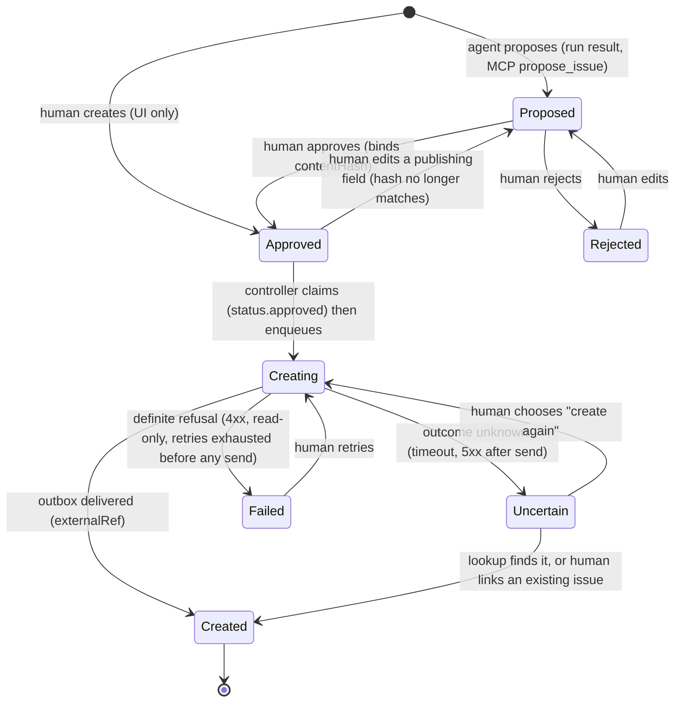
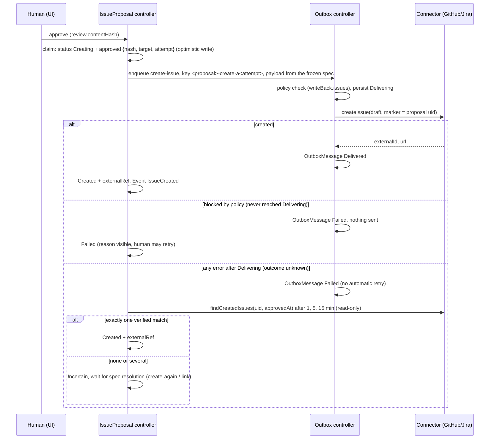

# ADR-0066: Create GitHub issues and Jira stories from the factory

- **Status:** Proposed
- **Date:** 2026-11-18
- **Deciders:** project owner
- **Extends:** ADR-0002, ADR-0005, ADR-0015, ADR-0030, ADR-0034, ADR-0039, ADR-0040

## Context
Today the factory only *reads* trackers (sync, ADR-0004/W4) and *comments* on items it imported (W1–W3). It cannot
create anything in GitHub or Jira, although the work regularly produces things that belong in a tracker:

| # | Use case | Who starts it | Example |
|---|---|---|---|
| U1 | **Mirror** a manual item | human | An idea typed into the dashboard should become a GitHub issue / Jira story, so the team sees it and clarifications go there. |
| U2 | **Findings** | agent | The reviewer's non-blocking findings, an out-of-scope bug the code-researcher found, a gap the verifier noticed. (Not to be confused with follow-up *WorkItems*, ADR-0039, which stay inside the factory.) |
| U3 | **Escalation** from the service desk | agent | The support-engineer finds a product bug while answering `SDDHEI-123`; a dev story belongs in the team's project. The service desk ticket itself stays read-only. |
| U4 | **Units → stories** | workflow | After spec-review, the approved `units-of-work` appear as stories under an epic (Jira) or sub-issues (GitHub). |
| U5 | **Incidents** | SRE (v0.6) | The monitor stage files an incident issue. |
| U6 | **Harness** | MCP client | A local agent (VS Code) proposes an issue through `/api/mcp`. |

Forces:
- **Rule 8 (AI proposes, humans approve).** An agent writing issues into a shared tracker is visible to other teams
  and possibly to the public. Inputs such as service desk tickets come from outsiders (prompt injection).
- **Rule 7 (outbox).** Creating an issue is an outbound effect. Unlike a comment, a duplicate is costly: a retry after
  a timeout must not create the issue twice.
- **Explicit write permissions.** Outbox writes are already authorized per action by a deny-by-default
  `SourceWritePolicy` registry (ADR-0040): `comment` needs `sync.bidirectional`, service desk replies and transitions
  need `writeBack.*`. Creating issues is yet another permission.
- **Echo.** An issue the factory creates may match a source's sync filter (e.g. label `factory`). It would then come
  back as a new WorkItem. For U1 that would be a duplicate of the item it mirrors.

## Decision

### 1. `IssueProposal` (runtime kind, plural `issueproposals`)
One proposed or created tracker issue. Owned by its WorkItem when it has one (cascade deletes the record, never the
external issue).

```yaml
apiVersion: factory.ai-dlc.io/v1alpha1
kind: IssueProposal
metadata: { name: wi-42-review-r3-i0, namespace: default, ownerReferences: [{ kind: WorkItem, name: wi-42 }] }
spec:
  purpose: finding              # mirror | finding | escalation | unit
  targetRef: { name: jira-main } # a Source with writeBack.issues (§2); a human may change it before approving
  title: "Retry budget is not reset after a restart"
  body: |                        # Markdown; rendered per tracker (§4)
    ...
  issueType: Bug                 # optional; default from the target
  labels: [tech-debt]
  pickUp: false                  # true: add the target's pickUpLabels, so the factory itself works on it later
  relatesTo: [{ sourceRef: { name: jira-servicedesk }, externalId: SDDHEI-123 }]   # rendered as links in the body (MVP)
  parent: { externalId: DHEI-7 } # seam for U4 (epic / parent issue); ignored in the MVP
  provenance: { agent: reviewer, run: wi-42-review-r3, workItem: wi-42, at: "…" }  # or { human: <principal> }
  review: { decision: approve, by: <principal>, at: "…", comment: "", contentHash: "sha256:…" }
  resolution: { id: "…", action: create-again }   # human, only when Uncertain/Failed: create-again | link { externalId }
status:
  phase: Created                 # Proposed | Approved | Creating | Uncertain | Created | Rejected | Failed
  approved: { contentHash: "…", target: jira-main, attempt: 1 }   # frozen claim, written before enqueueing (§4)
  externalRef: { id: DHEI-881, url: https://jira…/browse/DHEI-881 }
  conditions: [{ type: Linked, status: "True" }]   # mirror only (§6)
  message: ""
```



- Humans write `spec`. The `issue-proposal` controller owns `status`.
- **Approval binds to content.** `review.contentHash` is the hash of every *publishing field*: `purpose`,
  `targetRef`, `title`, `body`, `issueType`, `labels`, `pickUp`, `relatesTo`, `parent`. The controller acts only
  while the current spec hashes to the approved value. Any later edit makes the approval stale, which puts the
  proposal back to `Proposed`, as with knowledge (ADR-0030).
- **Frozen once claimed.** From `Creating` on, admission rejects edits to publishing fields. Only `resolution` stays
  writable. Rejecting is no longer possible then, because the external effect may already have happened.
- Admission: approving requires a `targetRef` to a Source with `writeBack.issues`. Agent proposals may never be created
  `Approved`.

### 2. Creation is a separate, explicit permission on `Source`
```yaml
kind: Source
metadata: { name: jira-main }
spec:
  type: jira
  sync: { bidirectional: true, … }   # unchanged: comments on imported items
  writeBack:                         # existing block (ADR-0040)
    issues:                          # new: the factory may create issues here
      project: DHEI                  # Jira only; GitHub uses connection.repo
      issueType: Story               # default when the proposal names none
      labels: [factory-created]      # always added
      pickUpLabels: [factory]        # added when proposal.pickUp is true (must match sync.filter to be picked up)
      fields: { components: [{ name: controlplane }] }   # static raw fields for required Jira fields
```
- No `writeBack.issues` means no creation; `jira-servicedesk` gets none.
- A `SourceWritePolicy` registered for the action `create-issue` checks `writeBack.issues`. No change to the outbox
  controller and no change to existing policies. The Jira connector's own write guard checks the same permission
  independently, as it does for replies and transitions.
- **Default target:** `Repository.spec.issueTrackerRef` (new, optional) of the item's first repository, which says
  where issues about this code belong. If none is set, the item's own Source is used when it has `writeBack.issues`. Otherwise
  the proposal has no target and a human picks one before approving.

### 3. Ports (ISP, rule 1–2)
```ts
/** Capability: create an issue in the external system. Returns the new item's id and URL. */
export interface IssueCreator {
  createIssue(source: Source, draft: IssueDraft): Promise<{ externalId: string; url?: string }>;
}
/**
 * Capability: find issues this factory's own account created in the source's create target since `since`
 * that carry the marker for `identity`. Read-only. Returns every match, so the caller can detect ambiguity.
 */
export interface IssueFinder {
  findCreatedIssues(source: Source, identity: string, since: string): Promise<{ externalId: string; url?: string; createdAt: string }[]>;
}
export interface IssueDraft {
  identity: string;       // the proposal's metadata.uid, embedded as a hidden marker; constant across all attempts
  title: string;
  body: string;           // Markdown; the connector renders it (GFM / ADF / wiki markup)
  labels: string[];
  issueType?: string;
  fields?: Record<string, unknown>;
}
```
- `canCreateIssues` / `canFindIssues` type guards, as with `canComment`. `GithubConnector` and `JiraConnector`
  implement both. `manual` and `internal` implement neither.
- Linking (GitHub sub-issues, Jira parent/epic and issue links) is a separate capability, `IssueLinker`, added with
  U4. It is not part of the MVP.
- The `create-issue` handler is a `RecoverableOutboxHandler` (ADR-0040): the outbox persists `Delivering` before it
  calls `deliver`, and after a restart it calls `recover` instead, which only *looks* (`findCreatedIssues`). Any
  error of a recoverable handler ends the message as `Failed` without an automatic POST retry. No outbox change.

### 4. Delivery: outbox action `create-issue`, at most once without a human

- **Claim before effect.** The controller first writes `status.phase: Creating` and `status.approved` (hash,
  resolved target, attempt) under optimistic concurrency, and only then enqueues. The spec is frozen from that write
  on (§1), so the payload equals what was approved. A crash between the two writes is harmless: a `Creating`
  proposal with no outbox message for its attempt enqueues again under the same key.
- **One identity across attempts.** The marker `<!-- software-factory:issue=<uid> -->` uses the proposal's
  `metadata.uid`. It is random, unique across namespaces and re-created resources, and the same for every attempt.
  Only the outbox key carries the attempt number.
- **No blind re-POST.** A new POST happens only on a new attempt: after a policy block (nothing was sent), or when a
  human picks *create again* on an `Uncertain` proposal. A human picks that knowing a duplicate is possible, and the
  UI shows the lookup result.
- **The marker is a hint, never proof.** A lookup match counts only if it is in the claimed target, created by the
  factory's own account (GitHub: the token's user, Jira: `reporter = currentUser()`), created after
  `approved.at`, and the only such match. GitHub lists the repo's newest issues, not the eventually consistent search
  API. Jira queries `project = P AND reporter = currentUser() AND created >= …`, and the 15 min window covers index
  lag.
- **Rendering:** GitHub takes Markdown as is. Jira gets a small Markdown converter (headings, lists, code, links,
  emphasis → ADF on Cloud, wiki markup on Data Center). Existing Jira comments benefit too.
- Title and body are redacted (ADR-0015) when the proposal is created, and again at delivery.

### 5. Capture from agents: skill `issue-proposal`
- Agents with the `issue-proposal` skill may return `issues: [{ title, body, issueType?, labels?, relatesTo? }]`
  (JSON mode and the tool loop's `finish`), like `knowledge` (ADR-0030). The AgentRun controller creates `Proposed`
  proposals named `<run>-i<n>`. Existing ones are never overwritten. At most 5 per run, and the rest are dropped with
  a warning event. Replays and superseded runs never propose.
- Agents never choose the target or `pickUp`. The default target rule (§2) decides, and humans can change it.
- First agents with the skill: `reviewer` (non-blocking findings), `support-engineer` (escalation, `relatesTo` the
  service desk ticket), `developer` (out-of-scope findings). `sre` gets it in v0.6.
- MCP (ADR-0034) offers only `propose_issue` (creates `Proposed`, same limits) and `list_issue_targets`. There is
  **no** MCP tool that creates or approves an issue: the MCP bearer token cannot tell a human from a local agent
  harness, and an external write is irreversible. Approval happens in the UI.

### 6. Mirroring a work item (U1) without echo
- On the item page, **"Create issue…"** opens a form prefilled from the item. It has a target and the option
  **"Link this item to the new issue"** (`purpose: mirror`, `pickUp` on by default). The new-item form offers the
  same option ("Also create in …").
- **One mirror per item.** A mirror proposal is named `<workitem>-mirror`. Admission rejects it when the item already
  has an `externalRef`.
- **Linking is part of done.** A `Created` mirror proposal keeps the condition `Linked=False` until the controller
  has written `WorkItem.spec.sourceRef` + `externalRef` from `status.externalRef` on the human's behalf (precedent:
  clarification sync writes `Clarification.spec`, ADR-0002). It also adds the label
  `factory.ai-dlc.io/external-ref: <source>.<id>`. The controller keeps reconciling `Created` proposals until
  `Linked=True`, which also covers crashes and conflicts. If the item meanwhile has a *different* `externalRef`, it
  sets `Linked=False` with reason `Conflict` and a warning event, and never overwrites the reference. From then on
  clarifications go to the issue (W1–W3).
- **The syncer never links.** It finds existing items by the deterministic name **or** the `external-ref` label. If
  an incoming issue carries a factory marker whose uid belongs to a mirror proposal that is not `Linked=True` yet,
  the syncer **skips that issue this round**. It is imported or updated on a later sync, once the link exists. A
  copied marker can therefore only delay an import, never re-point an item.
- Findings with `pickUp: true` get the target's `pickUpLabels` and are imported as **new** work items by the
  normal sync (with the Source's default workflow). That is intended: the factory picks up its own findings, but only
  after a human approved them. To work on a finding *inside* the factory without a tracker, humans keep using
  "Create follow-up" (ADR-0039).

### 7. UI
- Work item page: an **Issues** panel lists the item's proposals. A `Proposed` proposal can be edited (Markdown
  preview), its target changed, and then approved or rejected. A `Created` proposal shows a link chip to the tracker.
  A `Failed` proposal shows the reason and a Retry button. An `Uncertain` proposal shows the lookup result and two
  explicit choices: **"Link existing issue"** (key or URL) or **"Create again"** (with a warning that a duplicate is
  possible). A mirror with `Linked=False/Conflict` shows both references.
- Navbar entry **Issues** (generic resource list from milestone U1): every open proposal across items, so findings
  don't get lost on finished items.
- Dashboard: a badge on items with open proposals.

### 8. Not in the MVP (seams only)
- U4 (units → stories): a stage-level `publish.issues: { from: units-of-work, parent: item }`, like
  `publish.pullRequest` (ADR-0023), plus `IssueLinker`. It needs a decision on whether spec-review approval also
  approves the stories, so it gets its own ADR.
- Duplicate detection against existing open issues: a read-only `search_issues` tool, so agents check before
  proposing.
- Syncing state back from the tracker (closed, reassigned) onto `IssueProposal.status`.

## Consequences
- Agents can turn what they find into tracked work. Humans stay in control of every issue that reaches a shared
  tracker, and agent-proposed issues are never auto-approved.
- One more runtime kind and controller, two connector capabilities, one outbox action with its write policy, one
  skill, and two optional fields (`Repository.spec.issueTrackerRef`, `Source.spec.writeBack.issues`). No
  `switch (type)` in core: permissions come from the `SourceWritePolicy` registry, crash recovery from
  `RecoverableOutboxHandler`, and creation from connector capabilities. The outbox controller is unchanged.
- **Exactly once is not promised.** Without a human, the factory creates *at most once*. A duplicate is possible only
  when a human chooses "create again" after an unknown outcome that no lookup could resolve.
- Known limits:
  - The Jira marker is visible as text, as with comments.
  - Required custom Jira fields must be configured statically in `writeBack.issues.fields`.
  - A lookup inside the window can miss an issue if Jira's index lags more than 15 min. The human then decides.
- AGENTS.md: new item **X46**. Glossary: *Issue proposal*, *Issue target*, *Mirror*. The
  architecture doc gets the new kind once this ADR is accepted.

## Alternatives considered
- **Only an outbox action, no new kind.** Simpler, but there is nowhere to edit, approve, retarget, retry, or list
  proposals, and the created issue's link would be buried in an `OutboxMessage`.
- **Agents call the tracker directly (MCP/GitHub tool).** Bypasses rule 7 and rule 8, has no idempotency, and the
  token would reach the agent's tool layer.
- **Reuse `sync.bidirectional` as the create permission.** It would make `jira-main` able to create in whatever
  project its filter covers, and it couples two permissions with different risks. `writeBack.issues` is explicit,
  like ADR-0040's reply and transition permissions.
- **A new `IssueTracker` definition kind** instead of `Source.spec.writeBack.issues`. Clean separation, but connection,
  secret, and connector are the same as the Source's. Duplicating them invites drift. This can be revisited if
  write-only trackers without sync appear.
- **Auto-approve proposals by policy** (e.g. labels only, private repos). Rejected for now (rule 8). It would need
  its own ADR.
- **New outbox outcome classes (`retryable`/`refused`/`uncertain`)** (the second draft). Rejected: ADR-0040's
  `Delivering` + `recover` already gives at-most-once delivery for recoverable handlers.
- **Look up the marker, then POST again on every retry** (the first draft of this ADR). Rejected: a lookup that finds
  nothing does not prove that nothing was created (Jira index lag, timeouts). That would turn an unknown outcome into
  a silent duplicate.
- **An MCP `create_issue` tool for humans.** Rejected: the shared bearer token cannot prove that a human is calling.
