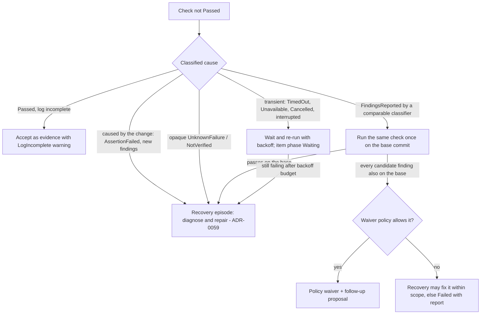

# ADR-0067: Self-resolving verification: auto-fix, policy waivers, no "retry" questions

- **Status:** Accepted
- **Date:** 2026-11-18
- **Deciders:** project owner
- **Extends:** ADR-0042, ADR-0047, ADR-0058, ADR-0059, ADR-0061
- **Amends:** ADR-0058 ("a run that does not call `finish` fails as before"), ADR-0059 §1 ("recovery never waives
  evidence") for policy-declared waivers only

## Context
The goal is that a work item needs as little human input as possible: a human approves the plan, the design and the
result, and nothing else unless the factory truly cannot proceed. ADR-0059 already says *"a failure or exhausted
retry count alone is not a human question"*. That rule is only implemented for unit readiness during `implement`.
The final checks still follow ADR-0042 §3: anything that is not `Passed` or `AssertionFailed` is re-run, and after
`maxExecutionAttempts` the item blocks with:

> `<check>: <outcome> after N execution attempts. No code-fix retry was charged. Inspect CheckRun …; fix
> prerequisites/scope or review the budget, then explicitly retry.`

Observed cases (2026-11-13 and 2026-11-18):

| Item | Check | What happened | What a human could do | What the factory could have done |
|---|---|---|---|---|
| ADR-0066 feature | `software-factory/security-scan` (`npm audit`) | 37 advisories (13 high), all already on `main`; classified `UnknownFailure`, re-run, blocked | Waive it (the check is waivable) | Notice the failure is identical on the base commit and apply a waiver the operator had pre-authorized; open a follow-up for the advisories |
| controlplane follow-up | `controlplane/unit-tests` (`make test-all`) | **Passed** twice (13 + 16 min), but `logsIncomplete` (output cut off): not evidence, blocked with "Passed after 2 execution attempts" | Nothing useful; answered "(no answer)" | Accept the pass (exit code and final snapshot are authoritative), keep head/tail of the log |
| ADR-0066 feature | developer, unit U5 | Called `shell` on the finish-only last step; harness rejected it; run failed; the **item** failed | Restart from `implement` (redoing four finished units) | Treat budget exhaustion as an interrupted unit attempt and retry it with the transcript as prior evidence |

Every one of these stops the item and asks a human for something the factory could have decided or fixed itself,
and the question text doesn't tell the human what to do.

## Decision

### 1. One rule: classify, then fix, waive or wait. Ask only for a named human-only decision
Every non-passing required check (final verification, preparation and preflight alike) is routed by **why** it failed,
never by "attempts used up":



- **"Explicitly retry" disappears.** No gate produces a Clarification whose only content is "inspect and retry". What
  remains for humans is a decision the factory may not take (scope, a credential, a policy) and is phrased as that
  decision, with options and a recommended choice (ADR-0059 §1). Otherwise the item ends `Failed` with a technical
  recovery report, and an operator can grant a recovery allowance (ADR-0059 §2).
- **A deterministic failure is not retried as-is.** A second `UnknownFailure` run happens only when something changed
  (a different snapshot, a transient termination, a recovery step). Two identical results, meaning the same exit code
  and the same normalized failure fingerprint (§4), never cost a second run.

### 2. Verification failures enter the ADR-0059 recovery episode
- `collectChecks` returns `{ action: "recovery", trigger: CheckRun }` instead of `block` once the cause is
  "caused by the change" or opaque. The episode is stage-bound (`verify` / `code-review` preparation) instead of
  unit-bound.
- **One budget.** Everything automatic draws on the workflow `recovery` policy's single hard limit per plan
  fingerprint, and each attempt is reserved idempotently (deterministic name) *before* it is submitted. That covers
  baseline runs, transient re-runs, diagnosis, repairs, direct `AssertionFailed` fixes and retried agent runs.
  Changing stage, trigger, candidate snapshot or failure signature never replenishes it; only an operator recovery
  allowance (ADR-0059 §2) adds attempts.
- The diagnosis agent gets the check, its complete log reference, the base-commit result (§3) and the candidate
  diff. Repairs go back to `implement` as a repair assignment (ADR-0047 "repair" kind), and the barrier re-runs the
  affected checks afterwards. All human gates stay.
- `AssertionFailed` keeps today's direct `goto implement` path while `maxCodeAttempts` lasts, and enters recovery
  afterwards, so it no longer blocks.

### 3. Base-commit comparison decides "pre-existing"
- **Only comparable evidence qualifies.** A failure can be called *pre-existing* only when a registered classifier
  produced complete findings (§4) for both runs. Opaque failures (generic exit code, `NotVerified`, truncated
  structured output) and **test failures** (`AssertionFailed`) are never pre-existing: a change can add a new defect
  inside an already-failing test, or turn a flaky test into a broken one, and test names alone can't tell. Those go to
  recovery, and after that to the human waiver.
- For a comparable `FindingsReported` failure, the gate schedules the same check once on the workspace's pinned
  `baseCommit` (purpose `baseline`, the existing `run_baseline_check` mechanism, now also controller-submitted) with
  the **exact resolved scope and command** of the candidate run. If the baseline cannot run that exact scope, or does
  not report completed coverage of it, there is no comparison.
- **Pre-existing** means every candidate finding also appears on the base under its full identity (§4). Any new
  finding means "caused by the change", and the whole check goes to recovery.
- Baseline results are reused across items only under an identical key: namespace, repository, `baseCommit`, check
  definition version, resolved scope and command, runtime and sandbox profile version, setup inputs, and for
  time-varying inputs (advisory databases) a freshness window (24 h). Everything else runs its own baseline.

### 4. Classifiers that understand findings (registered, rule 4)
- New registered `CheckResultClassifier` formats return `findings: string[]` (stable IDs) in addition to the outcome:
  - `npm-audit-json`: `npm audit --json`. A finding's identity is advisory ID + package + installed version +
    dependency path + severity, so a new vulnerable path or version for an advisory already on `main` is a **new**
    finding, as is a severity increase. A registry, network or parse error is `Unavailable` (transient), not a
    finding.
  - Test classifiers (`node-test-tap`, `go-test-json`) keep reporting failed tests, but those never qualify as
    pre-existing (§3).
  - A generic `exit-code` check has no findings. Its fingerprint (exit code + normalized stderr tail) is used only to
    skip an identical re-run (§1), never to prove equivalence.
- An outcome with findings that is not a test failure is reported as `FindingsReported`, a new `CheckOutcome`. It
  goes through §3: new findings → recovery (the developer may fix dependencies), only pre-existing findings → policy
  waiver.
- `security-scan` for `software-factory` changes to
  `{ command: cd web && npm audit --omit=dev --audit-level=high --json, format: npm-audit-json }`.

### 5. Policy waivers: humans authorize in advance, in Git
Rule 8 still holds, with the decision moved from the moment of failure to the repository definition, where it is
reviewed like code:

```yaml
kind: Repository
spec:
  verification:
    waivableChecks: [integration-tests, acceptance-criteria, security-scan]
    autoWaive:                          # new; absent = today's behaviour (human waiver)
      - check: security-scan
        when: pre-existing              # only failures identical on the base commit (§3)
        followUp: finding               # propose a tracker issue (ADR-0066) or an ADR-0039 follow-up item
      - check: acceptance-criteria
        when: not-configured            # e.g. no acceptance suite exists yet
```

- Only checks in `waivableChecks` can be listed. Admission rejects anything else. `when` is a registered predicate
  (rule 4): `pre-existing`, `not-configured`, `unavailable-tool`. The first version ships only `pre-existing` and
  `not-configured`.
- Applying a policy waiver creates the same `Approval` (verification kind `waiver`) as a human waiver today, decided
  by principal `policy:<repository>@<definition version>`. Its reason names the baseline CheckRun, so it is auditable
  and visible on the item and in gate evidence.
- **Deterministic and revocable.** The waiver's name is derived from item UID, plan fingerprint, candidate fingerprint,
  check, policy version and the baseline evidence, and the WorkItem controller creates it under optimistic
  concurrency (rules 5–6). A human revoking it records a veto on exactly that binding. The policy never re-creates a
  vetoed waiver, so the next reconcile falls back to the human waiver approval. A new candidate or new evidence is a
  new binding.
- **Final verification only (first version).** Policy waivers apply at the `verify` gate, where today's waiver
  validation already binds the approved candidate. Preflight and preparation failures go to recovery or end with a
  report; waiving them needs stage-specific bindings and barrier rules (ADR-0047) and is left for later.
- **The human result review still sees it.** The candidate/ship approval lists every policy waiver as gate evidence
  (ADR-0027 "warning"). Waived means "not caused by this change", never "passed".
- `followUp` emits at most one proposal per `(repository, check, baseCommit, findings fingerprint)`, so parallel items
  don't all propose the same `npm audit fix`.
- Without `autoWaive`, a pre-existing failure on a waivable check goes straight to the existing **waiver approval**
  (one click with the baseline evidence), not to a free-text question.

### 6. Evidence rules that don't throw away real passes
- A check with exit code 0, an unchanged final snapshot and a classifier that decides on the exit code alone
  (`exit-code`, or a structured format whose summary survived) counts as `Passed` even when the log was cut off.
  `logsIncomplete` becomes a warning on the evidence, not a failure. Structured classifiers that cannot see their
  summary still return `NotVerified`.
- Logs keep the first and last 8 MB instead of only the first 16 MB, so the summary and failures at the end survive.
- `Repository.spec.checks.<name>.maxOutputBytes` (optional) overrides the limit per check.

### 7. Agent runs that run out of steps are retried, not fatal (amends ADR-0058)
- A unit, repair or diagnosis run that ends without an accepted `finish` (budget exhausted, or a non-`finish` call
  on the finish-only step) is treated like an interrupted attempt: `RunFailurePolicy.recover` charges one
  execution attempt and starts a new attempt. The previous transcript summary and the workspace diff are its prior
  evidence (ADR-0059 §2). Only when the episode's budget is used up does the item end `Failed` with a report.
- On the finish-only step, the harness answers a non-`finish` tool call with a correction ("only `finish` is
  available now") and allows **one** extra finish-only step before giving up.
- Non-assigned runs (triage, planning, review) keep today's behaviour, because their output is a document and a
  retry has no workspace progress to build on.

### 8. Visibility instead of questions
- Every automatic decision (waived by policy, accepted with incomplete logs, retried after budget exhaustion, baseline
  result) is a Normal or Warning **event** on the item, with the CheckRun or AgentRun reference. Gate evidence shows
  them, grouped as "decided automatically".
- System health shows counts per `(repository, check, cause)` for the last 7 days. A check that is waived on every
  item is a signal to fix `main`, not to keep waiving.

## Consequences
- Of the three observed blocks, all would have resolved without human input: `security-scan` by policy waiver with a
  follow-up (its findings are identical on `main`), `unit-tests` by accepting the pass, U5 by a retry. Opaque or test
  failures still cost a human decision once recovery is used up; that is deliberate. The human still approves plan, design, result
  and ship.
- More automation means more trust in configuration. Waivers are only as good as `autoWaive` and the baseline
  comparison, so both are explicit, versioned definitions in Git and every application is recorded.
- Baseline runs cost time on the first failure per base commit (cached afterwards).
- Code changes:
  - New classifier formats.
  - `CheckOutcome` gains `FindingsReported`; `CheckRunStatus` gains `findings`.
  - `RepositorySpec.verification.autoWaive`, `checks.<name>.maxOutputBytes`.
  - Changes in `collectChecks` and `RunFailurePolicy`, the harness finish-only correction, and log head/tail
    retention.
  - No new resource kind.
- AGENTS.md: new item **X47**. Glossary: *Pre-existing failure*, *Policy waiver*.
- Follow-up: ADR-0066 findings are the natural target for `followUp`. Until X46 lands, `followUp` creates an ADR-0039
  follow-up item proposal instead.

## Alternatives considered
- **Raise `maxExecutionAttempts`.** Doesn't help: both observed checks were deterministic, so more attempts only
  cost more time before the same question.
- **Make `security-scan` non-required.** Hides new vulnerabilities introduced by a change. The baseline comparison keeps
  them blocking while not punishing items for `main`'s state.
- **Waive any failure that also fails on the base** (the first draft). Rejected: two unrelated errors share an
  outcome class, and a test that already failed can fail for a new reason. Only complete, identity-rich findings are
  comparable.
- **Let the recovery agent decide waivers.** A model deciding which evidence to drop is exactly what rule 8 forbids.
  Policy waivers keep the decision human, made once in Git, and limited to failures proven pre-existing.
- **Auto-run `npm audit fix` in every item.** Dependency upgrades are a change of their own with their own risk.
  They belong in one follow-up, not silently in every unrelated item's diff.
