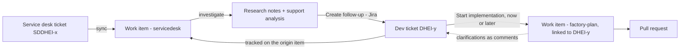

# ADR-0068: Tracker follow-ups start from work items

- **Status:** Accepted (§4 defaults amended by ADR-0093)
- **Date:** 2026-11-18
- **Deciders:** project owner
- **Extends:** ADR-0039 (work-item follow-ups), ADR-0066 (create issues in trackers)
- **Amends:** ADR-0066 §1 (standalone proposals), §5 (MCP), §7 (UI)

## Context
ADR-0066 lets agents and humans create GitHub issues and Jira tickets. In its implementation an issue starts as a
standalone `IssueProposal`, reviewed in a separate **Issues** list. Trying it on a real case (service desk ticket
SDDHEI-11446 → a dev ticket for team Hyperion) showed the flow doesn't fit how the team works:

- The work starts from a **work item**: a service desk ticket synced by `jira-servicedesk` and investigated by the
  `servicedesk` workflow. The dev ticket is a consequence of that investigation, but the proposal didn't know it.
- The research (research notes, support analysis) stayed in the factory instead of going into the ticket.
- After the ticket existed, nothing connected it back: no status on the original item, and no way to say "now
  implement this" that carries the investigation into the implementation.
- Agents' findings ended up in a global inbox nobody looks at, away from the item that produced them.

The intended flow:

## Decision

### 1. One "Create follow-up" with two destinations
ADR-0039's **Create follow-up** dialog on the work item page gets a destination choice:

| Destination | Result | Exists today |
|---|---|---|
| **In the factory** | a new WorkItem (ADR-0039, unchanged) | yes |
| **As a ticket in `<source>`** (every Source with `writeBack.issues`) | a tracker issue, linked to the origin item | new |

- The ticket variant reuses ADR-0039's preview: title, description, separately editable instructions, and
  **reviewed evidence** (bounded, redacted, revision-bound). The ticket body is rendered from it: what was found, the
  evidence with citations, and a link to the origin (the service desk ticket URL and the factory item).
- Ticket fields come from the target Source's `writeBack.issues` (project, issue type, team, fix version, labels).
  The dialog shows them read-only, so the human sees where the ticket lands.
- **Create** is the human approval (rule 8). Under the hood it is an `IssueProposal` with `purpose: follow-up`, owned
  by the origin item and created `Approved` with the preview revision bound into the content hash. Delivery keeps
  ADR-0066's guarantees: claim before effect, at most once without a human, and `Uncertain` resolved by lookup or a
  human. No new kind.

### 2. Agent findings are suggestions on the item, not a global inbox
- Findings that agents return with the `issue-proposal` skill stay `Proposed` IssueProposals owned by the item. They
  are shown in the item's **Follow-ups** panel as *suggested* follow-ups. **Use** opens the follow-up dialog prefilled
  (either destination); **Dismiss** rejects it.
- A proposal must belong to a work item. MCP `propose_issue` requires `workItem` (it is optional today); harnesses
  without an item use `create_work_item` first.
- The navbar **Issues** entry becomes a read-only overview of all proposals and created tickets, linking to their
  items. Approving happens only on the item.
- ADR-0066 §6 (**mirror** a manual item at creation, "Also create in …") stays: it is the same mechanism with
  `purpose: mirror`.

### 3. Track the ticket on the origin item
- The **Follow-ups** panel lists factory follow-ups and tracker tickets together. Each ticket shows key, link,
  status, assignee and last update.
- A registered `IssueStatusReader` capability (Jira: `GET issue?fields=status,assignee,updated,resolution`; GitHub:
  `GET issue`) refreshes created tickets every `pollInterval` of their Source while the ticket is open. It writes
  `IssueProposal.status.tracked` (controller-owned, rule 5). This is ADR-0066 §8's "state sync back", now in scope.
- Read-only: the factory never transitions or edits the ticket after creating it.

### 4. Start implementation, now or later
A created ticket has a **Start implementation** action (on the origin item's Follow-ups panel and on the proposal):
- It asks for workflow and repositories. The defaults come from the target Source's `defaults` (set `jira-main` to
  `factory-plan`).
- It creates a WorkItem with `sourceRef: <target source>` and `externalRef: <ticket>`, so the new item is a normal
  synced item: clarification questions go to the ticket as comments (W1–W3), and replies answer them.
- It carries the follow-up's `originWorkItemRef` and the **same evidence snapshot** that went into the ticket
  (ADR-0039), so the implementation starts with the service desk investigation instead of researching from zero.
- The name is the syncer's deterministic name (`<source>-<key>`), so it converges with sync. If a sync imports the
  ticket first (for example because someone added the source's pick-up label in Jira), the syncer recognizes the
  factory marker of a created follow-up and attaches the origin and snapshot itself. Either path yields one work item
  with the origin.
- Starting is always explicit (button or Jira label). A created ticket is never auto-implemented, because the team
  decides in Jira when it is planned.

### 5. Optional link to the origin ticket
When the origin item came from the same Jira instance (service desk ticket → dev ticket), the factory can also create
a Jira **issue link** ("relates to") from the new ticket to the origin ticket. It is a separate `IssueLinker`
capability, enabled per Source with `writeBack.issues.linkOrigin: true` and **off by default**: the link is also
visible on the service desk ticket, whose Source stays read-only (`jira-servicedesk` gets no write). Without it, the
ticket body still contains the origin URL.

## Consequences
- The service desk → dev ticket → implementation path is one continuous chain with provenance: the origin item shows
  its tickets and their status, and the implementation item knows its origin and starts with its evidence.
- No new kind and no new controller loop. Changes:
  - Follow-up dialog destination, and a ticket body renderer from the evidence snapshot.
  - `IssueProposal` creation path for human follow-ups (created `Approved`, revision-bound).
  - `IssueStatusReader` capability and `status.tracked`.
  - "Start implementation" command and the syncer's origin attachment.
  - `propose_issue` requires `workItem`; Issues list becomes read-only.
  - Optional `IssueLinker` + `writeBack.issues.linkOrigin`.
- The standalone proposal reviewed under **Issues** (as done for SDDHEI-11446) goes away. Existing standalone
  proposals stay reviewable on their detail page until decided.
- AGENTS.md: new item **X48**. Glossary: *Tracker follow-up*, *Start implementation*.

## Alternatives considered
- **Keep the standalone Issues inbox** (ADR-0066 as implemented): disconnected from the investigation, no tracking,
  no hand-over into implementation.
- **Auto-create a work item for every created ticket**: the factory would start implementing tickets the team hasn't
  planned. Starting stays explicit.
- **Auto-import created tickets through the sync filter only** (pick-up label): works, but loses the origin and
  evidence unless the syncer attaches them, which §4 does anyway. The button just makes it one click.
- **Write the issue link from the service desk Source**: would require making `jira-servicedesk` writable. The link
  is created from the dev ticket's Source instead, and is opt-in.
