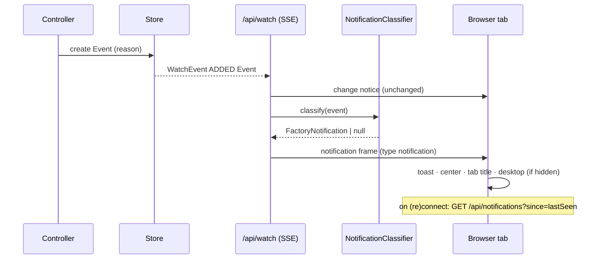
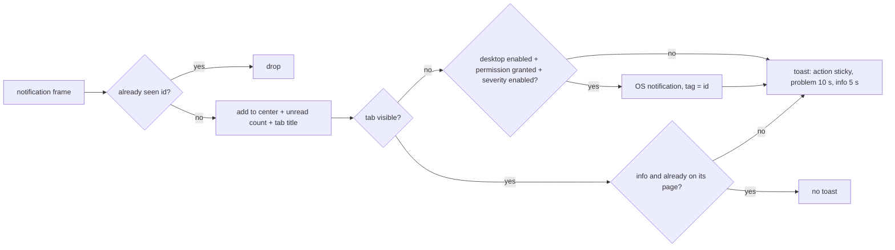

# ADR-0069: Browser notifications (toasts, notification center, desktop)

- **Status:** Accepted
- **Date:** 2026-11-19 (proposed 2026-11-18)
- **Deciders:** project owner
- **Extends:** ADR-0018 (UI), ADR-0025 (UX increment). **Prepares:** ADR-0009 (per-user targeting in v0.4)

## Context
The factory runs for minutes or hours without a human, then suddenly needs one: a clarification is open, a gate waits
for approval, a run failed, the model quota is exhausted. Today a human only notices this by looking at the dashboard.
Items sit in `Blocked` or `AwaitingApproval` while nobody knows, so the "human in the loop" (rule 8) becomes the
bottleneck.

What already exists:
- **Every meaningful transition is already an `Event` resource** with a `reason` and a `Normal`/`Warning` type
  (`StoreEventRecorder`). The WorkItem controller records `Blocked`, `AwaitingApproval`, `Completed`, `Failed`,
  `Waiting`, `LoopExhausted`, …; other controllers record `AgentRunFailed`, `ModelUnavailable`, `ReconcileFailing`,
  `KnowledgeProposed`, `Delivered` (e.g. `open-pull-request`), `DeliveryBlocked`, `Synced`, `AnsweredAtSource`.
- **SSE** (`/api/watch`) sends a light change notice per store write. One shared `EventSource` per tab (`ui/api.ts`).
- **`@mantine/notifications`** is installed and mounted (`ui/providers.tsx`), but only used for action results (`act()`).

So the raw signal exists. What is missing is a decision about *which* events matter to a human, *how loudly*, and
*where* they show up (open tab, background tab, after a reload).

### Brainstorm: what can "a notification" be?
| Idea | Value | Cost | Verdict |
|---|---|---|---|
| In-app toast (Mantine) | Immediate, zero setup | Lost when not looking, lost on reload | **Yes (N1)** |
| Notification center (bell, unread count, list) | Nothing is lost; catch up after lunch | Needs history + read state | **Yes (N2)** |
| Unread count in the tab title / favicon dot | Visible from other tabs | Tiny | **Yes (N2)** |
| Desktop (OS) notification via the `Notification` API | Reaches you while you are in the IDE | Permission prompt; secure context only | **Yes, opt-in (N3)** |
| Sound | Hard to miss | Annoying | Later (desktop notifications already make the OS sound) |
| Web Push (service worker + VAPID), works with the tab closed | Real "pager" | Subscriptions per user → needs auth (v0.4) | Later |
| Slack / Teams / e-mail | Team-wide | External effect → outbox handler; per-squad routing | Later, reuses the same rules |
| "My" notifications (approvals for my role, items I created) | Less noise | Needs `User`/`Role` (v0.4) | Later, seam only |

### Brainstorm: what is worth interrupting a human for?
Three severities, by what the human has to do:

- **action** — a human must act, otherwise the item stays stuck. Sticky until clicked or dismissed.
- **problem** — something went wrong; maybe a human must act. Auto-closes after 10 s, stays in the center.
- **info** — good to know. Auto-closes after 5 s; hidden while you are already looking at that item.

## Decision

### 1. Notifications are a projection of `Event` resources (no new kind)
A notification is derived from an `Event` by a **rule**. Nothing new is persisted: history is the Event list, the
id is the Event's `uid`. A dedicated `Notification` kind only pays off once there are recipients with their own read
state (v0.4, ADR-0009), so per ADR-0010 we stop at a seam.

Classification happens **on the server, in core**, so every channel (SSE toasts, the notification center, desktop
notifications, later Slack/Web Push via the outbox) shows the same thing with the same wording.

### 2. Ports (ISP) and rule registry
New file `web/src/core/ports/notifications.ts`:

```ts
export type NotificationSeverity = "action" | "problem" | "info";

export interface FactoryNotification {
  id: string;              // Event uid: stable dedup key across tabs and reloads
  at: string;              // Event creationTimestamp
  namespace: string;
  severity: NotificationSeverity;
  category: string;        // "clarification" | "approval" | "failed" | "quota" | … (icon + filter)
  title: string;           // "Clarification needed"
  message: string;         // "<item title>: <short reason>", max 160 chars
  workItem?: string;
  subject?: string;        // the work item's title: all a desktop (lock-screen) notification shows besides `title`
  link: string;            // UI path (e.g. /items/<name>) or absolute URL (pull request)
}

/** Registered under "<involved kind>/<reason>" ("*" = any kind). Pure: no I/O. */
export interface NotificationRule {
  toNotification(event: FactoryEvent, ctx: NotificationContext): NotificationDraft | null;
}
// NotificationContext = { workItem?, workItemTitle? }; NotificationDraft = severity, category, title, message, link

/** Maps a stored Event to a notification, or null when it is not worth one. */
export interface NotificationClassifier {
  classify(event: FactoryEvent): Promise<FactoryNotification | null>;
}

/** History for the notification center. v0.4 narrows it to the principal's namespaces. */
export interface NotificationQueries {
  listNotifications(p: Principal, q: { since?: string; limit?: number }): Promise<FactoryNotification[]>;
}
```

- `RuleBasedNotificationClassifier` (`core/notifications/`) looks rules up in a `Registry<NotificationRule>` filled by
  `registerNotificationRules` in the composition root (rule 4, no `switch (reason)`). It reads the WorkItem title
  through `ResourceReader` (the rules stay pure) and adds id, time, namespace and work item from the Event. Messages
  pass through the `Redactor` (ADR-0015) before truncation: some Event messages carry raw error text.
- `EventNotificationFeed` implements `NotificationQueries` (kept out of `FactoryApp`, which is already large): list
  `Event`s, keep those at or after `since` (inclusive, so an Event in the cursor's millisecond isn't lost; clients
  dedup by id), sort newest first, classify until `limit` (default 50, max 200). In-memory filtering is fine for the single-process SQLite MVP; a
  timestamp field selector is a v1.0 (Postgres) concern.
- A new reason only needs a new rule. Controllers don't change.

### 3. Rule catalog (initial)
The item page has no anchors yet, so item links open the item page (decisions are shown first there, ADR-0049).

| Involved kind / reason | Severity | Title | Link target |
|---|---|---|---|
| WorkItem / `Blocked`, `RecoveryHumanNeed` | action | Clarification needed | item |
| WorkItem / `AwaitingApproval` | action | Approval needed | item |
| WorkItem / `PlanningNeedsAttention` | action | Planning needs attention | item |
| AgentRun / `KnowledgeProposed` | action | Knowledge to review | `/knowledge` |
| AgentRun / `IssueProposed` | action | Issue proposals to review | item |
| WorkItem / `Failed`, `GateFailed`, `RecoveryUnavailable` | problem | Work item failed | item |
| WorkItem / `AgentRunFailed` | problem | Agent run failed | item |
| WorkItem / `LoopExhausted` | problem | Review loop exhausted | item |
| WorkItem / `RecoveryExhausted` | problem | Automatic recovery exhausted | item |
| AgentRun / `ModelUnavailable` | problem | Waiting for model quota | item |
| any / `ReconcileFailing` | problem | Control loop failing | object |
| OutboxMessage / `DeliveryBlocked`, `DeliveryFailed` | problem | Write-back failed | item |
| WorkItem / `Completed` | info | Work item done | item |
| OutboxMessage / `Delivered` (`open-pull-request`) | info | Draft PR opened | PR URL (from message) |
| Source / `Synced` (created > 0) | info | N new work items | dashboard |
| WorkItem / `AnsweredAtSource` | info | Answered on the issue | item |
| any / `ReconcileRecovered` | info | Control loop recovered | object |
| Conversation / `ChatAnswered` | info | Agent answered | `/chats/<name>` |

Deliberately **not** notified (the timeline has them): `Started`, `Succeeded`, `StageStarted`, `Resumed`, `Preparing`,
`Ready`, `CheckPassed`, `CheckFailed` (the review→fix loop handles it; `LoopExhausted` is the signal), `DeliveryRetry`,
`Edited`, `ContextUpdated`, `AgentRunInterrupted` (recovery retries it), `BaseConflict` (handled by the bounded
conflict loop), `PublicationHeld` (a human set it), `Approved`/`Rejected` (until v0.4 these are always your own actions; `act()` already confirms
them).

### 4. Delivery


- **SSE**: `/api/watch` keeps its change notices and adds a `notification` frame for `ADDED` Events that classify
  to non-null (`MODIFIED`/`DELETED` never notify). The wire format is backward compatible (`type` already exists).
- **History**: `GET /api/notifications?since=&limit=` (wrapped with `principalFrom`, like every route).
- **Catch-up**: on page load the client fetches the latest 50; after every reconnect (`hello`) it fetches
  `since = newest received`. Caught-up notifications go to the center **without** a burst: a single missed one is
  shown normally; several show one summary toast ("3 items need you") if any of them is `action`, otherwise none.
  On the very first visit in a browser, the loaded history counts as read.

### 5. Browser UX


- **Toasts** (Mantine): `limit={3}` visible, icon + color per category (never color alone), click navigates to `link`
  and marks read. Toasts for the same `(workItem, category)` within 5 s are coalesced.
- **Notification center**: bell `ActionIcon` in the header next to the health badges, unread `Indicator`, popover
  list (newest first, severity filter, "Mark all read", click → `link`). Unread count also in the tab title:
  `(3) Software Factory`.
- **Desktop notifications** (opt-in in the bell's settings): permission is requested only from that click (user
  gesture). Shown only while the tab is hidden. `tag: id` makes the OS collapse duplicates from several open tabs.
  The body is only the work item's title (`subject`), never event or agent text, because it can show on a lock screen. Needs a
  secure context: on `http://<lan-ip>` the toggle is disabled with the reason ("needs HTTPS or localhost").
- **Settings** (per browser, `localStorage`): desktop on/off and "also for info" (default: desktop for `action` +
  `problem`). Toasts are always on.
- **Read state** (per browser, `localStorage`, synced between tabs via the `storage` event): `readAt` + the ids read
  after it (capped at 500), plus the catch-up cursor. Without auth
  there is no user to attach it to. v0.4 moves read state and settings to the `User` behind a new
  `NotificationReadState` port; the client code calls one small hook, so only the hook changes.
- **Accessibility**: action/problem toasts use `role="alert"`, info toasts `role="status"`; toasts never steal focus;
  icon + text per category (never color alone); the bell has `aria-label="Notifications, N unread"`.

### 6. Plan (UX increment, item X49)
| Step | Scope | Exit criteria |
|---|---|---|
| N1 | Ports, rule registry + catalog, `notification` SSE frame, toasts | A clarification opened in one tab appears as a sticky toast in another tab and links to the item |
| N2 | `/api/notifications`, notification center, unread count, tab title, catch-up after reconnect/reload | After a reload, notifications missed while offline are listed as unread, without a toast burst |
| N3 | Desktop notifications + settings | With the tab in the background, an approval request shows one OS notification even with two tabs open |

Tests (`core/notifications.test.ts`): classification and links, uncatalogued reasons and wildcard rules, the
conditional rules (PR delivery, sync with new items), `since`/`limit` of the feed. The UI is verified manually /
with Playwright.

## Consequences
- Humans learn about stuck items in seconds instead of on the next dashboard visit; `action` notifications directly
  shorten the human-in-the-loop wait.
- No new kind, no migration, no new controller; controllers keep only recording Events. A badly worded event message
  now also shows up in a toast, so event messages should stay short and human-readable.
- Read state is per browser until v0.4: two browsers have separate unread counts.
- Without auth, every connected browser gets every notification across namespaces (same as the dashboard and the
  change notices today). Rule 9 holds as a seam: both entry points resolve a `Principal`, and notifications carry
  `namespace`, so v0.4 filters the feed's Event list and the SSE frames by the principal's namespaces in the routes,
  like the existing watch feed.
- Later channels (Web Push, Slack/Teams via an `OutboxHandler`) reuse the classifier, so the catalog is the single
  definition of "worth telling a human".
- Affected: AGENTS.md §4 (UX increment, new item X49), glossary (Notification, Notification rule, Notification severity),
  `docs/architecture.md` UI section once implemented.

## Alternatives considered
- **Classify in the browser from change notices.** Needs an extra fetch per event, puts domain rules into React, and
  every future channel would re-implement them. Rejected.
- **New `Notification` kind written by a notifier controller.** Gives per-recipient read state, but there are no
  recipients yet (auth postponed, ADR-0025) and it would duplicate every Event. Revisit with v0.4.
- **Notify from WorkItem phase changes (watch `status.phase`) instead of Events.** Misses non-phase signals
  (knowledge proposals, PR opened, failing controllers) and needs the previous object to detect a transition, which
  `WatchEvent` does not carry. Rejected.
- **Web Push now.** Needs a service worker, VAPID keys (a secret, ADR-0015) and stored subscriptions per user; useless
  without users. Later.
- **Desktop notifications on by default.** Browsers block permission prompts without a user gesture, and an unasked
  prompt on page load is hostile. Opt-in only.
