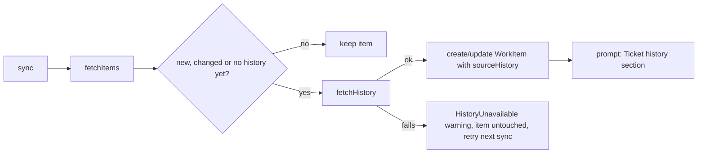

# ADR-0070: Ticket history is mandatory context for synced items

- **Status:** Accepted
- **Date:** 2026-11-19
- **Deciders:** project owner
- **Extends:** ADR-0003 (factory loop input), W4 (Jira connector), X11 (service desk workflow), ADR-0040 (reviewed Jira actions)

## Context
Sync imports a ticket's title and description only (`fields=summary,description,labels,priority,updated`). Everything
said and done on the ticket afterwards is invisible to agents: the requester's follow-up comments, what other
service-desk agents already tried or told the customer, internal notes ("known bug, see DEV-9"), status and assignee
changes. On a service-desk ticket that history usually *is* the request. The support engineer then investigates a
stale problem, asks for things the ticket already answers, or drafts a reply that contradicts what a colleague wrote.
Retrospectives already have an operator code for it (`missing-ticket-history`).

Comment reading existed only to turn replies into clarification answers, and only on `bidirectional` sources;
`jira-servicedesk` is read-only.

## Decision
1. **The full ticket history is part of a synced item.** A new capability port `ItemHistoryFetcher`
   (`fetchHistory(source, externalId)`) returns every comment and every field change. Sync stores it as
   `WorkItem.spec.sourceHistory` (`fetchedAt`, `comments[]`, `changes[]`, `omitted`), written by sync only, like
   title and description (rule 5: spec is human/sync-written; humans never edit this field).
2. **Mandatory, per item.** When the connector implements the port, an item is never imported or updated without
   its history. If reading fails, that item is left as it is, a `HistoryUnavailable` Warning event (and a
   `problem` notification, ADR-0069) says why, its updated stamp isn't advanced, and the next sync retries. Other
   items of the same sync are unaffected. The same error on the same ticket warns once per episode, not every poll
   (in memory: a restart warns once more).
3. **When it's read:** for new items, for items whose ticket changed (Jira bumps `updated` on every comment and
   field change), and once for items imported before this ADR (backfill). Unchanged tickets cost no extra calls.
4. **Jira** (Cloud and Data Center, service-desk and normal projects): comments from
   `/issue/{key}/comment?expand=properties` (paged), the changelog from `/issue/{key}?expand=changelog` (Data
   Center, fetched whole) or the paged `/issue/{key}/changelog` (Cloud). Connector bounds: the newest 2000 comments
   and changes, 20,000 characters per comment, 300 per changed value. Sync then caps the stored history at 256,000
   characters in total, dropping the oldest entries. Everything dropped is counted in `omitted` (on Cloud a lower
   bound, since a skipped changelog page holds at least one change each).
5. **Visibility is explicit and conservative.** A comment is `internal` when it is restricted to a role/group, has
   Cloud `jsdPublic: false`, or carries the service-desk property `sd.public.comment` with `internal: true` (or
   `"true"`, as Data Center stores it); otherwise `public`. Comments carrying the factory's echo marker are flagged
   `byFactory`.
6. **Every agent sees it.** The prompt builder adds a "Ticket history" section right after the description, oldest
   first, bounded to 24,000 characters (the newest entries are kept, an oversized newest entry is clipped, and the
   omission is stated); the work-item digest (explain, item chat) gets a 6,000-character version of the same
   section. When internal comments exist, the section (in both places) tells agents never to quote or reveal them in
   anything the requester sees; each internal comment is labelled `INTERNAL`, also the factory's own. Human
   publication review (ADR-0040) stays the final safeguard.
7. **Humans see what agents see.** The item page has a **Ticket history** tab (shown when the item has one) with the
   stored comments and changes, oldest first, public/internal/factory badges.
8. **Not part of the planning intent.** A new comment doesn't invalidate an approved plan by itself; later runs see
   the current history. A changed description still does, as before.

## Consequences
- Agents start from what the requester and team already said; fewer redundant clarifications and contradicting
  replies.
- Two extra GETs per new or changed ticket (more for long comment threads). A ticket whose history can't be read
  (e.g. missing permission) is not imported at all until that's fixed, by design.
- Internal service-desk notes now reach agents. They are labelled, and agents are told not to reveal them; the
  human publication review remains required.
- Requesters sometimes paste credentials into comments. Like the description, comment text goes to the model
  as is; transcripts redact only the factory's own secrets (ADR-0015). The bounds keep the stored spec small
  enough for every WorkItem read.
- GitHub doesn't implement the port yet, so GitHub items keep importing without history. Adding it there is a
  follow-up (issue comments + timeline).
- Humans see the same history on the item page, tab **Ticket history**: comments and changes oldest first,
  filterable, internal comments badged and marked in orange.
- Affected: AGENTS.md §4 (UX increment, new item X50), glossary (Ticket history), `docs/architecture.md`.

## Alternatives considered
- **Give agents a Jira tool instead of importing.** Agents would have to remember to call it, each run would spend
  steps on it, and explain/chat could see something different from what the run saw. Rejected: the history is
  context every run needs.
- **Use the service-desk API (`/rest/servicedeskapi/request/{key}/comment`) for visibility.** It has an explicit
  `public` flag, but only works for service-desk requests, not normal Jira projects, and has no changelog. The issue
  API with `expand=properties` covers both with the documented internal property.
- **Fail the whole sync when one ticket's history fails.** Simpler, but one forbidden ticket would block all others.
- **Import without history and add it later.** Agents would start on the stale description, which is the problem
  this ADR solves.
