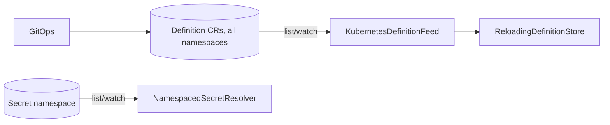

# ADR-0077: Kubernetes definitions backend

- **Status:** Accepted
- **Date:** 2026-11-20
- **Deciders:** project owner

## Context
Definitions (`Agent`, `Skill`, `Workflow`, `ArtifactType`, `Source`, `Repository`, `ModelProvider`, `SandboxProfile`,
`KnowledgeSource`, `ToolServer`) already have a KRM shape. Teams want to manage them with a GitOps tool (e.g. Argo CD)
in a Kubernetes cluster, and the factory should pick up changes live. Runtime objects stay in SQLite (human decision:
definitions only).

## Decision

### 1. Backend selection
`FACTORY_DEFINITIONS_BACKEND=git|kubernetes` (alias `FACTORY_DEFINITION_SOURCE`, default `git`). In kubernetes mode
`FACTORY_LOCAL_ROOT` serves workspaces and file knowledge; no Git definitions root is needed. Git mode is unchanged.

### 2. Cluster-wide watch, last good snapshot
`KubernetesDefinitionFeed` lists and watches every definition CRD (group `factory.ai-dlc.io`) in **all namespaces**,
re-listing on watch close or `410 Gone`. `ReloadingDefinitionStore` swaps the snapshot only as a whole and only when it
is valid; otherwise it keeps the last good snapshot and records a `DefinitionsRejected` Warning event. The factory never
writes status to definition CRs. Agents and Skills carry their Markdown body in `spec.body`.

### 3. CRDs generated from the code
`deploy/kubernetes/crds.yaml` is generated by `npm run crds:generate` (`web/scripts/gen-crds.ts` →
`web/src/core/store/crd-generator.ts`) from the spec types in `web/src/core/model/kinds.ts`. Constraints and CEL rules
(`x-kubernetes-validations`) are JSDoc tags next to the fields. Output is deterministic. A unit test fails when the
committed file differs from the generated output (drift check), so a model change without regeneration breaks the build.
Free-form fields need an explicit tag. An envtest integration test applies the CRDs and valid/invalid samples
(`deploy/kubernetes/samples/`) to a real API server; it skips with a visible reason when the binaries are missing.

Watching all namespaces does not widen reference resolution: ADR-0011 still applies, so a `*Ref` resolves in its own
namespace (falling back to `factory-system`), and an explicit `namespace` may only name `factory-system`.

### 4. Secrets in one trusted namespace
Every `secretRef` resolves only against `FACTORY_SECRET_NAMESPACE`; startup fails without it, and refs naming another
namespace resolve to nothing. RBAC (`deploy/kubernetes/rbac.yaml`):

- a ClusterRole with `get`, `list`, `watch` on the definition CRDs only, **no Secret access**;
- a namespaced Role with `get`, `list`, `watch` on `secrets` in the secret namespace only.

`NamespacedSecretResolver` keeps an in-memory copy that is replaced in one assignment. Rotation: the `SecretWatcher`
port (`KubeSecretWatcher`) watches that namespace and triggers a re-list on every event and on watch close (re-opened
after a delay); a periodic re-list (`FACTORY_SECRET_RELIST_MS`, default 5 min) repairs missed events. Logs contain only
Secret names and counts, never values; values are redacted through `RedactingSecretResolver`.

## Setup
1. `kubectl apply -f deploy/kubernetes/crds.yaml`
2. Create the secret namespace (default in the manifests: `factory-secrets`) and adjust `rbac.yaml` if you use another
   one; `kubectl apply -f deploy/kubernetes/rbac.yaml`.
3. Put only factory Secrets into that namespace (key `value`, or a single key).
4. Run the factory with `FACTORY_DEFINITIONS_BACKEND=kubernetes`, `FACTORY_SECRET_NAMESPACE=factory-secrets`,
   `FACTORY_LOCAL_ROOT=<dir>` and a kubeconfig or in-cluster service account `software-factory`.
5. After changing `kinds.ts`: `cd web && npm run crds:generate` and commit `crds.yaml`.

## Consequences
- The secret namespace's Secrets are all listable by the factory; keep only factory Secrets there.
- A rotated Secret can be stale for at most one re-list interval if a watch event is lost.
- Runs are not frozen to definition versions; provenance records what was used.
