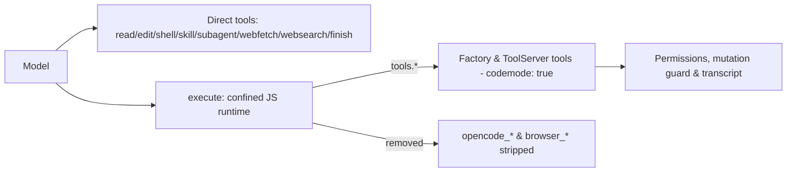

# ADR-0078: Enable OpenCode Code Mode and web tools by default

- **Status:** Accepted (amends ADR-0060 §3)
- **Date:** 2026-11-20
- **Deciders:** project owner

## Context
ADR-0060 §3 denied and hid OpenCode's Code Mode (`execute`) and web tools (`webfetch`, `websearch`) for every session,
and registered all factory and `ToolServer` (MCP) plugin tools with `options: { codemode: false }`.

As agents attach more `ToolServer` tools (e.g. `kubernetes-cr-mcp`, knowledge search) and need to look up external
documentation or package details during research and implementation:
- Listing every MCP/factory tool directly adds every schema to every prompt and dumps raw payloads into the model
  context one turn at a time, consuming context window and step budget (ADR-0058).
- Agents cannot perform web research (`webfetch`, `websearch`) without falling back to ad-hoc shell commands.

Code Mode (`@opencode/codemode`) runs JavaScript in a confined runtime with no direct filesystem access, no module
imports, and no timers; it only exposes `fetch` and the tools explicitly placed in its catalog.

## Decision

### 1. Code Mode (`execute`) and web tools enabled by default
- `ALWAYS` in `web/src/core/adapters/opencode/mapping.ts` adds `execute`, `webfetch`, and `websearch` (with their
  corresponding `allow` permission rules) so every OpenCode session — and its sub-agents — can use them by default.
- `question` and `external_directory` remain denied: human input still goes through `finish` → `Clarification`
  (rule 6), and file access stays inside the workspace.

### 2. Strip OpenCode's built-in session, worktree, and browser namespaces
- Enabling `execute` would otherwise expose OpenCode's built-in `opencode_*` tools (`worktree_create`,
  `worktree_remove`, `session_move`, `session_rename`, `models`, etc.) and `browser_*` tools.
- In `OpenCodeHost`'s `ctx.tool.transform`, all `opencode_*` and `browser_*` tools are removed, and `browser` remains
  denied by `DENY_ALL`. Code Mode can only invoke tools the factory explicitly offers.

### 3. Factory and MCP tools in Code Mode; `finish` stays direct
- Factory tools (`search_knowledge`, `run_check`, `read_check_log`, `run_baseline_check`, etc.) and `ToolServer` (MCP)
  tools are registered with `options: { codemode: true }` under a factory/server namespace so agents can discover,
  batch, and filter their outputs in one step.
- `finish` stays `options: { codemode: false }` (direct tool only), preserving `PARENT_ONLY` enforcement, in-loop
  output validation (ADR-0057), and the last-step finish-only wrap-up guard (ADR-0058).
- Built-in workspace tools (`read`, `glob`, `grep`, `edit`, `write`, `patch`, `shell`) remain direct tools governed by
  the agent's declared capabilities and mutation guard.

### 4. Recording and secrets unchanged
- Every `execute`, `webfetch`, `websearch`, and nested factory/MCP tool call is recorded in the run transcript through
  the existing tool hooks and `host.invoke` (ADR-0012, rule 14).
- Factory secrets remain in-process via `SecretResolver` (ADR-0015) and are never exposed to Code Mode scripts or tool
  arguments.

## Consequences
- Agents can compose and filter MCP/factory tool calls in parallel within a single step, reducing context bloat and
  preserving step budget.
- Agents can research external documentation via `webfetch` and `websearch`, and Code Mode scripts have outbound `fetch`
  access. Operators running on hosts with sensitive local HTTP services should pair this with network-aware host rules
  or isolated runtimes.
- `AGENTS.md` adds milestone **X57** and updates `docs/architecture.md` to reflect the amended ADR-0060 §3 tool policy.

## Alternatives considered
- **Keep Code Mode off and only optimize individual MCP tool schemas:** Still forces one LLM round-trip per tool call
  and leaves raw payloads in the conversation context.
- **Expose `finish` inside Code Mode too:** Weakens the finish-only last-step guard (ADR-0058) and complicates
  `PARENT_ONLY` filtering for sub-agents.
- **Enable Code Mode without stripping `opencode_*`:** Would allow agents to create unmanaged worktrees or move sessions
  outside the factory's `Workspace` controller (ADR-0021).
