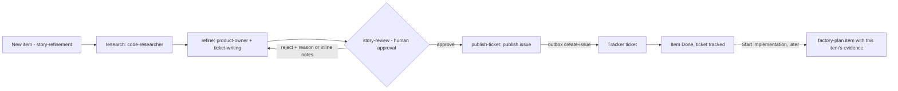

# ADR-0084: Story refinement: a workflow that ends in a tracker ticket

- **Status:** Accepted
- **Date:** 2026-11-20
- **Deciders:** project owner
- **Extends:** ADR-0023 (stage `publish` blocks), ADR-0066 (create issues in trackers), ADR-0068 (tracker follow-ups),
  ADR-0076 (product owner drafts tickets)

## Context
Teams want to put ideas into the Jira backlog as plannable stories, without implementing them now. The factory can
create tickets in two ways today, and neither fits:

- **Also create in …** on a new work item (ADR-0066 §6, mirror) proposes a ticket whose body is the raw item
  description. It needs a second approval and starts the item's (implementation) workflow.
- **Create follow-up → Tracker ticket** (ADR-0068, ADR-0076) needs an existing investigated item.

A good story needs research first (what exists in the code, what is affected), then a product owner who writes it
(problem, user story, SMART goal, Given/When/Then acceptance criteria), then a human who approves it. That is a
workflow: research, write, review, publish.

## Decision

### 1. Workflow `story-refinement`
A normal workflow, started from **New item** like any other (the dashboard's **New ticket** button opens New item with
it preselected):



- **research**: `code-researcher` writes `research-notes` with `repo:path:line` citations. Repositories stay required.
- **refine**: `product-owner` with `ticket-writing` produces a **`ticket-draft`** artifact: schema-backed JSON with
  `title` and `body` (Markdown), so malformed output is corrected in the run (ADR-0055, ADR-0057). Agents may ask
  clarifying questions as in any workflow.
- **story-review**: a `human-approval` gate. Rejection routes back to `refine` with the reason. Inline feedback on the
  artifact (ADR-0071) works without extra code.
- **publish-ticket**: no agents. Its `publish.issue` block creates the ticket (§2). No classify stage: the item is a
  story by choice.

### 2. A reusable `publish.issue` stage block
```yaml
- name: publish-ticket
  publish:
    issue:
      artifactRef: { name: ticket-draft }   # the approved draft
      reviewStage: story-review             # the human-approval gate that approved it
      targetRef: { name: jira-main }        # default; the item may choose another target
```
When the stage starts, the block:

- takes the newest approved, not superseded `Approval` of `reviewStage` and the newest current `ticket-draft` that
  existed when that Approval was created. It never publishes a draft the human didn't see. The match is by creation
  time, which is safe because the Approval is only created after the producing run finished and the item left the
  producing stage (separate reconciles). Recording the reviewed artifact on the Approval itself would make it explicit;
  that is left for a later generic "approval binds its inputs" change.
- creates one `IssueProposal` per item (`<item>-ticket`, purpose **`story`**), owned by the item, Approved on behalf
  of the human who decided the gate (rule 8). Its content hash covers the exact title and body, and its provenance
  records the Approval and the artifact (name, uid, version). Admission verifies that binding.
- appends the factory link to the body, as follow-up tickets do (ADR-0076 §3).
- waits until the ticket is `Created`, then the stage advances and the item is **Done**. A failed or uncertain
  creation keeps the item `Waiting` with the reason. The human resolves it on the item's Issues panel (ADR-0066 §4),
  and the item continues by itself.
- creates at most one ticket per item. A restart that would publish different content stops with a visible reason,
  because the factory never edits a created ticket (ADR-0068 §3).

Delivery, recovery after an unknown outcome and status tracking reuse ADR-0066/0068 unchanged.

### 3. Engine seam: `StagePublisher` registry
Publication blocks other than the built-in `pullRequest` are `StagePublisher`s, registered by key
(`issue` → the story publisher). The WorkItem controller asks each publisher of the stage for its progress
(`pending` / `published` / `blocked`). It doesn't know what an issue is (rule 4). The controller watches
`IssueProposal`s owned by the item.

### 4. Target per item
`WorkItem.spec.ticketTarget` (human-written) chooses the Source; the block's `targetRef` is the default. New item
shows **Publish ticket to** instead of **Also create in …** when the chosen workflow publishes a ticket; a mirror is
rejected for such an item. The target must permit `writeBack.issues`.

### 5. Implementable later, with the research
A `story` ticket behaves like a follow-up ticket of its item: it is tracked read-only, and **Start implementation**
creates the `factory-plan` item for it, carrying this item's evidence (`originWorkItemRef`, origin snapshot). A sync
that imports the ticket first converges on the same item and origin.

## Consequences
- An idea becomes a researched, reviewed Jira story in one item, without a second approval and without implementing.
- Any workflow can now end with "file a ticket". The servicedesk `needs-change` route could later publish its dev
  ticket with the same block instead of the manual follow-up.
- New: workflow `story-refinement`, ArtifactType `ticket-draft`, IssuePurpose `story`, `StageSpec.publish.issue`,
  `WorkItemSpec.ticketTarget`, `StagePublisher` port and registry, `IssueProposal` in the WorkItem controller's watches.
- `tools/validate.py` checks a `publish.issue` block: its `reviewStage` is an earlier `human-approval` stage of the
  same workflow, and its target permits `writeBack.issues`.
- AGENTS.md: new item **X64**. Glossary: *Story refinement*, *publish.issue*.

## Alternatives considered
- **A standalone "New ticket" dialog with an interactive product owner draft** (built and discarded during this
  change): no research and no durable record of the reasoning. The workflow gives both and reuses every gate feature.
- **An `issue-publication` gate that shows the exact text and creates on approve** (like `ticket-publication`,
  ADR-0040): one stage less, but a new gate type, and it would duplicate the review the `human-approval` gate already
  does on the same artifact.
- **Let the product owner create the ticket with a tool**: rule 8. Agents never publish.
- **Mirror the item to the ticket after publishing** (item becomes a synced item): its questions would go to Jira,
  but the item is finished once the ticket exists. Start implementation creates the synced item instead.
