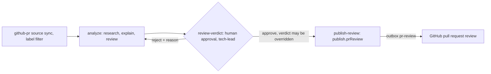

# ADR-0094: Pull request review workflow

- **Status:** Accepted
- **Date:** 2026-11-26
- **Deciders:** project owner
- **Extends:** ADR-0021 (workspaces), ADR-0023 (stage `publish` blocks), ADR-0055 (schema-backed artifacts),
  ADR-0075 (capabilities), ADR-0084 (`StagePublisher` registry)

## Context
Teams want the factory to review pull requests that humans (or other tools) opened, not only to review its own
candidates inside `factory-plan`. The building blocks exist — the `reviewer` and `code-researcher` agents, the
`code-review` skill, workspaces with read-only code tools, human gates, the outbox and stage publishers — but:

- the GitHub connector imports issues and drops pull requests on purpose;
- a workspace forks from the repository's base and cannot check out a pull request's head;
- the `code-review-report` is free Markdown whose only verdict is the `factory-plan` loop outcome;
- nothing posts a review to a pull request.

## Decision

### 1. Workflow `pr-review`

Read-only: no implementation, no checks. `analyze` has three steps:

- `research-change`: `code-researcher` writes `research-notes`.
- `explain-change`: `code-researcher` with the new `change-explanation` skill writes a Markdown `pr-explanation` for a
  human reviewer **without the change's context**: plain-language summary, needed background, a before/after Mermaid
  diagram (ADR-0013), a worked example, a file walkthrough and the places that deserve attention (as questions, not
  verdicts). It is for the human at the gate and is never posted to GitHub.
- `review-change`: `reviewer` with `code-review` + the new `pull-request-review` skill (verdict rules for external
  pull requests, where the description is the spec) declares `outcomes: [accepted, partially-accepted, rejected]`.

Explaining and judging are separate steps so the explanation stays neutral and the reviewer can use it as input.

### 2. Source type `github-pr`
A separate connector (`GithubPullRequestConnector`, type `github-pr`) implements the existing `ItemFetcher`
(open pull requests, filtered by `sync.filter.labels`). `ExternalItem` gains an optional `pullRequest`
(`number`, `headSha`, `baseRef`), which sync copies into `WorkItem.spec.pullRequest` (sync-only, like `sourceHistory`).
A new head SHA updates the spec but never restarts the item; the item page shows that the PR changed since review.
Using a new type rather than a mode on `github` keeps the issue connector unchanged and its policies separate.

### 3. Workspace on the pull request head
`WorkspaceSpec.checkout` (`{ ref, commit, baseBranch }`) is set by the WorkItem controller from
`WorkItem.spec.pullRequest`. The git worktree backend fetches `refs/pull/N/head` and the base branch into
factory-private refs of the source checkout (with the token in `authEnv` only, SEC-3), verifies the fetched head equals
the pinned `commit`, forks the worktree from it and pins `baseCommit = merge-base(head, base)`. `git_diff` and `{{base}}`
therefore show exactly the pull request's changes. A head that moved since sync fails the workspace visibly.

### 4. Artifact `pr-review-report`
Schema-backed JSON: `verdict` (`accepted | partially-accepted | rejected`), `summary`, `rationale`, `accepted[]` (what
is fine), `requiredChanges[]` (what must change) and `findings[]` (`severity: blocking | non-blocking`, `path`, optional
`line`, `startLine`, `side`, `message`, `suggestion`). The schema makes the verdict agree with its contents, so a contradictory report is corrected in the
run (ADR-0057): `accepted` has no required changes and no blocking finding; `partially-accepted` names at least one
accepted part and one required change; `rejected` names what a new attempt must do differently. The UI and the posted
review render it as Markdown, verdict first. It is a new type so `factory-plan`'s
`code-review-report` loop stays unchanged; X63c may later converge both.

### 5. Publication `publish.prReview` and outbox action `pr-review`
A `StagePublisher` registered as `prReview` (ADR-0084 pattern): takes the newest non-superseded approval of
`reviewStage` and the newest current `pr-review-report` created before it, and enqueues one outbox message keyed by the
approval. The human may override the verdict on the approval (`ApprovalSpec.prReview.verdict`); the published event
uses the override. The verdict is always stated in the review body; it maps to a GitHub event: `accepted` → `APPROVE`,
`partially-accepted` and `rejected` → `REQUEST_CHANGES` (both block merging until changes are made). The handler (`PullRequestReviewPublisher` port, ISP, separate from `CommentPublisher`) posts one
GitHub review (`APPROVE | COMMENT | REQUEST_CHANGES`) pinned to the reviewed `commit_id`, with findings in the body.
Before posting it lists the PR's reviews and returns an existing one carrying the message's marker, so a retry after a
lost response never posts twice. GitHub refuses `APPROVE` on one's own PR; the handler then posts `COMMENT` and records
the downgrade in its result.

**Inline comments, one review.** Findings with a `line` become inline comments (`comments[]`) of the same review
call, so the verdict and all line comments arrive together. GitHub rejects a whole review whose comment line is not in
the diff, so:

- when the reviewer finishes, an artifact check parses the workspace diff (head vs. merge-base, the PR's "Files
  changed") and sends back every finding whose `line`/`startLine..line` is outside a changed hunk on its `side`; the
  reviewer moves it or drops `line` (file-level finding) in the same run (ADR-0057);
- the publisher places the findings again when it enqueues the message (inline-able → comment, the rest stay in the
  body under "Other findings"), and the payload is frozen for every retry;
- if GitHub still answers 422, the handler posts the same review once more with every finding in the body (a 422
  creates nothing, so this cannot duplicate).

`suggestion` renders as GitHub's applicable ```` ```suggestion ```` block; it requires `line` and the head side. The gate
view shows each finding as "inline comment" or "in the review", so the human approves what is posted.

### 6. Write permission
`Source.spec.writeBack.pullRequestReviews: (approve | comment | request-changes)[]` permits GitHub events, not verdicts;
the `pr-review` `SourceWritePolicy` refuses delivery otherwise. When a verdict's event is not permitted it is posted as
`comment` if that is permitted (the body still states the verdict), else publication is blocked.

### 7. Capability `pr-review`
Detected from a stage with `publish.prReview` or an item with `spec.pullRequest`; the item page shows the PR, head SHA
and the published verdict.

## Consequences
- AGENTS.md §4: new item X72.
- New terms in the glossary: *pull request review*, *review verdict*, *change explanation*.
- Out of scope: editing an earlier review after new pushes (GitHub marks its comments outdated), replies to inline comments, webhooks, automatic re-review on push, checks on the PR head, other code hosts, inline comments,
  reading review replies back.
- Items with several repositories check out the PR head in every workspace; `github-pr` sources should default to
  exactly one repository (the PR's).

## Alternatives considered
- **A `PullRequestFetcher` port:** would duplicate the sync path; an optional field on `ExternalItem` reuses it.
- **Reuse `code-review-report`:** free Markdown has no reliable verdict and would change the `factory-plan` loop.
- **Post as a plain comment:** loses GitHub's review state (approve / request changes).
