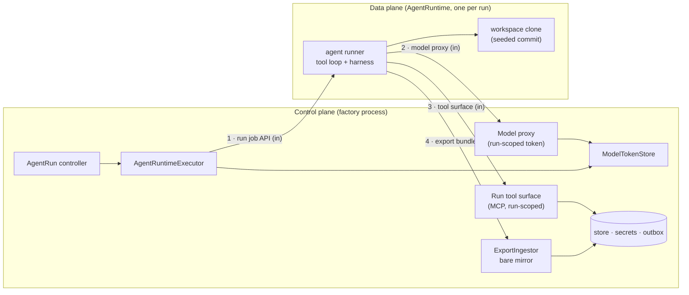

# AgentRuntime S2 — design note

**Status:** design (for ADR-0080 stage **S2**; not an ADR itself — the decision is ADR-0080)
**Date:** 2026-11-23
**Related:** ADR-0080 (§1–§14), ADR-0019, ADR-0020 (superseded by §10), ADR-0021, ADR-0034, ADR-0060, ADR-0079,
ADR-0081; `docs/security.md` §7 (S0, P0, P1, P2).

This note turns ADR-0080 §2–§14 into an implementation plan for **S2**. It defines the ports, the run job protocol,
the runtime layout, the tool split and the delivery stages. It does **not** re-open the decision; where the ADR
leaves a choice, the choice taken here is marked **Decision**.

> **Review status.** Reviewed against AGENTS.md and ADR-0080; blocking findings on the run tool surface, bounded
> reads, token delivery, runtime selection, the transcript contract and create-time refusal are folded in below.
> Nothing here blocks starting **S2-0**, which is specified by ADR-0080 §10 alone.

---

## 1. Goal and scope

S2 deliverable (ADR-0080 §14):

> `AgentRuntime` port with the `bwrap` backend; the agent loop runs inside the runtime (the tool loop first — S4
> switches it to OpenCode), with the model proxy and the tool surface as its only reachable endpoints; §11 and §12
> land here; §10 (removing `host`) lands here too.

S2 kill criterion:

> A real item completes end to end with the loop inside the runtime; the only factory endpoints reachable from
> inside it are the proxy and the tool surface; nothing in the runtime holds a provider key; a `container` profile
> without `acceptWeakerIsolation` is refused on `bwrap`; `FACTORY_SANDBOX_RUNTIME=host` fails with a message naming
> the replacements; the SEC-1/SEC-2/SEC-3 tests cannot be reproduced.

Already done before this note: **S0** (loopback bind, origin check + CSP), **S1** (export contract — `ports/export.ts`,
`GitBundleIngest`), **§11** (`SandboxProfile.spec.acceptWeakerIsolation`, `agents/sandbox-isolation.ts`), **§12**
(`ToolServer.spec.hostExecution`) and **§10** (the `host` runtime removed — **S2-0**, landed).

Out of scope for S2 (later stages): the Kubernetes backend and enforced network egress (S3) and OpenCode inside the runtime (S4).
**S3 is deferred by the owner (2026-11-23): `bwrap` is the supported backend for now**, so the S2 work stands alone and
nothing here depends on a cluster.

---

## 2. The two planes and the four interfaces



An `AgentRuntime` is **per run**: it is created, does one thing, and is disposed (§3). The factory consumes its
outputs as **data** — it never runs `git` inside the candidate, never reads the candidate's configuration, and never
executes anything it received.

---

## 3. The ports (interface first)

New files under `web/src/core/ports/`. Read surfaces are segregated like `ports/sandbox.ts`
(`SandboxExec`/`SandboxFiles`/…), so a consumer that only needs the export never depends on the loop.

### 3.1 `ports/agent-runtime.ts`

```ts
/** ADR-0080 §2: the run job API, factory side. One port, several backends. */
export interface AgentRuntime {
  readonly backend: string;                        // "bwrap" | "kubernetes"
  capabilities(): Promise<RuntimeCapabilities>;
  health(): Promise<RuntimeHealth>;
  /** Creates the runtime for one run; idempotent per (run.uid, round) (rule 6). */
  create(job: RuntimeJobSpec): Promise<RuntimeJob>;
}

export interface RuntimeCapabilities {
  isolation: IsolationLevel;                       // the strongest isolation this backend provides
  network: NetworkMode[];                          // modes the backend can ENFORCE (ADR-0080 §7; P1-1)
  export: "bundle";
  reattachable: boolean;                           // cheap seam for S3 re-attachment
}

export interface RuntimeHealth { backend: string; available: boolean; version?: string; message?: string; }

export interface RuntimeJobSpec {
  run: Ref;
  namespace: string;
  image: string;                                   // pinned runtime image/rootfs (see §7)
  profile: SandboxProfile;
  seeds: { repository: string; commit: string }[]; // repo@commit the runtime checks out
  /** Endpoints only — the tokens are delivered out of band (§3.3), never serialized here. */
  model: { baseUrl: string };
  tools: { baseUrl: string };
  task: { system: string; user: string; maxSteps: number; protocol: number };
  budgets: { ttlSeconds: number };
}

export interface RuntimeJobControl  { wait(): Promise<RuntimeJobResult>; dispose(): Promise<void>; }
export interface RuntimeEventReader { events(afterSeq?: number): Promise<RuntimeEvent[]>; }
export interface RuntimeExporter    { export(): Promise<{ bundlePath: string; ref: string }>; }
export type RuntimeJob =
  & RuntimeJobControl & RuntimeEventReader & RuntimeExporter
  & { readonly id: string; readonly run: Ref };

export interface RuntimeJobResult {
  status: "succeeded" | "failed" | "waiting";      // "waiting" = quota/unavailable (ADR-0031)
  finish?: unknown;                                // UNTRUSTED hint; `finish` is validated factory-side (§4)
  message?: string;
  usage?: { steps: number; tokens?: number };
}

/** An untrusted transcript event submitted by the runtime, stored marked `runtime-reported` (§8). */
export interface RuntimeEvent { seq: number; role: string; content: string; meta?: Record<string, unknown>; }
```

### 3.2 `ports/run-tool-surface.ts` — the third interface, and it is a port

The runtime-facing tool surface is documented as a port, not prose, because ADR-0080 §5/§14 and S0-2 make it a
security boundary. ISP-split:

```ts
/** ADR-0080 §5: a run's scoped tool offering. Bound to one run; never a gate, approval or publication tool. */
export interface RunToolSurface {
  readonly run: Ref;
  /** The tool schemas this run may call — exactly the stored offering. */
  offering(): Promise<ToolSchema[]>;
  /** Invokes one call. Authorization is re-checked per call by the transport (the run-scoped token). */
  invoke(call: { name: string; arguments: Record<string, unknown> }): Promise<{ content: string }>;
}
```

The surface is **bound to one run** and to that run's stored offering, so a runtime cannot widen its own surface.
`RuntimeJobSpec.tools` carries **no** tool names; a call outside the offering is refused.
Workspace tools are marked *runtime-local* and refused here — they run inside the runtime, never factory-side.

The surface is served, with the model proxy, on the **control channel** the backend exposes (§3.3). For `bwrap` that
is a Unix socket in the job dir; its routes are only `/chat/completions`, `/tools` and `/invoke`, so **no**
decide/review/publish path is reachable from the runtime (S0-2). S2-b serves it as a small HTTP endpoint; parity with
the factory's MCP surface (§3.2 intent) is a follow-up.

### 3.3 Token delivery and lifetime

- The port carries the tokens **explicitly and out of band**: `AgentRuntime.create(job, secrets: RuntimeJobSecrets)`
  where `RuntimeJobSecrets = { modelToken, toolToken }`. The backend hands them to the runner (an inherited file
  descriptor or a `0600` env file deleted at `dispose()`); they are never serialized into `job.json`, logged or
  prompted. `RuntimeJobSpec` is therefore safe to log after redaction, and `job.json` holds no secret.
- `RuntimeModelAccess` (`ports/…`) wraps `ModelTokenStore`: `issue(run): Promise<{ baseUrl; token }>` before
  `create`, `revoke(run)` when the run ends (times out into the existing `Retry-After` path on quota).
- The surface token is the same run-scoped token; the proxy and the tool surface both verify it (the proxy against the
  store, the control server against the token it issued).
- The backend exposes the control channel: `AgentRuntime.control(run): RuntimeControlChannel` →
  `{ endpoint, prepare() }`. The executor calls `prepare()` (the parent dir exists), starts the control server on the
  endpoint, and puts that endpoint into `model.baseUrl` and `tools.baseUrl`.

### 3.4 Runtime selection: a registry, and the same isolation rule

**Decision.** `AgentRuntime` is selected through a `Registry<AgentRuntime>` with an `auto` order, mirroring
`DefaultEnvironmentSelector` — not an if-chain in the composition root. Effective-vs-declared isolation reuses
`agents/sandbox-isolation.ts` unchanged; `auto` never waives (ADR-0079 §2, §11). `create()` refuses **at create
time**, with a named reason, any profile whose `network` mode is not in `capabilities().network` — it never
degrades silently.

`AgentRuntimeExecutor` is an ordinary `AgentExecutor`, so the `AgentRun` controller, workflow compiler, gates and
outbox are unchanged.

---

## 4. The runner and the tool split

The loop and the harness semantics move into the runtime as a **runner** program (a separate entrypoint; a program,
not a port). The tool split is what makes the boundary real:

| Runs **inside** the runtime (against the local clone) | Runs **factory-side** (authority / data / secrets) |
|---|---|
| `read_file`, `list_files`, `search_code` | `finish` (in-loop validation, ADR-0057) |
| `write_file`, `run` (command), `git_diff` | `run_check`, `run_baseline_check`, `check_logs` |
| | `search_knowledge`, `propose_issue`, `fetch_url` |
| | every `ToolServer` tool (ADR-0034) |

Workspace tools never round-trip to the factory — that is what stops the factory from touching the candidate
(§3, X41). `finish` is a **tool-surface** call so the factory validates it (ADR-0057); `result.json.finish` is only a
hint. `run-harness.ts` is factored into a **portable part** (tool guide, `finish` schema, step budget and wrap-up,
`FINISH` reserved tool) shared by both halves and a factory-bound part (store, secrets, checks, egress).

Sub-agent delegation (e.g. `code-researcher`) stays **factory-side**: it is a child `AgentRun` started by the
factory, never runtime recursion, so the delegation tree and its transcript remain factory-observed.

---

## 5. The run job protocol

Versioned, file-based for `bwrap` (a mounted control directory); the same shape can travel over HTTP for
`kubernetes` (S3).

| Path | Direction | Content |
|---|---|---|
| `<job>/job.json` | in | the serialized `RuntimeJobSpec` (endpoints only; no tokens, §3.3) |
| `<job>/events.jsonl` | out | `RuntimeEvent` lines, monotonically sequenced (`seq`) |
| `<job>/result.json` | out | `RuntimeJobResult` |
| `<job>/out.bundle` | out | the exported candidate bundle (untrusted; ingested by `ExportIngestor`) |

`protocol: 1` is written into `job.json`; a runner that does not recognize the version refuses the job.

The candidate's **diff** is read from the ingested commit by a `CandidateDiffer` (plumbing only, `git diff <base> <candidate>` in the bare mirror) — the factory never checks the candidate out.

**Everything the factory reads back is untrusted and bounded.** `job.json`, `result.json`, `events.jsonl` and
`out.bundle` are read with `O_NOFOLLOW` (a symlink is refused, never followed), a size cap, and schema validation;
`out.bundle` must resolve inside the job's output directory. `events.jsonl` and tool arguments obey the §13 size and
rate limits; the factory rejects what exceeds them instead of storing it. These cases live in the `runtimeContract`
suite (symlink output, oversized file, malformed JSON, non-monotonic `seq`).

**Transcript contract (rule 14, ADR-0080 §8).** The factory keeps **one** ordered transcript per run: its own
observations (proxy calls and usage, tool-surface calls, artifacts, the ingested export) plus the runtime-submitted
events, each marked `runtime-reported` in provenance, interleaved by a factory-assigned order and the runtime's
`seq`. A gap in `seq` is recorded as a visible note on the run, never silently ignored.

---

## 6. Reaching the proxy and the tool surface under `network: none`

**Decision.** Under `bwrap`, run the runtime with **`--unshare-net`** and serve the model proxy and the run tool
surface on a **Unix domain socket** bind-mounted into the runtime.

Rationale: today every bwrap command runs with `--share-net`, which shares the host network namespace, so a runtime
could reach the UI on `127.0.0.1` (exactly SEC-15). With `--unshare-net`, the runtime has only its own loopback and
no host reachability, so "the only reachable factory endpoints are the proxy and the tool surface" holds **by
construction**, independent of S0-2. The socket is the four-interface "in" channel for both the proxy and the tools.

Cost: no outbound network inside the runtime, so toolchains (`go get`, `npm install`, `envtest`) fail. This is the
ADR's known "toolchains versus closed egress" limitation; it is resolved later by prebuilt per-repo images, a
registry mirror behind the egress proxy, or a pre-warmed cache volume (S3 / P1-1). A profile that asks for a mode
the backend cannot enforce is **refused at create time** (§3.4), not degraded. The `none` backend keeps simulation.

---

## 7. Runtime layout (`bwrap` backend)

The runtime directory (a per-run volume) contains the workspace, the control directory and the output directory. The
factory runs the runner under bwrap with:

- **read-write:** the workspace volume, the control/output directory;
- **read-only:** the runner code and the pinned toolchain roots (`SYSTEM_RO_BINDS`, ADR-0081);
- **bind-mounted:** the runtime-facing Unix socket;
- **absent:** the factory data directory, `$HOME`, the store, secrets, the UI listener;
- **network:** none (`--unshare-net`), and **`--die-with-parent`** so a factory restart does not orphan the child.

`BwrapAgentRuntime` and `BwrapEnvironment` **share** the read-only system bind list (`SYSTEM_RO_BINDS`) so the ADR-0081
hardening cannot drift between the two. **Seeding is by bundle** (S2-b): the factory makes a self-contained bundle of
the pinned commit from the prepared workspace (a read-only export; the sandbox never sees the checkout) and the runner
clones it. Only one seed is supported until the Kubernetes backend (S3). The host network is unshared (`--unshare-net`)
and the runtime-facing surface is reached over a Unix socket in the job directory. The candidate is exported as a
bundle and ingested by `GitBundleIngest`; the factory reads trees/blobs/diffs through plumbing only and never checks it
out. (S2-b ships the surface as a small HTTP-over-Unix-socket endpoint; MCP conformance per §3.2 is a follow-up.)

**Image pinning.** `RuntimeJobSpec.image` for bwrap is a hash of the runner build plus the bound toolchain roots,
recorded in provenance; a mismatch between the pinned hash and what runs is a **rejection**, with a mismatch test.

---

## 8. Integration points

- **Token lifecycle.** The executor issues a run-scoped token (`RuntimeModelAccess.issue`) before `create` and revokes
  it when the run ends (`revokeRun`). `DefaultModelProxy` already enforces the model allowlist, step/token budgets and
  TTL and charges usage; a proxy 429/503/529 becomes `RuntimeJobResult.waiting`, which the `AgentRun` controller maps
  to the existing `retryAt`/`ModelUnavailable` path (ADR-0031).
- **Provenance.** Extend `RunProvenance` with `runtime` (backend@version/image hash), **effective vs declared
  isolation** (§11, from `sandbox-isolation.ts`), `hostExecution` (§12, already recorded) and the seed `repo@commit`;
  runtime events are marked `runtime-reported` (§8).
- **Workspaces.** Runtime runs use the seeded-commit model, not host worktrees; `GitWorktreeWorkspaces` is bypassed
  for this path (ADR §3). Checks/verification still run in **factory-controlled** runtimes from the exported commit
  (S1): S2 end state is *agent runs in `AgentRuntime`, checks in `ExecutionEnvironment`* — the two pipelines share the
  ingested commit, and the bundle ingest is what S1's evidence binds to.
- **OpenCode sequencing.** Per ADR-0080 S2, the loop is the **tool loop** first; S4 moves OpenCode into the runtime.
  With a real runtime selected, `OpenCodeExecutor` stands down and the runtime-hosted tool loop takes over (the X40
  "fall back to the tool loop until a workspace driver exists" rule). This is a **deliberate, temporary capability
  regression for bwrap runs**, fixed in S4.
- **Naming.** The ADR's `AgentRuntime` port keeps its name. The existing `FACTORY_AGENT_RUNTIME`
  (OpenCode vs tool loop) is *not* renamed — no env-var churn without an ADR. The overlap ("agent runtime" = the
  OpenCode harness vs `AgentRuntime` = the port) is disambiguated in the glossary when the port lands.

---

## 9. Delivery stages

| Stage | Deliverable | Exit / kill criterion |
|---|---|---|
| **S2-0 (§10)** ✅ | `host` removed: `HostEnvironment` → `core/testing/`, dropped from the registry + `auto` + `usesWorktrees`, `FACTORY_SANDBOX_RUNTIME=host` fails loudly; ADR-0020 → Superseded; rule 18 updated | `host` unreachable from the composition root; suites pass against the helper; a fail-loud test exists |
| **S2-a** ✅ | `AgentRuntime` + `RunToolSurface` ports; `FakeAgentRuntime`; the `AgentRuntimeSelector`; the `runtimeContract` tests; `AgentRuntimeExecutor` behind `FACTORY_AGENT_RUNTIME_BACKEND`, default off | Ports reviewed; an `AgentRun` completes through the port on the fake (executor test); token issued/revoked, events marked `runtime-reported`, network refusal works; production unchanged (the failing-item workflow test lands in S2-b with a real backend). The runtime-facing listener + its route allowlist land in S2-c |
| **S2-b** ✅ (core) | ✅ `BwrapAgentRuntime` + the runner (tool loop inside, workspace tools local, `finish` over the surface, export bundle); ✅ the factory-side `RunToolSurface` (bound per run; workspace tools refused) + the Unix-socket **control server** (model proxy + tool surface); ✅ composition wiring (`FACTORY_AGENT_RUNTIME_BACKEND=bwrap`); ✅ token issue/revoke + `RunProvenance.runtime`. **Reviewed (S2-b):** untrusted `result.json`/events are validated (a symlink or bad file fails the run, never hangs); the token is revoked on every path and a stale socket is cleared; factory tool calls are recorded by the factory; the control server bounds bodies and checks the token before reading. ✅ diff-from-export (`CandidateDiffer`, plumbing only), an executor-side `wait()` deadline, and a full-workflow item test (`agent-runtime-workflow.test.ts`: a real item's developer step completes on bwrap). **Pending (non-blocking):** separate model/tool token scopes and seeding from a bare mirror | ADR S2 criterion **proven** in `agent-runtime-e2e.test.ts`: a real run completes through `AgentRuntimeExecutor` with the loop, the factory tool surface and the model proxy **inside bwrap**; egress is denied (`--unshare-net`); only the Unix socket is reachable; the run carries the run-scoped token (never a provider key); the exported commit ingests and carries the candidate |
| **S2-c** ✅ | The runtime-facing surface is its own endpoint (a Unix socket for `bwrap`), never the UI listener; a cross-check test proves the decide/review/publish routes are unreachable and the token is required | `agent-runtime-control.test.ts`: only `/chat/completions`, `/tools`, `/invoke` exist; every decide/review/publish-shaped path is 404, unauthenticated calls are 401, and an oversized body is 413. (For a container runtime the same allowlist runs on its own TCP listener — S3.) |

**Definition of done for each stage** (AGENTS.md §7): ports first; wiring only in the composition root; `tsc`;
`npm test` / `test:integration` / `test:acceptance`; `python tools/validate.py`; docs/glossary/ADRs updated; the
milestone row (X59/X60/X61) updated; `architecture-reviewer` run with no blocking findings. Concrete doc amendments
for S2: glossary entries for *AgentRuntime*, *runner*, *run job*, *runtime-reported*; the **X59** row moves to
"In progress (S2-a…)" and **X60** is completed by the S2-b token wiring.

---

## 10. Risks and open questions

- **Toolchains without egress** could make some real items unrunnable on bwrap until S3/P1-1; profiles must be
  explicit, and `create()` refuses an unenforceable mode. The shipped `node-build`/`go-build` profiles declare
  `network.mode: allowlist` (package registries), which `bwrap` refuses because it provides `none` — so local
  construction on bwrap needs a reviewed no-egress profile until the toolchain/registry-mirror work of S3. This is the
  ADR's known "toolchains versus closed egress" cost, not a runtime defect.
- **The runtime image is a shipped artifact.** For bwrap it is a bind-mounted, pinned set of toolchain roots plus the
  runner; for Kubernetes it becomes a real image. Version mismatch is a rejection path (§7).
- **Distributed control plane.** Run lifetimes, crash/partition handling and re-attachment are pulled forward from
  "planned" to "required"; S2 keeps runs in-process (X42) with the token in memory, `--die-with-parent`, and a reaper
  for orphaned output volumes.
- **Transcript honesty.** `events.jsonl` is runtime-reported; the factory-side controls (proxy usage, tool-surface
  calls, ingested export, `finish` validation) are authoritative (§8). Whether to require signed batches remains an
  ADR-0080 open question; a `seq` gap is flagged in the UI meanwhile.
- **OpenCode parity** (S4) and deletion of the in-factory control path depend on S2's ports being sufficient; the
  `FakeAgentRuntime` contract suite is the guard that the protocol does not need to change for it.
