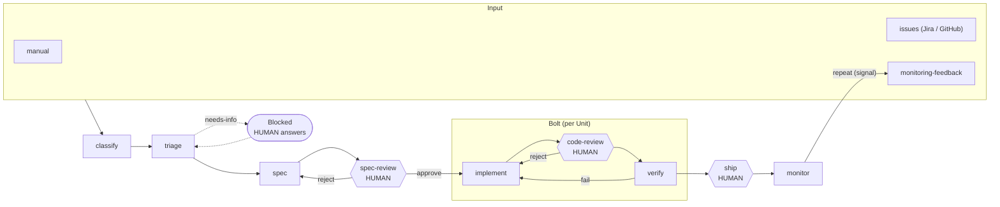

# AI-DLC Shared Dictionary

This is the shared vocabulary for the factory. Use it to name resources, labels, and documents.
Part A covers the AI-DLC method itself. Part B covers the terms *this factory* adds to turn the method into code.

> Source: AI-DLC as described by AWS (Raja SP, 2025). Where we interpret the method, the entry says so.

---

## Part A: AI-DLC core concepts

### Principles
| Term | Definition |
|---|---|
| **AI-Driven Development Lifecycle (AI-DLC)** | A development method where AI is a central collaborator throughout the lifecycle, not a coding assistant bolted onto SDLC/Agile. |
| **AI-directed conversation** | AI drives the work. It proposes plans, asks clarifying questions, and generates artifacts. |
| **Human oversight** | Humans validate, decide, and approve at every critical point. *AI proposes, a human approves.* |
| **Rapid cycles** | Iterations are measured in hours or days, not in weeks-long sprints. |
| **Persistent context** | Every artifact (requirements, designs, decisions) is stored and fed back to the AI. This keeps context across phases and sessions. |

### Phases
| Term | Definition |
|---|---|
| **Inception** | Turns an *Intent* into requirements, stories, and *Units of Work*. Done through *Mob Elaboration*. |
| **Construction** | Turns each Unit into tested code: domain model → logical design → code → tests. Done through *Mob Construction* in *Bolts*. |
| **Operations** | Deploys, observes, and runs the system. AI handles IaC and deployment, and helps with monitoring and incident response. Humans approve the changes. |

### Work items
| Term | Definition |
|---|---|
| **Intent** | A high-level statement of purpose: a business goal, feature, or technical outcome. The entry point of the lifecycle. |
| **Unit of Work** (Unit) | A cohesive, loosely coupled slice of an Intent, made of related user stories, that can be built and deployed independently. Roughly comparable to an epic or a bounded context. |
| **Bolt** | The smallest iteration: a time-boxed cycle of hours to days that delivers part or all of a Unit. It replaces the sprint. |
| **User Story** | A requirement from a user's perspective, with acceptance criteria. |
| **NFR** | Non-functional requirement: performance, security, scalability, compliance. |
| **Risk** | A risk identified during Inception and tracked in later phases. |

### Rituals
| Term | Definition |
|---|---|
| **Mob Elaboration** | An Inception session where the whole team works with the AI in one room/screen. The AI proposes stories and Units, and the team refines and approves them. |
| **Mob Construction** | A Construction session where the team makes design and technical decisions together while the AI generates the artifacts. |

### Construction artifacts
| Term | Definition |
|---|---|
| **Domain Model** (Domain Design) | Business logic modeled independently of technology, typically with DDD: aggregates, entities, value objects, and events. |
| **Logical Design** | The domain model mapped onto architecture: patterns, NFR handling, and technology choices. |
| **ADR** | Architecture Decision Record, a persisted decision with its rationale. |
| **Code & Tests** | Implementation plus unit, functional, and NFR tests. |
| **Deployment Unit** | A packaged, deployable output (container, function, IaC module) that results from a Unit. |

### Roles
| Term | Definition |
|---|---|
| **Product Owner** | Owns the Intent and approves requirements and Units. |
| **Developer / Tech Lead** | Validates designs and code, and approves Construction gates. |
| **Operations** | Approves deployments and owns runtime health. |

*AI-DLC doesn't prescribe fixed AI roles. The roles above are human roles.*

---

## Part B: Factory terms (our extension)

| Term | Definition |
|---|---|
| **Resource** | Any factory definition with the envelope `apiVersion / kind / metadata / spec`. |
| **Agent** (`kind: Agent`) | An AI persona that does work within a phase. Defined in Markdown. Maps to a human counterpart role. |
| **Skill** (`kind: Skill`) | A reusable, instructable capability (procedure) that agents use. Defined in Markdown. |
| **Workflow** (`kind: Workflow`) | A declarative flow of phases → stages → steps, with gates. Defined as a YAML custom resource. |
| **ArtifactType** (`kind: ArtifactType`) | A typed output that is passed between steps. It implements *persistent context*. |
| **Stage** | A group of steps inside a phase, e.g. `mob-elaboration` or `bolts`. |
| **Step** | One agent invocation with skills, inputs, and outputs. |
| **Gate** | A checkpoint at the end of a stage or phase: `human-approval` (implements *human oversight*) or `automated` (CI checks). |
| **Ref** | A typed reference by name: `agentRef`, `skillRefs`, `workflowRef`, `artifactRef`, `requires`. |
| **Fan-out** (`forEach`) | Runs a sub-workflow once per item of a collection artifact, e.g. one Bolt per Unit. |
| **Human counterpart** | The human role that validates an agent's output. |
| **User** | A person authenticated through the OIDC IdP. Has role tags and squad memberships (ADR-0009, M7). |
| **Role** | A configurable tag (e.g. `ProductOwner`, `Engineer`) that grants permissions and matches `gate.approvers[].role`. |
| **Squad** | A team. Users belong to one or more squads, and work items are visible and editable only within them. |
| **Principal** | The authenticated caller (user + roles + squads) that is passed to every API entry point. |
| **AgentRun** | One execution of an agent for a step (Job pattern). It has a transcript and provenance. |
| **Transcript** | The append-only, ordered log of everything in an AgentRun or Conversation: prompts, responses, tool calls, delegations. |
| **Provenance** | What a run used (model, definition versions, inputs, answers). It makes runs explainable and re-runnable. |
| **Replay: inspect** | Step through a recorded transcript exactly as it happened. |
| **Replay: re-run** | Create a new AgentRun from an old run's provenance and compare the results. The original is never changed. |
| **Conversation** | A follow-up chat with the agent of a past run ("why did you…?"). Explain mode makes no changes. |
| **Outbox** | Persisted queue (`OutboxMessage`) for effects in external systems, e.g. posting questions to GitHub or Jira. Delivered with retries, and each message is idempotent. |
| **Echo suppression** | The factory marks its own comments, so syncing replies back never treats them as human answers. |
| **Answer at source** | A human reply on the original issue (GitHub or Jira) that answers an open clarification and resumes the item. |
| **ModelProvider** | A definition mapping model tiers (`reasoning`, `coding`, `fast`) to a vendor's models, with a `secretRef` (ADR-0014). |
| **Model tier** | A vendor-neutral model class that agents declare instead of a model name. |
| **secretRef** | A reference to a secret by name. The value is resolved at runtime and never stored (ADR-0015). |
| **Execution environment / Sandbox** | An isolated place where agents may run commands and write code. Provided by a runtime adapter (podman, docker, kubernetes, remote, or `none`) (ADR-0019). |
| **Workspace** | The per-item, per-repository copy of the code (host: Git worktree on `factory/<item>`) with a pinned base commit and setup. It is the single code state all agents of an item see (ADR-0021). |
| **Tool loop** | The agent loop in which the LLM calls tools (read/write files, run commands) inside a sandbox until it calls `finish`. Every turn, call and result is recorded. |
| **Bound tool** | A tool instance bound to only the capabilities it declares: `read`/`search` (workspace, no sandbox) or `write`/`exec`/`artifacts` (sandbox only) (ADR-0022). |
| **Review→fix loop** | Blocking AI code-review findings send the item back to `implement` (bounded), so humans review already-fixed code (ADR-0024). |
| **code-review-report** | The AI code review's findings. Blocking ones trigger the review→fix loop and are input for the developer. |
| **ReconcileFailing / failing badge** | A control loop that keeps failing on an object. It shows up as a Warning event on that object and as a red "N failing" badge in the header. |
| **Tool narrowing** | A workflow step can restrict its agent's tools (`tools: []` = none). It can never add tools. |
| **SandboxProfile** | A runtime-neutral sandbox definition: image, limits, network allowlist, minimum isolation. Agents reference it with `sandboxRef`. |

---

## The Factory Loop

| Stage | AI-DLC phase | Agent | Skill | Output artifact | Gate |
|---|---|---|---|---|---|
| **input** | (trigger) | – | – | `signal` | – |
| **triage** | Inception | triager | issue-triage | `triage-decision` | decision: accept / needs-info / duplicate / reject |
| **spec** | Inception | product-owner, architect | requirements-elicitation, unit-decomposition | `spec`, `units-of-work` | – |
| **spec-review** | Inception (Mob Elaboration) | reviewer | spec-review | `review-report` | **human**: PO + tech lead, reject → spec |
| **implement** | Construction (Bolt) | architect, developer | domain-driven-design, test-driven-development | `domain-model`, `source-code` | – |
| **code-review** | Construction (Mob Construction) | reviewer | code-review | `review-report` | **human**: tech lead, reject → implement |
| **verify** | Construction | verifier | verification | `verification-report` | automated: tests, acceptance criteria, security; fail → implement |
| **ship** | Operations | release-manager | release-management | `release` | **human**: ops lead |
| **monitor** | Operations | sre | observability | `signal` | automated: SLOs, error budget; fail → rollback + feedback |
| **repeat** | – | – | – | `signal` (source: feedback) | – |

| Term | Definition |
|---|---|
| **Signal** | Any input to the loop. Its source is `manual`, `issues`, or `feedback`. Every signal becomes an *Intent* once triage accepts it. |
| **Triage decision** | The routing outcome for a signal: `accept`, `needs-info`, `duplicate`, or `reject`. |
| **Spec** | The Inception output: Intent, stories with acceptance criteria, NFRs, and risks. |
| **Review report** | Findings marked as blocking or non-blocking. The AI pre-reviews, and a human decides. |
| **Verification report** | A trace from each acceptance criterion to a test and its result. |
| **Release** | A version, changelog, rollout plan, and rollback plan. |
| **Feedback** | A signal emitted by monitor. It closes the loop. |

## Mapping: AI-DLC concept → factory resource

| AI-DLC | Factory |
|---|---|
| Phase (Inception / Construction / Operations) | `Workflow.spec.phases[]` |
| Mob Elaboration / Mob Construction | `stage` + `human-approval` gate |
| Intent, Story, Unit, Domain Model, … | `ArtifactType` |
| Bolt | Sub-`Workflow` (`construction-bolt`) fanned out per Unit |
| Human oversight | `gate.type: human-approval` |
| Persistent context | Step `inputs` / `outputs` via `artifactRef` |
| Human roles | `Agent.spec.humanCounterpart`, `gate.approvers` |

## Open questions to decide together
1. Should **Logical Design** be its own step and artifact, separate from Domain Model? (The current Bolt combines them.)
2. Should Bolts be time-boxed in the spec, e.g. `timebox: 8h`?
3. Do we need a **Risk** / **ADR** ArtifactType from day one?
4. Should *Mob* rituals be explicit, e.g. a `mode: mob | solo` on stages?
