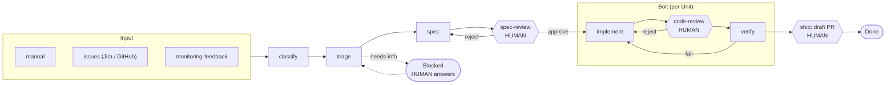

# AI-DLC Shared Dictionary

This is the shared vocabulary for the factory. Use it to name resources, labels, and documents.
Part A covers the AI-DLC method itself. Part B covers the terms *this factory* adds to turn the method into code.

> Source: AI-DLC as described by AWS (Raja SP, 2025). Where we interpret the method, the entry says so.

---

## Part A: AI-DLC core concepts

### Principles
| Term | Definition |
|---|---|
| **AI-Driven Development Lifecycle (AI-DLC)** | A development method where AI is a central collaborator throughout the lifecycle, not a coding assistant bolted onto SDLC/Agile. |
| **AI-directed conversation** | AI drives the work. It proposes plans, asks clarifying questions, and generates artifacts. |
| **Human oversight** | Humans validate, decide, and approve at every critical point. *AI proposes, a human approves.* |
| **Rapid cycles** | Iterations are measured in hours or days, not in weeks-long sprints. |
| **Persistent context** | Every artifact (requirements, designs, decisions) is stored and fed back to the AI. This keeps context across phases and sessions. |

### Phases
| Term | Definition |
|---|---|
| **Inception** | Turns an *Intent* into requirements, stories, and *Units of Work*. Done through *Mob Elaboration*. |
| **Construction** | Turns each Unit into tested code: domain model → logical design → code → tests. Done through *Mob Construction* in *Bolts*. |
| **Operations** | Deploys, observes, and runs the system. AI handles IaC and deployment, and helps with monitoring and incident response. Humans approve the changes. |

### Work items
| Term | Definition |
|---|---|
| **Intent** | A high-level statement of purpose: a business goal, feature, or technical outcome. The entry point of the lifecycle. |
| **Unit of Work** (Unit) | A cohesive, loosely coupled slice of an Intent, made of related user stories, that can be built and deployed independently. Roughly comparable to an epic or a bounded context. |
| **Bolt** | The smallest iteration: a time-boxed cycle of hours to days that delivers part or all of a Unit. It replaces the sprint. |
| **User Story** | A requirement from a user's perspective, with acceptance criteria. |
| **NFR** | Non-functional requirement: performance, security, scalability, compliance. |
| **Risk** | A risk identified during Inception and tracked in later phases. |

### Rituals
| Term | Definition |
|---|---|
| **Mob Elaboration** | An Inception session where the whole team works with the AI in one room/screen. The AI proposes stories and Units, and the team refines and approves them. |
| **Mob Construction** | A Construction session where the team makes design and technical decisions together while the AI generates the artifacts. |

### Construction artifacts
| Term | Definition |
|---|---|
| **Domain Model** (Domain Design) | Business logic modeled independently of technology, typically with DDD: aggregates, entities, value objects, and events. |
| **Logical Design** | The domain model mapped onto architecture: patterns, NFR handling, and technology choices. |
| **ADR** | Architecture Decision Record, a persisted decision with its rationale. |
| **Code & Tests** | Implementation plus unit, functional, and NFR tests. |
| **Deployment Unit** | A packaged, deployable output (container, function, IaC module) that results from a Unit. |

### Roles
| Term | Definition |
|---|---|
| **Product Owner** | Owns the Intent and approves requirements and Units. |
| **Developer / Tech Lead** | Validates designs and code, and approves Construction gates. |
| **Operations** | Approves deployments and owns runtime health. |

*AI-DLC doesn't prescribe fixed AI roles. The roles above are human roles.*

---

## Part B: Factory terms (our extension)

| Term | Definition |
|---|---|
| **Resource** | Any factory definition with the envelope `apiVersion / kind / metadata / spec`. |
| **Agent** (`kind: Agent`) | An AI persona that does work within a phase. Defined in Markdown. Maps to a human counterpart role. |
| **Skill** (`kind: Skill`) | A reusable, instructable capability (procedure) that agents use. Defined in Markdown. |
| **Workflow** (`kind: Workflow`) | A declarative flow of phases → stages → steps, with gates. Defined as a YAML custom resource. |
| **ArtifactType** (`kind: ArtifactType`) | A typed output that is passed between steps. It implements *persistent context*. |
| **Artifact schema contract** | An optional versioned draft-2020-12 JSON Schema on an ArtifactType. It validates output structure before domain checks; schema identity is recorded in agent context (ADR-0055). |
| **Cited-code context** | Line-numbered excerpts of every `repo:path:line` citation in a run's inputs, resolved deterministically against the pinned workspace before the first model step, with unresolved citations marked (ADR-0057). |
| **In-loop output validation** | Schema and domain checks run when an agent calls `finish`; errors return as the tool result so the agent corrects in the same conversation. Post-run rejection and rerun remain the backstop (ADR-0057). |
| **Planning review** | The typed `planning-review` artifact in `factory-plan`: research gaps, plan defects, answerable human decisions and advisory findings with exact reviewed evidence references. Its findings drive the displayed report and validated outcome (ADR-0055). |
| **Stage** | A group of steps inside a phase, e.g. `mob-elaboration` or `bolts`. |
| **Step** | One agent invocation with skills, inputs, and outputs. |
| **Gate** | A checkpoint at the end of a stage or phase: `human-approval` (implements *human oversight*) or `automated` (CI checks). |
| **Ref** | A typed reference by name: `agentRef`, `skillRefs`, `workflowRef`, `artifactRef`, `requires`. |
| **Fan-out** (`forEach`) | Runs a sub-workflow once per item of a collection artifact, e.g. one Bolt per Unit. |
| **Human counterpart** | The human role that validates an agent's output. |
| **User** | A person authenticated through the OIDC IdP. Has role tags and squad memberships (ADR-0009, M7). |
| **Role** | A configurable tag (e.g. `ProductOwner`, `Engineer`) that grants permissions and matches `gate.approvers[].role`. |
| **Squad** | A team. Users belong to one or more squads, and work items are visible and editable only within them. |
| **Principal** | The authenticated caller (user + roles + squads) that is passed to every API entry point. |
| **WorkItem owner** (proposed ADR-0056) | The single accountable human who accepts or rejects peer feedback. Ownership grants neither namespace access nor gate-approver roles. |
| **Feedback thread** (proposed `FeedbackThread`, ADR-0056) | Revision-bound human discussion on an item, plan or design, with append-only replies and owner decisions. Separate from agent Conversations. |
| **Accepted peer input** (proposed ADR-0056) | Exact owner-approved instructions queued for a safe plan/design revision and pinned in the relevant AgentRun. Acceptance is not gate approval or proof of implementation. |
| **AgentRun** | One execution of an agent for a step (Job pattern). It has a transcript and provenance. |
| **Transcript** | The append-only, ordered log of everything in an AgentRun or Conversation: prompts, responses, tool calls, delegations. |
| **Provenance** | What a run used (model, definition versions, inputs, answers). It makes runs explainable and re-runnable. |
| **Replay: inspect** | Step through a recorded transcript exactly as it happened. |
| **Replay: re-run** | Create a new AgentRun from an old run's provenance and compare the results. The original is never changed. |
| **Restart** | Re-run a work item's workflow from the first or a chosen stage in a new round (ADR-0029). Unlike a replay, it advances the workflow. The restart dialog can replace the additional context and send the draft inline notes on the re-run stages with it (ADR-0085). |
| **Superseded** | Label on runs and artifacts that a restart replaced. Kept as history, but never agent input or gate evidence again. |
| **Simulation policy** | `FACTORY_SIMULATION`: `allow` falls back to simulated placeholder output; `wait` keeps runs Pending until an LLM or sandbox can take them. |
| **Conversation** | A persistent dialogue with an append-only transcript. `explain` / `explain-item` answer from recorded run/item evidence; `refine-knowledge` reviews a knowledge draft; `agent-chat` directly investigates with an opted-in agent's read-only MCP tools (ADR-0036); `draft-ticket` records the product owner's follow-up ticket drafts (ADR-0076). |
| **Agent chat** | A standalone Conversation, not a workflow run. One durable turn at a time, resumable history, visible tools and model waiting. Explicit answer completion distinguishes interim announcements from a finished turn (ADR-0038). An optional `workItemRef` supplies refreshed item evidence without workflow changes (ADR-0037); otherwise a human can convert reviewed findings into a WorkItem with `conversationRef`. |
| **Feedback (inline)** | A human's note on a selected passage of an artifact (`InlineFeedback`). Collected as drafts and submitted as one batch: it rejects the open gate or restarts from the producing stage, and the next run of the producing step receives the quotes, comments and the version read, once (ADR-0071). Asking about a passage instead is read-only (explain conversation). A planning revision takes the drafts on the stages it re-runs along (ADR-0073). |
| **Outbox** | Persisted queue (`OutboxMessage`) for effects in external systems, e.g. posting questions to GitHub or Jira. Delivered with retries, and each message is idempotent. |
| **Echo suppression** | The factory marks its own comments, so syncing replies back never treats them as human answers. |
| **Answer at source** | A human reply on the original issue (GitHub or Jira) that answers an open clarification and resumes the item. |
| **ModelProvider** | A definition mapping model tiers (`reasoning`, `coding`, `fast`) to a vendor's models, with a `secretRef` (ADR-0014). |
| **Model tier** | A vendor-neutral model class that agents declare instead of a model name. |
| **Model-call usage** | Provider-reported token counts and categories for one model request, recorded with the transcript. Missing usage is unknown, not zero (proposed ADR-0052). |
| **Model proxy** | The factory's OpenAI-shaped model endpoint. It holds the provider key, accepts only model-shaped requests, and is the authoritative control point for a run's step and token budgets, usage accounting (ADR-0052) and quota waits (ADR-0031). A runtime calls it with a **run-scoped model token** instead of a provider key (ADR-0080 §4, X60). |
| **Run-scoped model token** | A short-lived credential bound to one `AgentRun`, with a model allowlist, budgets and a TTL, revoked when the run ends. It authorizes calls to the model proxy and never exposes a provider key (ADR-0080 §4). |
| **Export contract** | The one interface where data flows into the factory from a runtime (ADR-0080 §13): the runtime exports a git bundle, and a factory-owned **bare** mirror ingests it with `fsck`/limits. Nothing is ever checked out, symlinks are recorded but never followed, submodules are refused, and the incoming config, hooks and filters never apply. |
| **Commit job** | ADR-0092: the short sandbox jobs that make the publication commit. The **commit run** (factory script, no hooks, no network, no token) commits the workspace — seen through a throwaway overlay — into a private git directory and exports the bundle the factory ingests and pushes. With `Repository.spec.git.commit.hooks`, a separate **hook run** commits the same tree with the repository's hooks and can only pass or fail publication. |
| **Egress proxy** | The factory-side component through which agent-initiated HTTP leaves (ADR-0080 §7). It enforces a host allowlist, requires https, does not follow redirects, caps the response, and records every request and refusal in the run's transcript. Agents reach it through the explicit `fetch_url` tool. |
| **Change feed** | The durable, ordered record of changes to store-backed resources (ADR-0062 §1): each entry is written in the same transaction as the resource write, kept for a retention window, and polled by consumers by cursor. A consumer behind the window resyncs (re-lists) rather than miss a change. It is what lets controllers and the UI see writes from another process. |
| **Feed watcher** | A `ResourceWatcher` fed by the change feed instead of an in-process emitter (ADR-0062 §1). It polls from its cursor, loads each changed object and delivers the same watch events a local writer would (a deletion is a tombstone); behind the retention window it re-lists the watched kinds. A web process uses it to see a worker's writes. |
| **Workspace lock** | The exclusive, fenced, store-backed lease per (namespace, WorkItem UID) that serializes a check's execution window and an agent mutation for the same item across processes (ADR-0062 §1/§2). It carries a holder, a generation (bumped on every claim) and an `expiresAt` from the store's clock; a stale holder's renew or release is rejected, and a held lock is a `Conflict`, never a wait. |
| **Fenced status write** | A `status` write that is rejected unless the writer still holds its lease (ADR-0062 §1). A CheckRun's execution claim uses it, so a holder whose lease expired or was taken over cannot overwrite the result of the run that now owns the CheckRun. |
| **Estimated model cost** | A non-invoice estimate computed from recorded usage and a versioned provider price schedule. It is distinct from a provider-reported monetary charge (proposed ADR-0052). |
| **secretRef** | A reference to a secret by name. The value is resolved at runtime and never stored (ADR-0015). |
| **Execution environment / Sandbox** | An isolated place where agents may run commands and write code, provided by a runtime adapter: `bwrap` on a Linux host, `kubernetes` in a cluster (`podman`/`docker`/`remote` planned, `none` executes nothing). There is no unsandboxed runtime — without a primitive, sandbox-requiring steps simulate or wait (ADR-0019, ADR-0080). |
| **Workspace** | The per-item, per-repository copy of the code (Git worktree on `factory/<item>`) with a pinned base commit and setup. It is the single code state all agents of an item see (ADR-0021). |
| **Workspace self-heal** | A `Ready` Workspace whose files have vanished is detected by the `WorkspaceProbe` and re-prepared (setup re-runs) instead of failing every git call with `spawn git ENOENT`; a `WorkspaceLost` warning is recorded, uncommitted work in the old worktree is lost and the branch is kept (ADR-0021 addendum). |
| **Repository checkout** | The local directory a Workspace's worktrees fork from: `Repository.spec.local.path` when it is there, otherwise a clone the factory makes itself from `spec.git.url` (the token stays in the environment). A missing checkout is a cold cache, not a stuck item; a path that exists but is not a git work tree is refused (ADR-0021 addendum, ADR-0008). |
| **Metrics (observability)** | Tool counts and time, tokens, time **in the agent** (model-call latency) vs **in the tools**, queue/wall time, check counts/durations and cost — derived from the factory's own transcripts and resources, never a runtime's self-report. A value that was not recorded is **omitted** (shown `—`), never a guessed `0`; cost is provider-reported or an estimate from an optional, versioned price schedule (ADR-0082, ADR-0052). |
| **Base conflict** | The item's candidate no longer merges cleanly into the current remote base branch because parallel work landed there. Detected before a PR is published; the base is merged into the workspace and the conflict is resolved and reviewed again (ADR-0053). |
| **Plan re-confirmation** | A human Approval that carries an approved plan forward after only workflow or repository definitions changed (specification and validation plan unchanged). Existing evidence stays valid; rejecting returns to planning (ADR-0054). |
| **Update pull request** | Re-publishing an item from its publish stage so a published PR whose base moved on is merged, resolved, reviewed and pushed to the same branch again (ADR-0054). |
| **Tool loop** | The agent loop in which the LLM calls tools (read/write files, run commands) inside a sandbox until it calls `finish`. Every turn, call and result is recorded. |
| **Agent runtime** | The harness an AgentRun executes in. By default the embedded OpenCode v2 host (ADR-0060): one session per run, factory-controlled model, deny-by-default permissions, repository skills and sub-agents, ending with `finish`. The factory's own tool loop is the fallback. (Distinct from **AgentRuntime** below: this is the *loop* choice, `FACTORY_AGENT_RUNTIME`.) |
| **AgentRuntime** | ADR-0080 §2: the data-plane **port** that hosts the agent loop, the workspace and the toolchain for one run. Backends: `bwrap` (local), `kubernetes` (cluster, planned); there is no unsandboxed backend. A run is created, produces an exported commit, artifacts and transcript events, and is disposed. The factory consumes its outputs as data and never executes workload code (§10). |
| **Run job / runtime runner** | ADR-0080 §3–§5: the per-run job an `AgentRuntime` executes, and the program inside the runtime that runs the agent loop. Inputs: a job spec (seeds, model-proxy URL, tool-surface URL, task, budget) and, out of band, a run-scoped token. Outputs: runtime-reported transcript events, a `finish` payload and an exported git bundle the factory ingests as untrusted input. |
| **runtime-reported** | ADR-0080 §8: provenance marker for transcript events the runtime submitted. The factory's own record is authoritative — model calls and usage (proxy), tool calls (tool surface), artifacts and the ingested export — so a runtime that omits or forges its events cannot change what the factory saw. |
| **Verification tier** | When a check runs and how much it covers (ADR-0061): `readiness` after each Unit (changed modules), `preparation` and `verification` per candidate (affected modules), `publication` before publishing (full). Lower-tier evidence never satisfies a higher tier, whatever its scope. |
| **Check scope** | The modules a scoped check covers: `changed`, `affected` (changed plus transitive dependents, ADR-0044) or `full`. Chosen by the tier (policy may raise it with `minScope`), widened to `full` for shared or unknown paths. |
| **Check worker** | The process that executes CheckRuns outside the web server, claiming them with fenced leases and limiting concurrency (ADR-0062). It announces itself with a long-lived `worker/<incarnation>` lease, renewed on a timer and released on a clean stop, which is what system health counts as a live worker — a `checkrun/…` lease only exists while a check runs. |
| **Bound tool** | A tool instance bound to only the capabilities it declares: `read`/`search` (workspace, no sandbox) or `write`/`exec`/`artifacts` (sandbox only) (ADR-0022). |
| **Item capability** | A named feature a work item supports (`planning`, `verification`, `checks`, `pull-requests`, `ticket-actions`, …). Derived by registered detectors from the compiled workflow, the item and its Source; present when declared **or** already used. The item page shows a workflow-specific panel only when its capabilities are present (ADR-0075). |
| **Gate evidence** | What a human sees at a gate: structured verdicts (e.g. verifier pass/partial/fail), check results, open questions. Graded ok/warning/blocking (ADR-0027). |
| **Delegation (at a gate)** | "Approve & let agents decide": open decisions are resolved by agents with the recommended/conservative default, documented under "Decisions taken". Gate comments are input for later agents. |
| **Agent model mapping** | `ModelProvider.agentModels`: assigns a specific model to an agent, overriding its tier (ADR-0028). |
| **Override** | Approving despite blocking evidence. It requires an explicit confirmation and a reason, and is recorded as `ApprovedDespiteFailures`. |
| **Review→fix loop** | Blocking AI code-review findings send the item back to `implement` (bounded), so humans review already-fixed code (ADR-0024). |
| **Unit manifest** (ADR-0047) | The approval-bound `units[]` of the validation plan: stable Unit IDs, dependencies, delivered criteria and obligations mapped to allowlisted readiness checks. |
| **Unit assignment** (ADR-0047) | The Unit (or cross-Unit repair) an implementation AgentRun is responsible for, fixed when the run is created. |
| **unit-result** (ADR-0047) | The developer's JSON report for its assignment: outcome and per-obligation status with workspace file evidence. A claim, not proof. |
| **Recovery episode** (proposed ADR-0059) | Controller-owned, durable technical recovery bound to an approved plan, Unit/stage and triggering evidence, with bounded diagnostic/execution/code attempts. Restart or snapshot churn does not replenish it. |
| **recovery-report** (proposed ADR-0059) | Schema-backed diagnostic artifact separating observed failures, hypotheses, attempted actions, remaining work and specific human-only needs. A proposal, not check evidence or approval. |
| **Unit readiness** (ADR-0047) | A Unit has a complete, real result and all its readiness checks pass for its recorded snapshot. The barrier requires fresh evidence for the final candidate; readiness is not independent review or final verification. |
| **Pre-review completeness barrier** (ADR-0047) | A server-side, non-overridable check that every approved Unit is ready and every readiness check passes on the current candidate before preparation, code review, candidate approval and verification. |
| **code-review-report** | The AI code review's findings. Blocking ones trigger the review→fix loop and are input for the developer. |
| **Review scope** | Which files of the candidate a review covers, and the reason every other changed file is not: selected deterministically by OpenCodeReview's delegation mode against the pinned base commit (`ocr delegate preview`) and recorded as check evidence. Evidence about coverage — not a review, and never a substitute for the reviewer's findings (ADR-0083). |
| **Delegation mode (OpenCodeReview)** | The LLM-free half of the `ocr` CLI (`ocr delegate preview\|rule`): it selects the reviewable files and resolves the per-file review rules, and calls no model. The factory uses it as check evidence; its native mode (its own review agent and provider) is not adopted (ADR-0083). |
| **ReconcileFailing / failing badge** | A control loop that keeps failing on an object. It shows up as a Warning event on that object and as a red "N failing" badge in the header. |
| **Tool narrowing** | A workflow step can restrict its agent's tools (`tools: []` = none). It can never add tools. |
| **SandboxProfile** | A runtime-neutral sandbox definition: image, limits, network allowlist, minimum isolation. Agents reference it with `sandboxRef`. |
| **Declared tool** | A binary a `SandboxProfile` promises the sandbox provides (`spec.tools[]`, ADR-0088): a `name`, the file whose presence *is* readiness (`provides`, relative to the toolchain cache) and how to obtain it (`via.type` — a registered provisioner such as `goInstall`, or `command` as the escape hatch). The factory installs the missing ones before a sandbox is handed out, and `SystemHealth.toolGaps` reports them before an item runs. |
| **Toolchain cache** | The factory-owned directory a profile's declared tools install into (ADR-0088): mounted read-write at `/factory-tools` in a sandbox, **on `PATH`**, and holding the sandbox's `HOME`, so tool installs and module/package caches survive a command. It belongs to the store, exactly like the workspaces directory (ADR-0021). |

### Security terms

| Term | Definition |
|---|---|
| **Threat model** | The adversaries the factory designs against (prompt injection, a malicious repository, a shared operator environment) and the assets they would reach (A1–A8, including the factory's own gate authority). Recorded in `docs/security.md`, which is required reading before changing an execution path. |
| **Trust domain** | Everything that shares one set of credentials and one OS identity: the factory process, its secrets, its store, and its authority to write to managed repositories. Compromise *of* it is the worst outcome; compromise *inside* it is a finding. |
| **Trust boundary** | The line across which control or data changes hands between differently trusted parties, and between code running with the operator's privileges and code running inside a sandbox. A boundary is only real if something enforces it (kernel namespace, cgroup, NetworkPolicy, cluster RBAC) — a policy check in the same process as the data it protects is *not* a boundary, it is a convention. |
| **Enforcement level** | How a capability is actually restricted: **✓** enforced by the OS, kernel or network; **~** enforced only by policy inside the factory process; **✗** not enforced. `docs/security.md` §4 tabulates it per capability and runtime. |
| **Sandbox escape** | An operation that reaches resources outside the sandbox's declared boundary — through a command, but equally through a factory-side file tool, an unconfined editor tool, or an outbound HTTP call. Recorded as a `SEC-n` finding. |
| **Isolation waiver** | Running an agent or a check at a lower isolation than its `SandboxProfile` declares, because the selected runtime cannot provide more. It is a reviewed property of the definition (`spec.acceptWeakerIsolation`, ADR-0080 §11) — never a consequence of the runtime the environment selected — and the effective isolation is recorded in run and check status and shown at the gates. |
| **Egress policy** | The per-profile rule for outbound network traffic (`none` / `allowlist`). Until it has an enforcement point (NetworkPolicy or egress proxy), it is documentation, not a control. |
| **Prompt injection surface** | Any ingested text an agent can be steered by: ticket bodies and comments, repository files and their instructions, knowledge entries, MCP/CR data, fetched web pages. Each surface is inventoried in `docs/security.md` §3 with its current mitigation. |
| **SEC-n** | An open security finding in the register (`docs/security.md` §6): severity, evidence with file references, impact, fix, and the assets it endangers. Closed by a change that makes it false (a test or an ADR), never by deleting the entry or by prose alone. |

---

## The Factory Loop

| Stage | AI-DLC phase | Agent | Skill | Output artifact | Gate |
|---|---|---|---|---|---|
| **input** | (trigger) | – | – | `signal` | – |
| **triage** | Inception | triager | issue-triage | `triage-decision` | decision: accept / needs-info / duplicate / reject |
| **spec** | Inception | product-owner, architect | requirements-elicitation, unit-decomposition | `spec`, `units-of-work` | – |
| **spec-review** | Inception (Mob Elaboration) | reviewer | spec-review | `review-report` | **human**: PO + tech lead, reject → spec |
| **implement** | Construction (Bolt) | architect, developer | domain-driven-design, test-driven-development | `domain-model`, `source-code` | – |
| **code-review** | Construction (Mob Construction) | reviewer | code-review | `review-report` | **human**: tech lead, reject → implement |
| **verify** | Construction | verifier | verification | `verification-report` | automated: tests, acceptance criteria, security; fail → implement |
| **ship** | Operations | – (publishes the draft PR) | – | pull request | **human**: ops lead confirms the PR, reject → implement (ADR-0065) |
| **monitor**, **repeat** | Operations | sre | observability | `signal` | planned for v0.6; not in the current workflows (ADR-0065) |

| Term | Definition |
|---|---|
| **Signal** | Any input to the loop. Its source is `manual`, `issues`, or `feedback`. Every signal becomes an *Intent* once triage accepts it. |
| **Triage decision** | The routing outcome for a signal: `accept`, `needs-info`, `duplicate`, or `reject`. |
| **Spec** | The Inception output: Intent, stories with acceptance criteria, NFRs, and risks. |
| **Review report** | Findings marked as blocking or non-blocking. The AI pre-reviews, and a human decides. |
| **Verification report** | A trace from each acceptance criterion to a test and its result. |
| **Release** | A version, changelog, rollout plan, and rollback plan. |
| **Feedback** | A signal emitted by monitor. It closes the loop (v0.6; until then `monitoring-feedback` items are created by sync or by hand). |
| **Service desk workflow** | `servicedesk`: classify → investigate (code research + `support-analysis`) → respond (`customer-response`) → response-review (**human**) → publish-response (**fresh human visibility review**, then delivery). Reject returns to respond; automatic ticket synchronization stays read-only (ADR-0040). |
| **Publication review** | A fresh Approval of exact ticket response evidence, public/internal visibility and an optional Jira transition. Earlier response approval alone never authorizes publication. |
| **Ticket transition** | A Jira-permitted action ID moving the current ticket to a target status. Humans confirm it independently or after reply delivery; status names are not guessed or hardcoded. |
| **Support analysis** | Internal analysis of a service request by the support-engineer: facts, findings with `repo:path:line`, hypothesis, outcome, and a proposed change for `needs-change`. |
| **Additional context** | Free text on a work item (`spec.context`) from the team: environment, setup, what was tried. Every agent sees it; sync never overwrites it (ADR-0032). |
| **Follow-up work item** | A human-created independent manual item with a selected workflow, new objective/instructions and reviewed evidence from another item. It has its own gates and leaves the origin unchanged (ADR-0039). |
| **Origin snapshot** | Immutable, redacted and bounded historical evidence captured on a follow-up, with the origin UID/version and evidence versions. It is not approval authority or a live dependency; new instructions stay separate. |
| **MCP server (factory)** | `/api/mcp`: lets a local agent harness work with the factory (items, context, answers, knowledge). Gates stay in the UI (ADR-0034). |
| **Tool server** | An MCP server agents may use (`ToolServer`, `toolServerRefs`); only its `allowedTools` are offered, as `<server>__<tool>`. |
| **CR catalog** | Operator-owned YAML allowlisting external Kubernetes `apiVersion`/`kind` pairs, resource plurals/scopes, permitted namespaces and directed reference relationships. Separate from factory definition kinds (ADR-0035). |
| **CR hierarchy** | A bounded graph of live CRs reached through the catalog's configured object-reference fields; not necessarily Kubernetes ownership. Missing/forbidden nodes and truncated traversal are explicit. |
| **Issue proposal** | A tracker issue (`IssueProposal`) proposed by an agent (a *finding*) or written by a human. A human approves it; the factory then creates it in GitHub or Jira at most once through the outbox (ADR-0066). Not an ADR-0039 follow-up WorkItem. |
| **Tracker follow-up** | An `IssueProposal` with purpose `follow-up`, owned by the origin work item, created Approved by the human Create click in the follow-up dialog and bound to the ADR-0039 preview revision; its ticket status is tracked read-only on the origin item (ADR-0068). |
| **Start implementation** | Explicit command that creates the WorkItem for a created tracker follow-up ticket, carrying `originWorkItemRef` and the origin snapshot. Never automatic (ADR-0068). |
| **Ticket draft** | A short ticket the `product-owner` agent writes with the `ticket-writing` skill (problem, user story, SMART goal, Given/When/Then acceptance criteria). Only a proposal: for a tracker follow-up the human edits it in the dialog, Create approves exactly the reviewed text and the draft is recorded in a `draft-ticket` conversation (ADR-0076); in `story-refinement` it is the `ticket-draft` artifact a human approves at story-review (ADR-0084). The origin links are appended by the server. |
| **Story refinement** | Workflow `story-refinement`: research the code → the product owner writes a `ticket-draft` → story-review (**human**) → publish-ticket. Turns an idea into a plannable tracker story without implementing it; "New ticket" starts it. Start implementation later continues from its research (ADR-0084). |
| **Pull request review** | Workflow `pr-review`: a pull request synced from a `github-pr` source is checked out at its pinned head (base = merge-base with its target branch), analyzed read-only by `code-researcher` and `reviewer`, approved by a human at review-verdict, then posted as one GitHub review through the outbox (ADR-0094). |
| **Change explanation** | The `pr-explanation` artifact of `pr-review`: the change in plain language for a reviewer without its context, with a before/after Mermaid diagram, a worked example, a file walkthrough and where to look. Neutral (no verdict) and never published (ADR-0094). |
| **Change manifest** | The factory-built list of a reviewed change's files with metadata only (path, status, `+/-` lines, segments, module, review scope; generated files are out of scope by their `Code generated … DO NOT EDIT` header or `Repository.spec.review.generatedPaths`), pinned to head and base. It is the only form of the diff in a review prompt; the reviewer reads each file with `read_change` (ADR-0095 §7). |
| **Review coverage** | Which in-scope files of a change a review run actually read and acknowledged (`acknowledge_change`: reviewed, or skipped with a reason), derived from the run's recorded reads, never from the agent's claim. Checked at `finish`, shown as gate evidence and stated in the published review (ADR-0095 §7). |
| **Review verdict** | The `verdict` of a `pr-review-report`: `accepted` (mergeable as is), `partially-accepted` (sound, but named changes are required) or `rejected` (needs a different approach). It must agree with the report's required changes and findings. A human may override it at the gate; it is posted as a GitHub review event the source permits (`writeBack.pullRequestReviews`), with the verdict stated in the body (ADR-0094). |
| **publish.issue** | Stage block that creates one tracker ticket (`IssueProposal` purpose `story`) from the draft a `human-approval` gate approved, on that human's behalf; the stage waits until the ticket exists. A registered `StagePublisher` (ADR-0084). |
| **Flaky check** | A test check whose every named failure passed in another attempt, or in a targeted re-run, on the same snapshot, while the change touched none of the failed tests' files. Readiness counts it as ready; verification re-runs it and then offers a waiver; it is never Passed (ADR-0086). |
| **Targeted re-run** | A CheckRun with purpose `rerun-failed` that runs only the failed tests of one attempt (`rerunFailed` command, names passed as quoted variables). Evidence for flakiness only, never a pass of the check (ADR-0086). |
| **Issue target** | A `Source` whose `spec.writeBack.issues` permits creating issues (project, type, labels live there, never in code). |
| **Mirror** | An issue proposal with purpose `mirror` that creates a tracker issue for a manual work item and links it back (`sourceRef`, `externalRef`) so the sync never imports it twice. |
| **Knowledge entry** | Reusable knowledge (`KnowledgeEntry`) that an agent proposed while working: where something lives in the code, how a recurring request is resolved, a pitfall. `Proposed → Approved / Rejected → Retired`; only approved entries reach agents (ADR-0030). |
| **Knowledge source** | External docs (`KnowledgeSource`) agents can search, e.g. product docs or runbooks. Maintained by humans. |
| **Retrospective feedback** (ADR-0041) | An unverified observation about factory workflow friction, with factory-attached reporter identity, definition versions and historical evidence. Runtime kind `RetrospectiveFeedback`; not approved knowledge or monitoring feedback. |
| **Support threshold** (ADR-0041) | A deterministic eligibility/count policy that triggers investigation of recurring feedback. Correlated agent agreement is evidence, not approval authority or statistical proof. |
| **Retrospective** (ADR-0041) | A separate read-only workflow investigating feedback and producing a human-reviewed improvement proposal without changing the originating items or publishing changes. |
| **Improvement proposal** (ADR-0041) | A retrospective artifact describing evidence, target versions, suggested changes, risks, tests and expected benefit. Approval is separate from implementation, publication and demonstrated improvement. |
| **Validation plan** (ADR-0042) | A human-reviewed JSON artifact mapping acceptance criteria to operator-approved named checks and preflights. Approval binds the exact specification, plan, workflow versions and repository policy; agents cannot weaken mandatory checks or invent commands/budgets. |
| **Planning workspace** (ADR-0045, ADR-0050) | Primary view for plan-first items: readable proposal, editable human intent, consolidated decisions, revision comparison and exact-revision approval. Chat is optional; existing construction/publication gates remain. `factory-plan` produces its proposal in one run and is the default for new manual items; eligible legacy planning items can migrate with an explicit restart. |
| **Implementation plan** (ADR-0045, ADR-0051) | JSON Artifact with Markdown outcome, scope, approach, ordered delivery, acceptance and risks plus stable human decision IDs/options/recommendations. It explains the proposal; it never replaces the policy-controlled validation plan. In `factory-plan` it is a decision sheet. |
| **Decision sheet** (ADR-0051) | Focused implementation-plan format (`planning.planFormat: decision-sheet`): only risks/assumptions/open points and human decisions. Spec, Units and validation plan are shown as sources instead of being restated; the design is left to the design stage. While required decisions are open, the plan gate waits for answers instead of offering approval; an answer stays bound to the same question (ADR-0072). |
| **Logical design** (ADR-0051) | Section the architect adds to the `domain-model` in `factory-plan`: approach, considered alternatives with citations, per-Unit notes, NFRs and open points. A tech lead approves it at the design `human-approval` gate before construction. |
| **Decision batch** (ADR-0046) | A consolidated submission of human planning choices, shared across agents with semantically unchanged answers preserved across revisions/restarts. New required decisions are directly answerable without reopening discovery; submitting answers updates the proposal but never approves it. |
| **Plan revision** (ADR-0045, ADR-0050) | Human edits, context, feedback, answers or answer withdrawals saved as WorkItem intent, followed by a fresh planner run and independent review on `factory-plan`. Previous artifacts remain history; the regenerated proposal needs explicit approval. |
| **Withdrawn answer** (ADR-0050) | A human answer removed from active planning intent while its question, text, actor and withdrawal date remain in bounded history. Agents see it as explicitly non-binding. |
| **Output check** (ADR-0049) | A deterministic structure check of an artifact right after its producing step. A rejected output reruns only that step, with the reason in the agent's context. |
| **Policy gap** (ADR-0042 addendum) | A check that repository verification policy requires (or uses for preflight, preparation or readiness) but that has no configured command, so it can never pass. Detected deterministically by `validate.py`, system health and plan review; agents report only undetected gaps, as `missing-check-command` feedback. |
| **CheckRun** (ADR-0042) | A durable runtime job for a named repository check against a pinned workspace tree/environment. Standalone checks and verified gates/tools share results with typed outcomes and redacted, possibly incomplete logs; workflow jobs also pin plan, stage, round and attempt. |
| **Preflight** (ADR-0042) | Named prerequisite checks in the actual execution environment before construction. Setup failures use bounded execution recovery and durable human attention, not speculative code edits. |
| **Check definition version** (ADR-0064) | Digest of the Repository fields that decide what a check runs and where (`local`, `workspace`, `sandboxRef`, `checks`, `moduleScope`, `verification`). Validation plans and CheckRuns bind to it, so publication, search or context edits keep evidence current. |
| **Candidate preparation** (ADR-0043) | Named approved-plan checks before AI and human candidate review, including reproducible generation. Successful execution may change the tree and remains NotVerified; the resulting tree needs fresh review and unchanged-tree final verification. |
| **Affected-module verification** (ADR-0044) | Repository-controlled build/test scope: modules changed since the pinned workspace baseline plus transitive dependents from the CI graph. Shared/unknown changes retain full validation; immutable CheckRuns record resolved scope and command. |
| **Verification waiver** (ADR-0042) | An explicit human exception to named missing evidence only where repository policy permits, with Principal/reason and exact plan/candidate/evidence binding. It remains Waived, never Passed, and does not authorize publication. |
| **Policy waiver** (ADR-0067) | A `waiver` Approval created by the controller from `Repository.verification.autoWaive` when a comparable check's findings all exist on the base commit; decided by `policy:<repo>@<version>`, verify stage only, durably vetoable by a human. Recorded as a `PolicyWaiver` event ("decided automatically"). |
| **Refine with the agent** | A conversation (purpose `refine-knowledge`) in which a human and the proposing agent improve an entry. The agent suggests drafts; the human applies them and decides on approval. |
| **Customer response** | The reply to the requester, free of internal details, ready to post after human approval. |
| **Notification** | A browser message derived from an `Event` by a notification rule: toast, entry in the notification center, or desktop notification. Not a stored kind (ADR-0069). |
| **Notification rule** | Maps one `(involved kind, reason)` of an Event to a notification with a severity, title and link. Uncatalogued reasons never notify. |
| **Notification severity** | `action` (a human must act, sticky), `problem` (something went wrong), `info` (good to know). |
| **Ticket history** | A synced item's source comments (public/internal) and field changes (`spec.sourceHistory`), written by sync. Mandatory where the connector can read it: no history, no import (ADR-0070). |

## Mapping: AI-DLC concept → factory resource

| AI-DLC | Factory |
|---|---|
| Phase (Inception / Construction / Operations) | `Workflow.spec.phases[]` |
| Mob Elaboration / Mob Construction | `stage` + `human-approval` gate |
| Intent, Story, Unit, Domain Model, … | `ArtifactType` |
| Bolt | One Unit's construction: `factory-plan` implements approved Units one at a time (ADR-0047); `forEach` sub-workflow fan-out stays an engine capability (ADR-0074) |
| Human oversight | `gate.type: human-approval` |
| Persistent context | Step `inputs` / `outputs` via `artifactRef` |
| Human roles | `Agent.spec.humanCounterpart`, `gate.approvers` |

## Open questions to decide together
1. Should **Logical Design** be its own step and artifact, separate from Domain Model? (The current Bolt combines them.)
2. Should Bolts be time-boxed in the spec, e.g. `timebox: 8h`?
3. Do we need a **Risk** / **ADR** ArtifactType from day one?
4. Should *Mob* rituals be explicit, e.g. a `mode: mob | solo` on stages?

## Kubernetes definition backend (ADR-0077)
- **DefinitionSource**: where definitions come from (`git` or `kubernetes`).
- **DefinitionSnapshot**: an immutable, validated set of definition resources, swapped atomically on reload.
- **DefinitionFeed**: port that lists (and optionally watches) definitions.
- **SecretNamespace**: the single namespace (`FACTORY_SECRET_NAMESPACE`) in which `secretRef`s resolve in kubernetes mode.
- **Last good snapshot**: the definition snapshot kept in use when a reload is rejected.
- **DefinitionsRejected**: the Warning event recorded when a reload is rejected.
- **SecretWatcher**: port that streams changes to the Secrets of the secret namespace; the resolver re-lists on every event and periodically.
- **CRD generator**: the deterministic step (`npm run crds:generate`) that turns the TS model in `web/src/core/model/kinds.ts` into `deploy/kubernetes/crds.yaml`.
