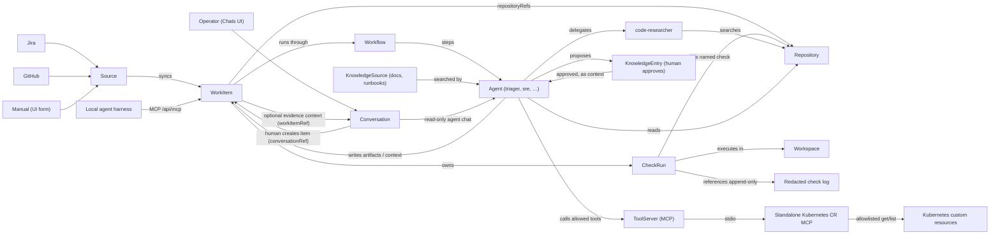
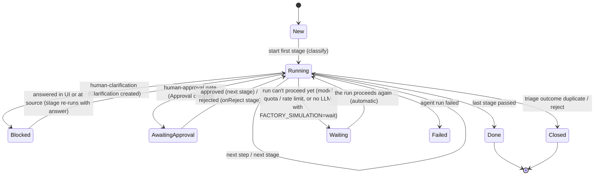
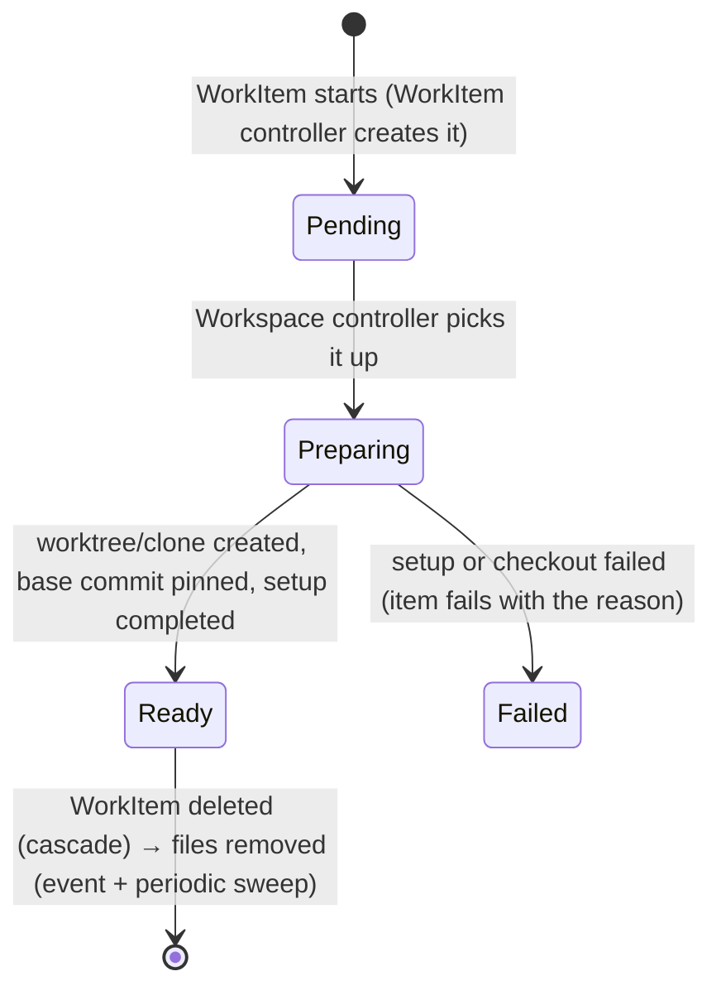
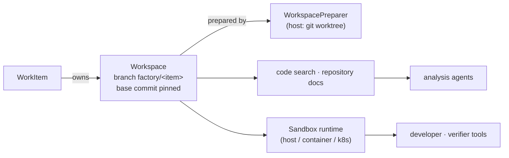

# Architecture

## Two kinds of resources

| Category | Kinds | Who writes them | Where they live |
|---|---|---|---|
| **Definitions** (the factory "as code") | `Agent`, `Skill`, `Workflow`, `ArtifactType`, `Source`, `Repository`, `KnowledgeSource`, `ToolServer` | Platform team, via Git | this repo |
| **Runtime objects** | `WorkItem` (plus its artifacts), `Conversation`, `KnowledgeEntry`, `CheckRun` | UI, sync, agents; controllers write status | the factory's store/API |

Runtime objects follow the Kubernetes split: humans and sync write the **`spec`** (intent), and the factory
controller writes the **`status`** (observed state). The UI is a view over `WorkItem` objects.

## Entities

| Kind | Purpose |
|---|---|
| **Source** | A connector that syncs work items from an external system, such as Jira or GitHub Issues. It defines the field mapping and the default repositories and workflow for synced items. |
| **Repository** | The codebase that work items change and that agents research. It holds the Git URL, default branch, and indexing settings, plus ownership metadata. |
| **WorkItem** | One unit of demand (task, bug, feature) moving through a workflow. This is a row in the dashboard. |
| **CheckRun** | A named repository check pinned to its workspace tree, configuration and environment. Standalone jobs never advance items; verification-enabled workflows and recorded `run_check` calls share durable jobs, with plan/stage/round/attempt identity (ADR-0042). |
| **Conversation** | Append-only dialogue. Explanation chats use existing evidence; standalone `agent-chat` invokes an opted-in agent with a curated read-only MCP tool intersection (ADR-0036). The Conversation controller serializes durable turns and retries model unavailability. No hidden WorkItem or AgentRun is created. |
| **KnowledgeEntry** | A piece of reusable knowledge an agent proposed (or a human edited). Used by agents only after a human approves it (ADR-0030). It outlives the work item it came from. |
| **KnowledgeSource** | External docs agents can search, e.g. product docs or runbooks. `type: files` searches a local folder; other types (e.g. a vector store) plug in later. |
| **Kubernetes CR MCP** | Independent read-only component (ADR-0035), not a new factory resource kind. A YAML catalog defines permitted external CR types, namespaces and directed object-reference relationships. The support engineer connects through the existing `ToolServer` adapter; the app neither stores cluster credentials nor imports the Kubernetes client. |
| **code-researcher** (Agent) | A shared, read-only agent. Other agents **delegate** to it, for example: "What would it take to add X?" or "Where does this stack trace come from?" |

## WorkItem lifecycle (`status.phase` + `status.stage`)

`phase` is a short, generic state. The position in the workflow is `status.stage` (classify, triage, spec, …).

- **Classification** happens automatically on creation or sync (stage `classify`). It sets the type, labels, priority guess, and the affected repositories.
- **Blocked** can be entered from any stage through the `human-input` gate. The item references its `Clarification` in
  `status.blockedBy` and does not move until a human acts. The answer can come from the UI or from a comment synced from the source.
  On resume, the stage that blocked runs again with the answer added to the item's context.

## Dashboard (UI)

| Column | Field |
|---|---|
| ID / Title | `metadata.name`, `spec.title` |
| Source | `spec.sourceRef` (`manual`, `jira-main`, `github-issues`, …) |
| Type / Priority | `status.classification` |
| Repository | `spec.repositoryRefs` |
| Phase | `status.phase` (badge; **Blocked** is highlighted) and `status.stage` |
| Waiting on | assignee of the `Clarification` / `Approval` in `status.blockedBy` |
| Current agent | agent of the latest running `AgentRun` |

Actions: **New item** (manual), **Sync now** (per source), **Answer** (unblocks an item), **Approve / Reject** (gates),
**Create follow-up** (independent item with inherited evidence).

## Follow-up work items (ADR-0039)

A human selects a new workflow/repositories, supplies a new objective and optional free-text instructions, and
reviews a bounded preview of the origin's findings, artifacts and human input. Narrow query/command ports reuse
the WorkItem evidence reader and existing creation validation. No agent-accessible handoff mutation is added.

The target is a manual-source WorkItem with fresh workflow state, gates and workspaces. `originWorkItemRef` and
`originSnapshot` record historical identity and evidence versions without cascade ownership or a required live
dependency. The original source, gates and lifecycle are unchanged. Same-name recreation is distinguished by UID.
Both item pages show provenance links; missing origins are explicit and retained evidence remains usable.

Every agent receives new instructions in `spec.context` separately from the immutable, redacted historical snapshot.
Their combined budget is 20,000 characters; inherited evidence truncates first. Superseded/replay output, transcripts
and prior inherited snapshots are excluded. Origin approvals never authorize the new workflow. Preview revision
checks reject stale evidence; deterministic per-request names/input fingerprints deduplicate retries, even after
the origin disappears. Network-uncertain creation retries retain the original input rather than re-previewing it.

## Reviewed ticket actions (ADR-0040)

The registered `ticket-publication` gate follows service-desk `response-review`. A fresh Approval captures the response
artifact UID/version, exact redacted text, item/ticket identity and source definition version. Humans explicitly approve
visibility and an optional live Jira transition. Generic approval cannot bypass this submission. The gate's segregated
approval-evaluation capability waits for registered outbox actions to deliver the reply and then its transition before
advancing. Legacy completed items enter this review only through an explicit human action.

`TicketQueries`/`TicketCommands` are human API ports, not agent tools. A separately confirmed status-only command
records Principal, source version, original state, allowed transition/target and request fingerprint in an owned
OutboxMessage. Available transitions are read again at delivery; stale state or required Jira form fields block writes.

Source write policies are registered by action and deny unknown source actions. Existing comments still require
bidirectional sync; JSM replies and status changes require separate `writeBack` permissions. Service-desk automatic
sync remains read-only. JSM comments explicitly set `public`; Jira statuses use transition IDs, not guessed names.
Recoverable handlers persist `Delivering` before POST. Restart recovery reads a deterministic comment receipt marker
or the target status instead of repeating the write. Uncertain errors fail visibly for human inspection.
Successful reply receipts survive a failed follow-on transition; no reply is automatically reposted.

## Planned agent retrospectives (proposed ADR-0041)

[ADR-0041](adr/0041-agent-retrospectives.md) proposes workflow-scoped `RetrospectiveFeedback`, deterministic support
aggregation and a separate read-only `factory-retrospective` workflow producing human-reviewed improvement proposals.
Feedback is untrusted historical evidence, not approved knowledge or agent instructions. Implementation follow-ups
remain human-created and have independent gates; proposal approval never authorizes publication.
X22 is planned only: no feedback kind, aggregation controller, retrospective workflow or UI is implemented yet.

## Reliable verification (ADR-0042)

[ADR-0042](adr/0042-reliable-verification-and-recovery.md) rolls out reliable verification in three phases.
The **Check evidence** card lists workflow and standalone jobs: humans can also confirm a named configured check on a stopped item
with a Ready owned workspace. No arbitrary command is accepted. A CheckRun pins the repository configuration,
budget, workspace contents and runtime/profile identity, then executes through the sandbox. Results and redacted
append-only logs survive restart; uncertain in-flight executions become Interrupted, never silently rerun.
Output is currently bounded at 64 KiB per stream and flagged incomplete when truncated; logs arrive on completion.
Concurrent standalone checks and restart/replay actions are guarded. A check changing candidate files is not Passed.

Checks accept a command string (15-minute default) or `{command, timeoutMs}` in Repository definitions; explicit
budgets must be positive integers no greater than 24 hours. Typed timeout/signal/spawn errors remain separate from
generic UnknownFailure. Standalone evidence does not advance/restart items or satisfy a workflow gate automatically.

X23b/c add the explicitly selected `factory-verified` workflow. Its architect writes a JSON `validation-plan` mapping
every acceptance criterion to named policy checks. Human spec-review approves its exact artifact/specification,
workflow versions and repository policy, then same-environment preflight runs before construction. Restarting directly
into implementation cannot bypass this policy. Human code-review binds the candidate tree and environment; generation
or formatting during a later check invalidates the review instead of silently publishing changed code.

[ADR-0043](adr/0043-candidate-preparation-and-drift-recovery.md) adds optional named **candidate preparation** checks
before AI and human code-review. Controlplane builds before review so generated files are included in the candidate.
A successful command that changes the tree records `executionOutcome: Passed` but remains `outcome: NotVerified`;
complete preparation evidence can make that resulting tree reviewable, never verified. Final checks must still run
against the unchanged, approved tree. Reviewers receive preparation provenance and inspect the actual workspace.
Active jobs are awaited before snapshot validation or resuming answered clarifications. Later candidate drift
returns to fresh code-review through a separate bounded recovery counter, not a repeatedly answered clarification.
Budget exhaustion requests human attention; an answer is not approval. `run_check` accepts workspace resource names
or unique repository aliases, and bare or `repository/check` identifiers, normalized before idempotent scheduling.

The registered `verified-checks` gate and verifier's recorded `run_check` tool share CheckRun scheduling. Checks
serialize on a WorkItem's workspace. Only typed AssertionFailed enters the code-fix budget; timeout, cancellation,
setup and unknown failures use a separate bounded execution budget, then a durable Clarification with check/log
references. Retry timing and attempts derive from persisted jobs. Developer prompts receive redacted structured
failure evidence. Generic nonzero exits are not interpreted as assertions; the `go-test-json` classifier requires
genuine complete test-failure events. Preflight nonzero results are SetupFailed.

Required checks without usable, current evidence cannot pass. Where repository policy explicitly permits it, a
fresh human waiver names the exact missing requirements and needs a reason; it binds plan/policy/candidate/evidence
revisions and remains **Waived**, not Passed. Non-waivable gaps and stale approvals block. Publication rechecks evidence
before entering the outbox. Migrating a stopped item via **Use verified workflow** preserves workspace/history,
restarts at validation planning with fresh human reviews, and sets a durable publication hold. It never approves
anything or enables pushes.

Legacy gate caching, retry routing and warnings for unsupported checks remain unchanged for non-migrated workflows.
No existing item is migrated or restarted automatically. Controlplane build/test checks retain explicit 30/60-minute
budgets; their module scope follows ADR-0044 below. Its existing preflight checks Go/make/gotestsum and prepares
Rover envtest assets; selected modules' supported Makefile targets also prepare their own assets. Missing integration/acceptance/security
checks remain visible requirements needing evidence or explicit permitted waivers.

### Affected-module verification (ADR-0044)
`Repository.spec.moduleScope` declares a repository-maintained JSON graph (`name → {path, depends_on}`),
shared-path globs and optional `nonBuildPaths`. Named checks opt in with `moduleScoped: true` and a single
`make <target>` command. One `ModuleScopePlanner` serves preparation, final verification, recorded agent requests,
manual checks and legacy automated gates. Repositories/checks without this policy keep their existing behavior.

The planner compares all candidate contents to the Workspace's pinned `baseCommit`, including committed, staged,
unstaged, deleted, renamed and non-ignored untracked paths. It selects changed modules plus transitive dependents,
then executes the existing Makefile target with a validated `MODULES` argument. Shared tooling/manifests/graph
changes, unknown paths or no build changes use full Makefile discovery with an explicit reason, never an empty suite.
Declared documentation paths do not expand code scope but remain in candidate fingerprints and acceptance evidence.
Invalid/missing graphs or baselines fail visibly. Repository CI remains responsible for maintaining the graph.

Immutable CheckRun specs pin the resolved command and scope (modules, baseline, graph hash and reason). Admission
and execution revalidate them; snapshot, environment and approved-plan checks remain unchanged. The UI shows scope
and exact commands; legacy events explain full-scope selection. Controlplane defaults build/test/preparation to
affected-module coverage; `full-build` and `full-tests` remain available when acceptance requires broader evidence.
Changing repository policy invalidates existing approved contracts and requires fresh human plan review.
See [ADR-0044](adr/0044-affected-module-verification.md).

## Direct agent conversations (ADR-0036)

**Agent chats** lists standalone conversations; an enabled Agent also offers **Start chat**. The support engineer
can discover and inspect configured cluster CRs and search knowledge, but has no shell, repository workspace,
publication or mutation tools. `Agent.spec.chat.allowedTools` explicitly narrows its existing ToolServer allowlists.
MCP annotations are not used to authorize reads.

A human submits one idempotent `spec.turn` at a time. HTTP returns after persistence. The Conversation controller
owns Queued/Running/Waiting/Ready/Failed status, executes outside reconcile, and recovers pending turns at startup.
Quota failures (or no tool-calling model) persist a reason and retry time, never simulated cluster findings.
Requests, definition/model provenance and tool activity use the shared redacting transcript recorder.
SSE refreshes state; active chats also refresh the execution log while a turn is running.
Completed answers survive interrupted status writes; interrupted read-only attempts may be repeated.

Completion is explicit (ADR-0038): an internal `respond` tool accepts the final Markdown answer or human question,
alone and with a non-empty message. This is a chat protocol, not an MCP permission or workflow `finish` capability.
Provider tool selection stays automatic. Text-only announcements are recorded as interim and continued within the
20-step budget; invalid or mixed completion calls receive a recorded error. Only a validated final answer becomes
a recovery checkpoint. Exhaustion fails visibly instead of reporting Ready.

**Create work item** is a human-only action after a completed answer. Review/edit findings and choose the
workflow/repositories; a bounded redacted excerpt and `conversationRef` preserve the origin. Creation is idempotent
per conversation, does not own/delete the chat, and leaves all normal human gates intact. Existing explanation
and knowledge refinement conversations keep their current behavior.

An agent chat may instead reference an **existing WorkItem** (ADR-0037). Start from **Chat with agent** on the item
or select its context on the chat list. A shared, namespace-scoped record reader supplies the same bounded digest
as item explanations: details, status, runs, artifacts, human input and key events. It reloads each turn; the
redacted system message records the exact resource versions read, so later workflow progress does not rewrite
earlier evidence. Reads are not a transactional snapshot. Historical evidence is distinct from live MCP observations.
Chats are labelled by item, not owned by it; deleting an item preserves chat history but makes future turns fail
visibly. The chat offers **Open work item** and cannot create a duplicate via conversion. Linking an item grants no
workspace or mutation capabilities and does not advance its workflow or gates.

## Workspaces (ADR-0021)

Each work item gets one **Workspace** per linked repository: a pinned copy of the code that every agent of the item sees.
Analysis agents search it, and construction agents read, write and run commands in it (through a sandbox runtime).

- Agent runs wait until all of the item's workspaces are `Ready`. Provenance records `repository → commit`.
- Workspaces fork from the **committed** HEAD (or `Repository.spec.workspace.baseRef`). Uncommitted local changes are not visible.
