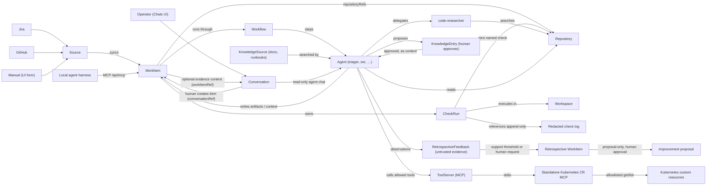
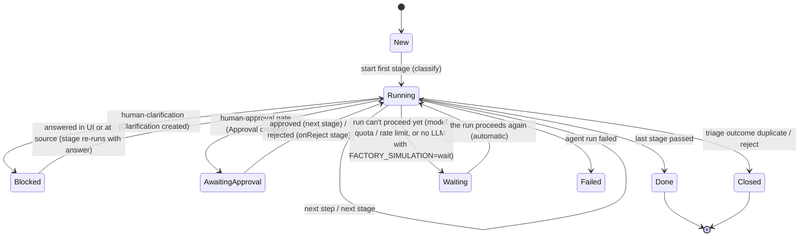
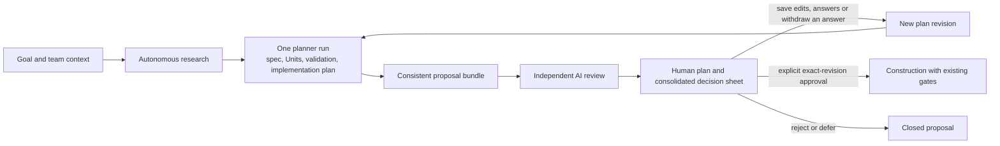
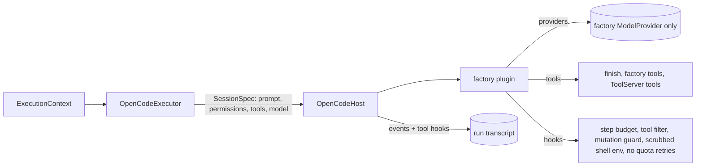
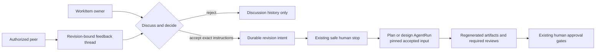
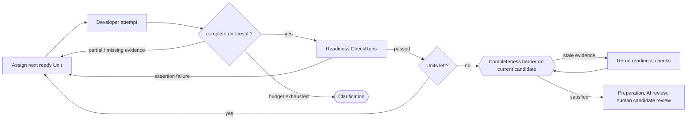
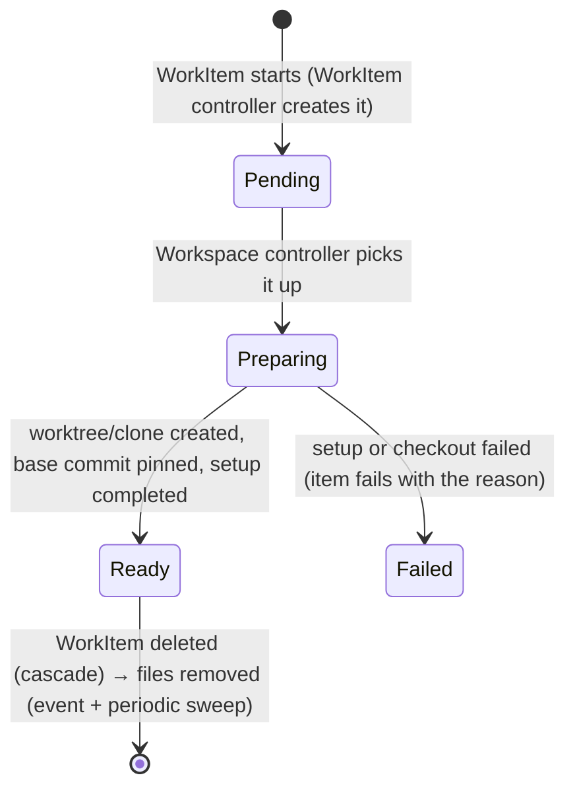
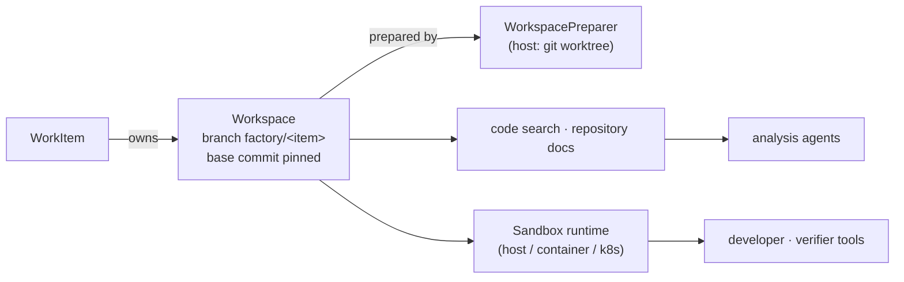

# Architecture

## Two kinds of resources

| Category | Kinds | Who writes them | Where they live |
|---|---|---|---|
| **Definitions** (the factory "as code") | `Agent`, `Skill`, `Workflow`, `ArtifactType`, `Source`, `Repository`, `KnowledgeSource`, `ToolServer` | Platform team, via Git | this repo |
| **Runtime objects** | `WorkItem` (plus its artifacts), `Conversation`, `KnowledgeEntry`, `RetrospectiveFeedback`, `CheckRun` | UI, sync, agents; controllers write status | the factory's store/API |

Runtime objects follow the Kubernetes split: humans and sync write the **`spec`** (intent), and the factory
controller writes the **`status`** (observed state). The UI is a view over `WorkItem` objects.

## Entities



| Kind | Purpose |
|---|---|
| **Source** | A connector that syncs work items from an external system, such as Jira or GitHub Issues. It defines the field mapping and the default repositories and workflow for synced items. |
| **Repository** | The codebase that work items change and that agents research. It holds the Git URL, default branch, and indexing settings, plus ownership metadata. |
| **WorkItem** | One unit of demand (task, bug, feature) moving through a workflow. This is a row in the dashboard. |
| **CheckRun** | A named repository check pinned to its workspace tree, configuration and environment. Standalone jobs never advance items; verification-enabled workflows and recorded `run_check` calls share durable jobs, with plan/stage/round/attempt identity (ADR-0042). |
| **Conversation** | Append-only dialogue. Explanation chats use existing evidence; standalone `agent-chat` invokes an opted-in agent with a curated read-only MCP tool intersection (ADR-0036). The Conversation controller serializes durable turns and retries model unavailability. No hidden WorkItem or AgentRun is created. |
| **IssueProposal** | A tracker issue proposed by an agent or human. Approval is bound to a hash of its publishing fields; creation runs through the recoverable outbox action `create-issue` and needs `Source.spec.writeBack.issues`. Unknown outcomes become `Uncertain` and are resolved by lookup or a human (ADR-0066). Purpose `follow-up` (ADR-0068): created Approved by the Create click in a work item's follow-up dialog, owned by that item; the controller tracks the ticket read-only in `status.tracked` and may link it to the origin (`writeBack.issues.linkOrigin`); "Start implementation" creates the linked WorkItem. |
| **KnowledgeEntry** | A piece of reusable knowledge an agent proposed (or a human edited). Used by agents only after a human approves it (ADR-0030). It outlives the work item it came from. |
| **RetrospectiveFeedback** | Immutable workflow observation with pinned origin identities and workflow versions. Untrusted evidence, not knowledge; independent lifetime. Its controller derives eligibility and durable investigation links (ADR-0041). |
| **KnowledgeSource** | External docs agents can search, e.g. product docs or runbooks. `type: files` searches a local folder; other types (e.g. a vector store) plug in later. |
| **Kubernetes CR MCP** | Independent read-only component (ADR-0035), not a new factory resource kind. A YAML catalog defines permitted external CR types, namespaces and directed object-reference relationships. The support engineer connects through the existing `ToolServer` adapter; the app neither stores cluster credentials nor imports the Kubernetes client. |
| **code-researcher** (Agent) | A shared, read-only agent. Other agents **delegate** to it, for example: "What would it take to add X?" or "Where does this stack trace come from?" |

## WorkItem lifecycle (`status.phase` + `status.stage`)

`phase` is a short, generic state. The position in the workflow is `status.stage` (classify, triage, spec, …).



- **Classification** happens automatically on creation or sync (stage `classify`). It sets the type, labels, priority guess, and the affected repositories.
- **Blocked** can be entered from any stage through the `human-input` gate. The item references its `Clarification` in
  `status.blockedBy` and does not move until a human acts. The answer can come from the UI or from a comment synced from the source.
  On resume, the stage that blocked runs again with the answer added to the item's context.

## Dashboard (UI)

| Column | Field |
|---|---|
| ID / Title | `metadata.name`, `spec.title` |
| Source | `spec.sourceRef` (`manual`, `jira-main`, `github-issues`, …) |
| Type / Priority | `status.classification` |
| Repository | `spec.repositoryRefs` |
| Phase | `status.phase` (badge; **Blocked** is highlighted) and `status.stage` |
| Waiting on | assignee of the `Clarification` / `Approval` in `status.blockedBy` |
| Current agent | agent of the latest running `AgentRun` |

Actions: **New item** (manual), **Sync now** (per source), **Answer** (unblocks an item), **Approve / Reject** (gates),
**Create follow-up** (independent item with inherited evidence).

On the item page, every stage chip opens a **stage view**: the stage's steps and their runs, its checks, its
pull-request publication, and the human input it waits on. Above the chips, the active stage says what it waits for (a
running check, a pending delivery, a human, or an agent) and says so plainly when that won't resolve by itself, e.g.
agent tools that no sandbox provides, or a pull request that failed to deliver.

## Planning workspace (ADR-0045, ADR-0046, ADR-0050, ADR-0051)

The `factory-plan` workflow (default for new manual items) makes the reviewed plan the primary work-item surface.
Its single planner run produces requirements, Units, validation and implementation plan together, followed by one
independent review and the existing verified human plan gate. `factory-planned` remains available for items already
using its multi-stage planning chain; they are not migrated automatically. A human can explicitly migrate an eligible
stopped item or an item paused in its planning stages, restarting at the one-planner stage and superseding the old
workflow's planning and later evidence. ADR-0047 implements approved Units one at a time and
keeps code review closed until every Unit is ready on the current candidate (see "Unit execution" below).
The implementation plan is a JSON Artifact with readable Markdown sections and structured human decisions;
the existing policy-controlled validation plan remains the verification contract. In `factory-plan` it is a focused
**decision sheet** (ADR-0051): only risks/assumptions and human decisions. The workspace shows the specification,
Units, validation plan and research notes (with the options considered) it is based on as source artifacts instead of
restating them. Each gate evidence entry also lists the artifacts its run read and produced, readable in place, so a
summary that refers to them can be checked before approving. The architect's `design`
stage adds a logical design to the domain model, and a tech lead approves it at a separate `human-approval` gate
before code is written; rejection reruns the design with the reason. Developers follow the approved plan and design
and report necessary deviations with reasons.



Planning ports separate queries, human revision commands, exact-review binding, question deferral and terminal intent.
They are composed only in the factory root. No Plan kind, mutable agent document, new workflow engine or unrecorded
model call is introduced. Human edits/answers are `WorkItem.spec.planning` intent with request identity; agent outputs
remain historical Artifacts. Controller-driven restarts supersede dependent output. The workspace compares section
revisions and leaves operational evidence accessible.

Questions in planning AgentRun results do not open per-agent Clarifications. They are consolidated with typed plan
decisions; omitted questions remain required blockers. Answers bind question/options/required semantics and survive
restarts and ordinary revisions when those semantics are unchanged. At a safe human stop, new required decisions and
corrections are directly answerable without reopening discovery; each consolidated submission regenerates the proposal.
Humans can withdraw a stale answer; its bounded history remains visible with the question and date, while agents
receive it explicitly as no longer binding.
Agents research facts and reuse settled answers instead of starting sequential interviews. Approval guidance shows
the actual next action or evidence issue. Malformed or stale plan evidence stops visibly for revision. Required choices cannot be
delegated through a generic approval comment or override.

Plan approval binds current human context/intent, specification, Units, validation, implementation plan, independent
review and definition/policy versions. In `factory-plan`, all four proposal artifacts must come from the same real,
current planner run; the independent reviewer must consume those exact revisions and both runs record the current
planning intent. An asynchronous revision cannot auto-approve, and direct restarts cannot bypass this binding.
Active agents/checks or publication effects prevent amendments; human reject/defer intent is applied to status only
by the WorkItem controller. Legacy workflows and ADR-0032 context behavior remain unchanged.

### Typed planning review (ADR-0055)

ArtifactType may declare an optional versioned JSON Schema (`spec.schema.version` and `jsonSchema`).
Local strict draft-2020-12 validation precedes registered domain checks. Schemas are recorded in output-producing
agent context; malformed output retries only its producing step and fails visibly when its budget is exhausted.

`factory-plan` uses the JSON `planning-review` artifact. Findings distinguish research gaps, plan defects,
human decisions and advisory concerns. Exact reviewed input references and decision links are checked in code.
New human decisions appear in the existing answer surface; they cannot be hidden solely in a report or bypassed
through approval comments. Routing must agree with the finding-derived verdict. The workspace renders findings
from this artifact and reports working, needs agent repair, needs answers, ready, or ready with disputed findings.
Valid AI concerns remain human-overridable with a reason; invalid contracts and missing answers do not.

Approval binds the current review schema digest and requires its recorded producer context. Existing Markdown
reports remain readable, but existing `factory-plan` proposals require a fresh revision before approval.
Other workflows retain their previous reports. This does not auto-restart or mutate live items.
Schemas and citations establish structure and identity, not factual truth. Cross-revision finding-resolution
accounting and broader decision lineage remain follow-ups.

### Accessible tools and grounded reviews (ADR-0057)

The harness, not agent definitions, makes tools usable. Before the first model step, the `cited-code` context
provider resolves every `repo:path:line` citation in a run's inputs, item context and answers against the run's
pinned workspaces, through the same confined read-only reader as `read_file`. Agents get line-numbered excerpts
and a list of unresolved citations; repositories outside the run's workspaces are reported, never probed.
The tool loop renders a "Tools for this run" section from the tools it actually bound: trusted registry guidance
for built-in tools, names only for MCP tools. `read_file` accepts ranges or a citation and returns numbered lines;
`search_code` can add context lines.

```mermaid
sequenceDiagram
  participant Agent
  participant Loop as Tool loop
  participant Check as FinishValidator
  participant Ctl as WorkItem controller
  Agent->>Loop: finish(result)
  Loop->>Check: schema + domain checks (same per-type checks)
  alt problems and corrections left
    Check-->>Loop: actionable errors
    Loop-->>Agent: errors as the finish tool result
  else valid or corrections used up
    Loop-->>Ctl: run Succeeded with result
    Ctl->>Ctl: post-run checks (rerun only the producer on failure)
  end
```

One `ProposedArtifactCheck` per artifact type serves both paths. After the run, it is adapted to `ArtifactCheck`
and reopens the run's workspaces only at the commits recorded in provenance. `planning-review` version 2 accepts
artifact or code evidence; code locations must exist in those workspaces. Research gaps list what was
investigated, and claims confirmed in code are listed as verified, not raised as findings. Provenance records tool
use and cited-code counts for observability only.

The tool guide also states the run's step budget. Near the end the harness tells the agent to wrap up, and the last
step only offers `finish`, so a run out of budget reports what it completed instead of failing (ADR-0058).

### Agent runtime: OpenCode v2 (ADR-0060)

Model-backed AgentRuns run in an OpenCode v2 host embedded in the factory process (`@opencode/sdk`), one session
per run. The same factory rules as the tool loop apply, through shared harness code: tool selection, guarded and
serialized workspace mutations, in-loop `finish` validation, step budget and wrap-up, `source-code` diffs. OpenCode
adds precise edit tools, a real shell, compaction, the repository's own skills and `AGENTS.md`, and background
sub-agents.



- Only the factory's resolved model is available; OpenCode's bundled providers, the public model catalogue, user and
  repository configuration and plugins are never loaded. The key stays in-process.
- Sessions start from "deny everything"; the agent's tools grant `read`/`glob`/`grep`, `edit`/`write` (never `.git`)
  or `shell`. `skill` and `subagent` are always allowed; sub-agents inherit the rules, cannot delegate further and
  cannot call `finish`. Web access, Code Mode and the interactive `question` tool are hidden.
- Agents that write or execute use OpenCode only on the `host` sandbox runtime; with an isolated runtime they fall
  back to the tool loop. Commands get the scrubbed environment plus the sandbox profile's `env`.
- A 429/503/529 is not retried inside OpenCode: the run waits (ADR-0031). `FACTORY_AGENT_RUNTIME=tool-loop` disables
  the runtime.

### In progress: autonomous technical recovery (proposed ADR-0059)

Opted-in workflows retain completed-attempt diagnoses and use bounded, schema-backed `recovery-report`
artifacts before repeating a failed implementation. Controller-owned recovery episodes bind the approved plan,
Unit/stage, triggering evidence and remaining budgets; restart and changed candidate snapshots do not erase them.
The harness offers only policy-authorized readiness checks, without adding tools to Agent definitions, through
the same durable scheduler and workspace serialization as the Unit gate. Explicit tool restrictions remain ceilings.

The implementation routes routine failures through autonomous diagnosis and bounded repair. Registered validation
checks a specific human-only runtime need before creating a Clarification and again before consuming its reserve.
Other exhausted recovery stops visibly with retained evidence. The item page separates diagnosis, repair, waiting,
failure and genuine human action, and shows consumed allowances and the exact report.
Existing human approvals, completeness barriers, verification and publication guards remain unchanged.
Production enablement is incomplete: diagnostics require a candidate-isolating runtime not provided by the
unsandboxed host adapter, and extra operator allocations require trusted identity not supplied by the anonymous
HTTP adapter. No existing workflow or item is opted in, migrated, answered or restarted automatically.

## Proposed: owner-led peer feedback (ADR-0056)

This is a proposal, not shipped behavior. A collaboration-enabled WorkItem would have one accountable human owner.
Authorized peers could discuss pinned plan/design revisions in WorkItem-owned `FeedbackThread` resources; the
owner could reply and accept or reject suggestions with a rationale. Ownership would not grant gate-approver roles
or access to another namespace. Trusted OIDC identity and server-side authorization are prerequisites.



Open/rejected discussion would not become workflow agent input. Accepted instructions would be queued until a safe
revision boundary, recorded in the next relevant run, and linked to its result. Acceptance would not alter in-flight
runs, satisfy required decisions, approve the regenerated evidence or bypass verification/publication safeguards.
Stale targets would require explicit owner review and re-anchoring. Feedback after construction starts would need a
supported amendment/restart or independent follow-up. See [ADR-0056](adr/0056-owner-led-peer-feedback.md) for the
proposed resource, concurrency, provenance and acceptance contracts.

## Unit execution (ADR-0047)

On `factory-planned`, the validation plan carries the approved Unit manifest. The implementation stage runs one
developer attempt per round, each assigned to the first Unit whose dependencies are ready; its `unit-progress` gate
checks the structured result and runs the Unit's readiness checks before moving to the next Unit.



Progress is derived from durable AgentRuns, Artifacts and CheckRuns; nothing is inferred from an agent finishing.
The barrier runs inside the verification stage policy and candidate approval validation, so overrides and direct
restarts cannot bypass it. Review findings, rejections and verification failures return as a cross-Unit repair
attempt, after which the barrier reruns all readiness checks. The item page shows Units above any gate controls.

## Follow-up work items (ADR-0039)

A human selects a new workflow/repositories, supplies a new objective and optional free-text instructions, and
reviews a bounded preview of the origin's findings, artifacts and human input. Narrow query/command ports reuse
the WorkItem evidence reader and existing creation validation. No agent-accessible handoff mutation is added.

The target is a manual-source WorkItem with fresh workflow state, gates and workspaces. `originWorkItemRef` and
`originSnapshot` record historical identity and evidence versions without cascade ownership or a required live
dependency. The original source, gates and lifecycle are unchanged. Same-name recreation is distinguished by UID.
Both item pages show provenance links; missing origins are explicit and retained evidence remains usable.

Every agent receives new instructions in `spec.context` separately from the immutable, redacted historical snapshot.
Their combined budget is 20,000 characters; inherited evidence truncates first. Superseded/replay output, transcripts
and prior inherited snapshots are excluded. Origin approvals never authorize the new workflow. Preview revision
checks reject stale evidence; deterministic per-request names/input fingerprints deduplicate retries, even after
the origin disappears. Network-uncertain creation retries retain the original input rather than re-previewing it.

## Reviewed ticket actions (ADR-0040)

The registered `ticket-publication` gate follows service-desk `response-review`. A fresh Approval captures the response
artifact UID/version, exact redacted text, item/ticket identity and source definition version. Humans explicitly approve
visibility and an optional live Jira transition. Generic approval cannot bypass this submission. The gate's segregated
approval-evaluation capability waits for registered outbox actions to deliver the reply and then its transition before
advancing. Legacy completed items enter this review only through an explicit human action.

`TicketQueries`/`TicketCommands` are human API ports, not agent tools. A separately confirmed status-only command
records Principal, source version, original state, allowed transition/target and request fingerprint in an owned
OutboxMessage. Available transitions are read again at delivery; stale state or required Jira form fields block writes.

Source write policies are registered by action and deny unknown source actions. Existing comments still require
bidirectional sync; JSM replies and status changes require separate `writeBack` permissions. Service-desk automatic
sync remains read-only. JSM comments explicitly set `public`; Jira statuses use transition IDs, not guessed names.
Recoverable handlers persist `Delivering` before POST. Restart recovery reads a deterministic comment receipt marker
or the target status instead of repeating the write. Uncertain errors fail visibly for human inspection.
Successful reply receipts survive a failed follow-on transition; no reply is automatically reposted.

## Agent retrospectives (ADR-0041)

[ADR-0041](adr/0041-agent-retrospectives.md) defines workflow-scoped `RetrospectiveFeedback`, deterministic support
aggregation and a separate read-only `factory-retrospective` workflow producing human-reviewed improvement proposals.
Feedback is untrusted historical evidence, not approved knowledge or agent instructions. Implementation follow-ups
remain human-created and have independent gates; proposal approval never authorizes publication.

Scheduling pins the actual root/subworkflow version chain; agents can report only about the stage they executed.
Terminal AgentRun status stores bounded, redacted candidates before a separate reconciler creates feedback. Capture
retries never execute the business agent again. Replays, superseded/simulated/legacy runs, controller-only failures,
positive observations, counterevidence and missing/replaced origins do not add automatic support. Evidence survives
origin deletion. Human classification of an unknown code is audited; raw feedback is not ordinary agent context.
Deletion of a run or its owning item conflicts while feedback capture is pending; a store guard checks this inside
the cascade transaction. The independent feedback and a content-bound capture receipt must persist first.

The default policy requires three distinct WorkItem UIDs and two reporter roles in 14 days. It triggers investigation,
not authorization; repeated reports from an item count once. Groups never cross namespace, stage or definition chain.
The first investigation is automatic at threshold; subsequent cycles require an explicit human request. Immutable
snapshots (up to 12 reports) and feedback links prevent duplicate investigation after restart or deletion.

Two different tool-free agents analyze and challenge the snapshot, then `retrospective-review` binds the exact proposal
and current eligibility of its historical evidence. Rejection or drift permits at most two review retries; changed
evidence can be reviewed afresh by restarting from `analyze`. New reports are visible without silently extending an
existing approval. The Retrospectives view exposes counts, policy, evidence, exclusions, human classification and
investigation links. The item view supports close/defer and separate human records for implementation, the loaded
definition version, and measured benefit/regression. A publishing implementation follow-up requires explicit additional
authorization; no automatic edits, workspace, commit, PR, merge, deployment or hot reload occur in a retrospective.

## Reliable verification (ADR-0042)

[ADR-0042](adr/0042-reliable-verification-and-recovery.md) rolls out reliable verification in three phases.
The **Check evidence** card lists workflow and standalone jobs: humans can also confirm a named configured check on a stopped item
with a Ready owned workspace. No arbitrary command is accepted. A CheckRun pins the repository configuration,
budget, workspace contents and runtime/profile identity, then executes through the sandbox. Results and redacted
append-only logs survive restart; uncertain in-flight executions become Interrupted, never silently rerun.
Output is currently bounded at 64 KiB per stream and flagged incomplete when truncated; logs arrive on completion.
Concurrent standalone checks and restart/replay actions are guarded. A check changing candidate files is not Passed.

Checks accept a command string (15-minute default) or `{command, timeoutMs}` in Repository definitions; explicit
budgets must be positive integers no greater than 24 hours. Typed timeout/signal/spawn errors remain separate from
generic UnknownFailure. Standalone evidence does not advance/restart items or satisfy a workflow gate automatically.

X23b/c add the explicitly selected `factory-verified` workflow. Its architect writes a JSON `validation-plan` mapping
every acceptance criterion to named policy checks. Human spec-review approves its exact artifact/specification,
workflow versions and repository policy, then same-environment preflight runs before construction. Restarting directly
into implementation cannot bypass this policy: entering any later stage with missing or stale preflight evidence (e.g.
after a definition change and plan re-confirmation) reruns preflight in place, within its budgets, instead of asking a
human to restart preflight and discard later work (ADR-0042 §4). A restart marks the restarted stages' open
Clarifications and undecided Approvals as superseded, like their runs, artifacts and CheckRuns; they can't be acted on
and are no longer polled on synced tickets. Human code-review binds the candidate tree and environment; generation
or formatting during a later check invalidates the review instead of silently publishing changed code.

[ADR-0043](adr/0043-candidate-preparation-and-drift-recovery.md) adds optional named **candidate preparation** checks
before AI and human code-review. Controlplane builds before review so generated files are included in the candidate.
A successful command that changes the tree records `executionOutcome: Passed` but remains `outcome: NotVerified`;
complete preparation evidence can make that resulting tree reviewable, never verified. Final checks must still run
against the unchanged, approved tree. Reviewers receive preparation provenance and inspect the actual workspace.
Active jobs are awaited before snapshot validation or resuming answered clarifications. Later candidate drift
returns to fresh code-review through a separate bounded recovery counter, not a repeatedly answered clarification.
Budget exhaustion requests human attention; an answer is not approval. `run_check` accepts workspace resource names
or unique repository aliases, and bare or `repository/check` identifiers, normalized before idempotent scheduling.

Entering the verify stage collects the approved plan's checks for the approved candidate **before** the verifier runs
(ADR-0063); the verifier evaluates that evidence ("Current verification evidence") and no longer has `run_check`. The
`verified-checks` gate shares the same collection code and afterwards only confirms the evidence is current. Checks
serialize on a WorkItem's workspace. Only typed AssertionFailed enters the code-fix budget; timeout, cancellation,
setup and unknown failures use a separate bounded execution budget, then a durable Clarification with check/log
references. Retry timing and attempts derive from persisted jobs. Developer prompts receive redacted structured
failure evidence. Generic nonzero exits are not interpreted as assertions; the `go-test-json` classifier requires
genuine complete test-failure events. Preflight nonzero results are SetupFailed.

Required checks without usable, current evidence cannot pass. Where repository policy explicitly permits it, a
fresh human waiver names the exact missing requirements and needs a reason; it binds plan/policy/candidate/evidence
revisions and remains **Waived**, not Passed. Non-waivable gaps and stale approvals block. Publication rechecks evidence
before entering the outbox. Migrating a stopped item via **Use verified workflow** preserves workspace/history,
restarts at validation planning with fresh human reviews, and sets a durable publication hold. It never approves
anything or enables pushes.

Legacy gate caching, retry routing and warnings for unsupported checks remain unchanged for non-migrated workflows.
No existing item is migrated or restarted automatically. Controlplane build/test checks retain explicit 30/60-minute
budgets; their module scope follows ADR-0044 below. Its existing preflight checks Go/make/gotestsum and prepares
Rover envtest assets; selected modules' supported Makefile targets also prepare their own assets. Missing integration/acceptance/security
checks remain visible requirements needing evidence or explicit permitted waivers.

### Affected-module verification (ADR-0044)
`Repository.spec.moduleScope` declares a repository-maintained JSON graph (`name → {path, depends_on}`),
shared-path globs and optional `nonBuildPaths`. Named checks opt in with `moduleScoped: true` and a single
`make <target>` command. One `ModuleScopePlanner` serves preparation, final verification, recorded agent requests,
manual checks and legacy automated gates. Repositories/checks without this policy keep their existing behavior.

The planner compares all candidate contents to the Workspace's pinned `baseCommit`, including committed, staged,
unstaged, deleted, renamed and non-ignored untracked paths. It selects changed modules plus transitive dependents,
then executes the existing Makefile target with a validated `MODULES` argument. Shared tooling/manifests/graph
changes, unknown paths or no build changes use full Makefile discovery with an explicit reason, never an empty suite.
Declared documentation paths do not expand code scope but remain in candidate fingerprints and acceptance evidence.
Invalid/missing graphs or baselines fail visibly. Repository CI remains responsible for maintaining the graph.

Immutable CheckRun specs pin the resolved command and scope (modules, baseline, graph hash and reason). Admission
and execution revalidate them; snapshot, environment and approved-plan checks remain unchanged. The UI shows scope
and exact commands; legacy events explain full-scope selection. Controlplane defaults build/test/preparation to
affected-module coverage; `full-build` and `full-tests` remain available when acceptance requires broader evidence.
Changing repository policy invalidates existing approved contracts and requires fresh human plan review.
See [ADR-0044](adr/0044-affected-module-verification.md).

### Verification tiers (ADR-0061)
Checks declared with `scoped: true` take their scope from the **tier** of the CheckRun's purpose instead of a per-check
flag. The tier table is data (`model/check-scope.ts`), and the planner receives the requested selection:

| Purpose (tier) | Default scope |
|---|---|
| `unit-readiness` (readiness) | `changed`: changed modules only |
| `preparation`, `verification` | `affected`: changed modules plus transitive dependents |
| standalone, preflight, diagnostic | `affected` (unchanged) |

`verification.minScope` raises a scoped check's scope per tier (e.g. `minScope: { verification: { tests: full } }`); it never
lowers it. Shared, unknown or empty changes still select `full` in every tier. Legacy `moduleScoped: true` checks keep
`affected` everywhere, and `validate.py` warns about them. Evidence counts only for its exact purpose and only with at least that purpose's scope (`scopeSatisfies`), so
readiness results never count as verification evidence. Admission and execution re-resolve the scope with the run's purpose, so a
CheckRun cannot carry another tier's scope. Side-effect-free checks, caches and the publication tier follow
(X41b–d); the check worker is ADR-0062.

## Direct agent conversations (ADR-0036)

**Agent chats** lists standalone conversations; an enabled Agent also offers **Start chat**. The support engineer
can discover and inspect configured cluster CRs and search knowledge, but has no shell, repository workspace,
publication or mutation tools. `Agent.spec.chat.allowedTools` explicitly narrows its existing ToolServer allowlists.
MCP annotations are not used to authorize reads.

A human submits one idempotent `spec.turn` at a time. HTTP returns after persistence. The Conversation controller
owns Queued/Running/Waiting/Ready/Failed status, executes outside reconcile, and recovers pending turns at startup.
Quota failures (or no tool-calling model) persist a reason and retry time, never simulated cluster findings.
Requests, definition/model provenance and tool activity use the shared redacting transcript recorder.
SSE refreshes state; active chats also refresh the execution log while a turn is running.
Completed answers survive interrupted status writes; interrupted read-only attempts may be repeated.

Completion is explicit (ADR-0038): an internal `respond` tool accepts the final Markdown answer or human question,
alone and with a non-empty message. This is a chat protocol, not an MCP permission or workflow `finish` capability.
Provider tool selection stays automatic. Text-only announcements are recorded as interim and continued within the
20-step budget; invalid or mixed completion calls receive a recorded error. Only a validated final answer becomes
a recovery checkpoint. Exhaustion fails visibly instead of reporting Ready.

**Create work item** is a human-only action after a completed answer. Review/edit findings and choose the
workflow/repositories; a bounded redacted excerpt and `conversationRef` preserve the origin. Creation is idempotent
per conversation, does not own/delete the chat, and leaves all normal human gates intact. Existing explanation
and knowledge refinement conversations keep their current behavior.

An agent chat may instead reference an **existing WorkItem** (ADR-0037). Start from **Chat with agent** on the item
or select its context on the chat list. A shared, namespace-scoped record reader supplies the same bounded digest
as item explanations: details, status, runs, artifacts, human input and key events. It reloads each turn; the
redacted system message records the exact resource versions read, so later workflow progress does not rewrite
earlier evidence. Reads are not a transactional snapshot. Historical evidence is distinct from live MCP observations.
Chats are labelled by item, not owned by it; deleting an item preserves chat history but makes future turns fail
visibly. The chat offers **Open work item** and cannot create a duplicate via conversion. Linking an item grants no
workspace or mutation capabilities and does not advance its workflow or gates.

## Workspaces (ADR-0021)

Each work item gets one **Workspace** per linked repository: a pinned copy of the code that every agent of the item sees.
Analysis agents search it, and construction agents read, write and run commands in it (through a sandbox runtime).





- Agent runs wait until all of the item's workspaces are `Ready`. Provenance records `repository → commit`.
- Workspaces fork from the **committed** HEAD (or `Repository.spec.workspace.baseRef`). Uncommitted local changes are not visible.
- Before a pull request is pushed, the candidate is trial-merged with the freshly fetched remote base (ADR-0053). On a
  conflict nothing is published: the Workspace merges the new base (`spec.integrate`, markers left, `baseCommit`
  re-pinned) and the publish stage routes to `onConflict.next` (bounded), else a human resolves via a Clarification.
- An already published PR is brought up to date with "Update pull request" (ADR-0054): a restart from the publish stage
  that goes through the same conflict resolution and pushes to the same branch. A plan approval made stale only by
  workflow/repository definition edits is re-confirmed in place through an Approval instead of restarting plan review.
- A repository without `spec.git.url` is never published: its changes stay in the workspace, and the publish stage
  shows the publication as "not configured" instead of retrying a delivery that can't succeed. Adding `git:` later
  keeps the item's plan and check evidence (they bind to the check definition version, ADR-0064); a preflight made
  stale by a check-definition change is rerun in place before publication.
