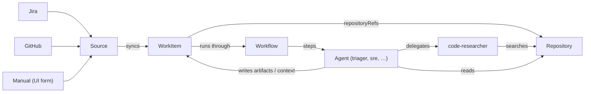
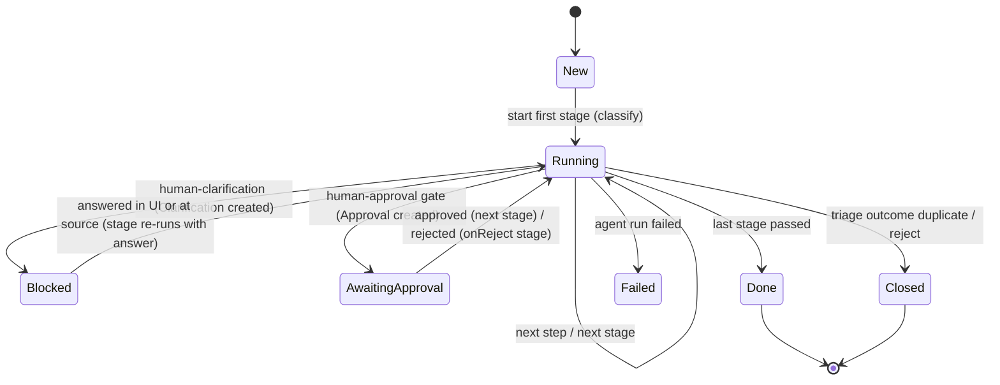
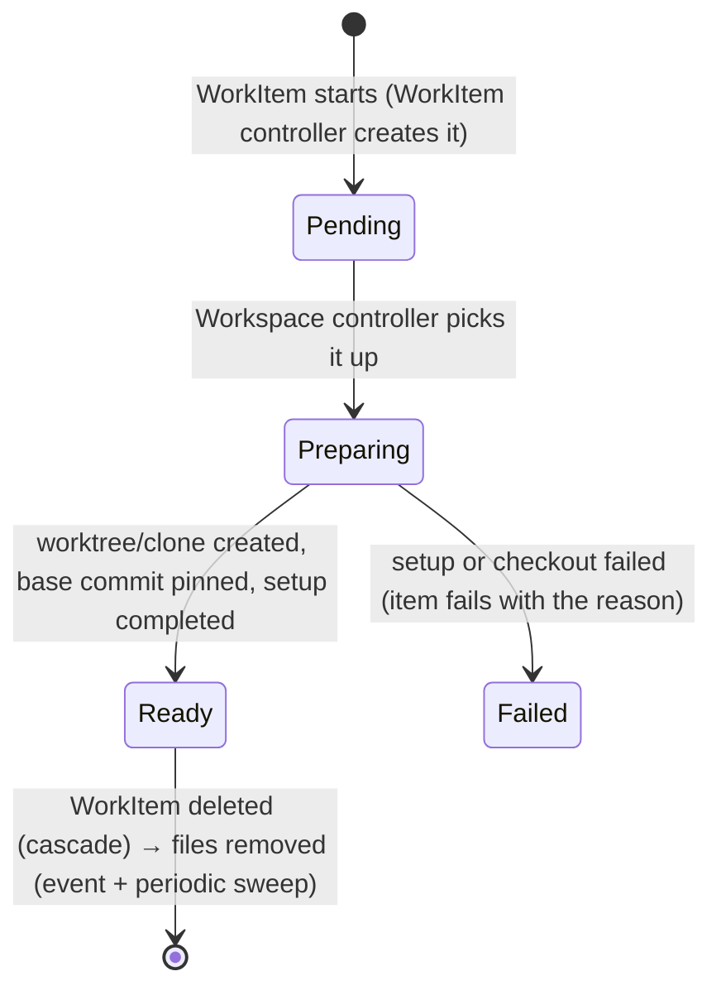
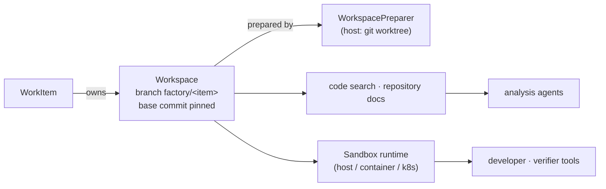

# Architecture

## Two kinds of resources

| Category | Kinds | Who writes them | Where they live |
|---|---|---|---|
| **Definitions** (the factory "as code") | `Agent`, `Skill`, `Workflow`, `ArtifactType`, `Source`, `Repository` | Platform team, via Git | this repo |
| **Runtime objects** | `WorkItem` (plus its artifacts) | UI, sync, agents | the factory's store/API |

Runtime objects follow the Kubernetes split: humans and sync write the **`spec`** (intent), and the factory
controller writes the **`status`** (observed state). The UI is a view over `WorkItem` objects.

## Entities

| Kind | Purpose |
|---|---|
| **Source** | A connector that syncs work items from an external system, such as Jira or GitHub Issues. It defines the field mapping and the default repositories and workflow for synced items. |
| **Repository** | The codebase that work items change and that agents research. It holds the Git URL, default branch, and indexing settings, plus ownership metadata. |
| **WorkItem** | One unit of demand (task, bug, feature) moving through a workflow. This is a row in the dashboard. |
| **code-researcher** (Agent) | A shared, read-only agent. Other agents **delegate** to it, for example: "What would it take to add X?" or "Where does this stack trace come from?" |

## WorkItem lifecycle (`status.phase` + `status.stage`)

`phase` is a short, generic state. The position in the workflow is `status.stage` (classify, triage, spec, …).

- **Classification** happens automatically on creation or sync (stage `classify`). It sets the type, labels, priority guess, and the affected repositories.
- **Blocked** can be entered from any stage through the `human-input` gate. The item references its `Clarification` in
  `status.blockedBy` and does not move until a human acts. The answer can come from the UI or from a comment synced from the source.
  On resume, the stage that blocked runs again with the answer added to the item's context.

## Dashboard (UI)

| Column | Field |
|---|---|
| ID / Title | `metadata.name`, `spec.title` |
| Source | `spec.sourceRef` (`manual`, `jira-main`, `github-issues`, …) |
| Type / Priority | `status.classification` |
| Repository | `spec.repositoryRefs` |
| Phase | `status.phase` (badge; **Blocked** is highlighted) and `status.stage` |
| Waiting on | assignee of the `Clarification` / `Approval` in `status.blockedBy` |
| Current agent | agent of the latest running `AgentRun` |

Actions: **New item** (manual), **Sync now** (per source), **Answer** (unblocks an item), **Approve / Reject** (gates).

## Workspaces (ADR-0021)

Each work item gets one **Workspace** per linked repository: a pinned copy of the code that every agent of the item sees.
Analysis agents search it, and construction agents read, write and run commands in it (through a sandbox runtime).

- Agent runs wait until all of the item's workspaces are `Ready`. Provenance records `repository → commit`.
- Workspaces fork from the **committed** HEAD (or `Repository.spec.workspace.baseRef`). Uncommitted local changes are not visible.
