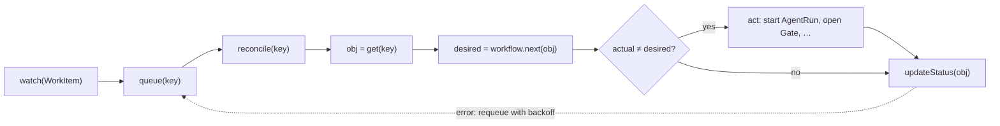
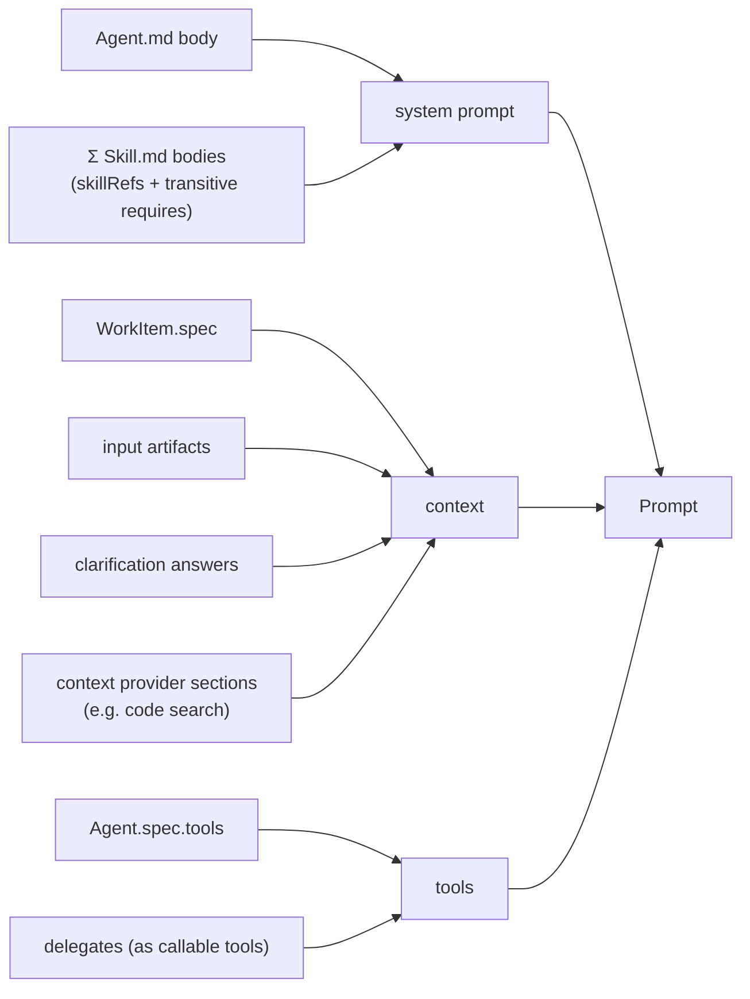

# Patterns

These are the building blocks for the factory runtime. Most of them come from Kubernetes, because we model everything as custom resources. Where a pattern is inspired by Kubernetes but implemented in our own app, the entry says so.

---

## 1. Data & API

### 1.1 Resource Model (KRM: Kubernetes Resource Model)
Every object has the envelope `apiVersion / kind / metadata / spec / status`.
- `spec` is the **desired state**. Humans, the UI and source sync write it.
- `status` is the **observed state**. Only controllers write it.
- `metadata` holds `name`, `uid`, `labels`, `annotations`, `resourceVersion`, `ownerReferences`, `creationTimestamp`, and `finalizers`.

*Why:* one shape for definitions (Git) and runtime objects (DB), one generic API, one generic UI.

### 1.2 Generic Resource Store (Repository pattern)
One interface for all kinds:
```ts
interface ResourceStore {
  get(kind, name): Resource | null
  list(kind, { labelSelector?, fieldSelector? }): Resource[]
  create(obj): Resource
  update(obj): Resource          // spec + metadata; fails on resourceVersion conflict
  updateStatus(obj): Resource    // status only (status subresource)
  delete(kind, name): void
  watch(kind, cb): Unsubscribe   // change feed for controllers + UI
}
```
- **Backends:** `GitDefinitionStore` (read-only, loads `agents/`, `skills/`, …) and `SqlStore` for WorkItems (SQLite now, Postgres later). A `CompositeStore` routes each request by kind.
- Storage is a single table: `(kind, name, uid, resourceVersion, doc JSON)`.

### 1.3 Optimistic Concurrency
Every write must carry the `resourceVersion` it read, otherwise it gets `409 Conflict`.
This lets the UI, sync jobs and controllers write the same object safely without locks.

### 1.4 Spec / Status Subresource Split
Writes to `spec` and `status` go through separate endpoints, so a human edit can't clobber controller state and the other way round.

### 1.5 Typed References (`*Ref`)
References are `{ name }` (later possibly `{ kind, name, namespace }`). They are resolved lazily and validated at admission (2.4).

### 1.6 Owner References & Garbage Collection
Artifacts, AgentRuns and Clarifications point to their WorkItem through `metadata.ownerReferences`.
Deleting a WorkItem cascades to everything it owns.

### 1.7 Labels & Selectors
The dashboard filters, the source sync ("items from `jira-main`"), and repository lookups all work through
`labelSelector`, e.g. `factory.ai-dlc.io/source=jira-main,factory.ai-dlc.io/type=bug`.

---

## 2. Control

### 2.1 Controller / Reconcile Loop

- **Level-triggered:** reconcile from the *current* state, not from the event that triggered it. A crash or restart just means reconciling again.
- **Idempotent:** running a reconcile twice has the same effect as running it once (2.6).
- **Requeue with backoff** on errors, and a periodic resync as a safety net.

One controller per concern, each owning one part of the status:

| Controller | Watches | Owns |
|---|---|---|
| `SourceSyncController` | Source | creates and updates WorkItems |
| `WorkItemController` | WorkItem | phase transitions, starts AgentRuns, opens Gates |
| `AgentRunController` | AgentRun | executes the agent, writes artifacts |
| `GateController` | Gate / Clarification | blocks and unblocks, approvals, escalation timers |

### 2.2 Conditions (in addition to `phase`)
`phase` is a single summary string for the UI. The details live in `status.conditions[]`:
```yaml
conditions:
  - { type: Classified, status: "True",  reason: AutoClassified, lastTransitionTime: … }
  - { type: Blocked,    status: "True",  reason: AwaitingClarification, message: "2 open questions" }
  - { type: Ready,      status: "False", reason: Blocked }
```
*Why:* states that happen together (e.g. classified **and** blocked **and** sync error) can't be expressed with a single enum.

### 2.3 Explicit State Machine
WorkItem phases form a declared transition table (`from × event → to`), derived from the `Workflow`.
Invalid transitions are rejected. The UI uses the same table to decide which buttons to show.

### 2.4 Admission Chain (Defaulting → Validation)
On every create or update:
1. **Mutating:** apply `Source.spec.defaults` (workflowRef, repositoryRefs) and add generated labels.
2. **Validating:** check the JSON Schema per kind, resolve refs, check that the transition is allowed.

The same functions run in CI (`tools/validate.py`, later ported to TypeScript) and in the API.

### 2.5 Finalizers
Before a WorkItem is deleted, finalizers can do cleanup, e.g. post "closed by factory" to Jira or cancel running AgentRuns.

### 2.6 Idempotency Keys
Every side effect, such as an AgentRun or a comment posted back to the source, gets a deterministic key
(`<workitem>/<stage>/<step>/<attempt>`). Running a reconcile again never runs the agent twice.

---

## 3. Execution

### 3.1 Work Queue with Leases
The controller **enqueues**, and workers **lease** jobs with a timeout. A crashed worker's lease expires and another worker picks up the job.
For now this is an in-process queue backed by the DB. It can move to a real queue later without changing controllers.

### 3.2 AgentRun as a Resource (Job pattern)
Each agent execution is its own object, like a Kubernetes `Job`:
```yaml
kind: AgentRun
spec:   { agentRef, skillRefs, workItemRef, stage, step, inputs, idempotencyKey }
status: { phase: Pending|Running|Succeeded|Failed, startedAt, finishedAt, outputs, transcriptRef, tokens }
```
*Why:* it can be observed, retried and audited, and the UI can show a timeline per WorkItem.

### 3.3 Prompt Assembly (Builder)

A pure function, so it can be unit-tested and previewed in the UI ("show prompt").

### 3.4 Delegation / Agent-as-Tool (Orchestrator → Worker)
Each entry in `Agent.spec.delegates` is exposed to the calling agent as a tool, e.g. `ask_code_researcher(question, repos)`.
The call creates a **child AgentRun** with an `ownerReference` to the parent, so it's traceable and cached by question hash.

### 3.5 Durable Suspension (Human-in-the-Loop)
A step that needs a human **does not wait inside a process**. Instead:
1. It creates a `Clarification` resource that owns the questions, assignee and answers.
2. The WorkItem gets `Blocked=True`, and the reconcile stops.
3. An answer, from the UI or synced from the source, updates the Clarification. This triggers a reconcile of the WorkItem, which resumes the stage with the answer in context.

Approval gates use the same mechanism (`Approval` resource). Nothing is held in memory, so it survives restarts.

### 3.6 Retry, Backoff & Escalation (Policy objects)
`onFailure: { retry, escalateTo }` and `escalation: { after }` are declarative policies on gates.
The GateController enforces them with timers, which are stored as `status.nextCheckAt`, not as in-memory timeouts.

---

## 4. Integration

### 4.1 Ports & Adapters (Hexagonal)
The core depends only on interfaces. Implementations plug in by `type`:

| Port | Adapters now | Later |
|---|---|---|
| `SourceConnector` | `manual`, `github` | `jira`, `linear`, … |
| `CodeSearch` | `ripgrep` over a local Git checkout | embeddings, Sourcegraph |
| `LLMProvider` | one OpenAI-compatible client | multiple, routed by `model.tier` |
| `Classifier` | heuristic (keywords) | LLM |

### 4.2 Registry (Plugin lookup)
`registry.connector(source.spec.type)`, `registry.codeSearch(repo.spec.index.type)` and so on.
Adding a source type means registering one adapter. No core changes.

### 4.3 Anti-Corruption Layer
Each connector maps the external model to a WorkItem through `Source.spec.mapping`.
Jira or GitHub concepts never leak into the core. The link back is kept in `spec.externalRef`.

### 4.4 Transactional Outbox
Outbound effects, such as posting a question as a Jira comment or updating a GitHub label, are written to an `outbox` table
**in the same transaction** as the state change. A dispatcher delivers them with retries.
This avoids blocking an item in the factory without the question ever reaching Jira.

### 4.5 Two-way Sync with Echo Suppression
Inbound sync must ignore changes that the factory made itself. To do that, it tags outbound comments and remembers external `updated_at` and ETags.

---

## 5. Observability & UI

### 5.1 Events (audit trail)
Kubernetes-style `Event` objects (`involvedObject`, `reason`, `message`, `type: Normal|Warning`) are appended for every
transition, AgentRun and human action. This is the WorkItem timeline in the UI. `status.history` becomes unnecessary.

### 5.2 Watch → Server-Sent Events
`store.watch()` drives the UI live through SSE. The dashboard updates without polling.

### 5.3 Generic Resource Views
The UI has one generic *list, detail and YAML* view for every kind (like a Kubernetes dashboard), plus
purpose-built views for WorkItems (table, blocked inbox, timeline).

---

## Proposed new kinds (follow from the patterns)

| Kind | Category | From pattern |
|---|---|---|
| `AgentRun` | runtime | 3.2 Job pattern |
| `Clarification` | runtime | 3.5 Durable suspension |
| `Approval` | runtime | 3.5 (gates) |
| `Artifact` | runtime | instance of an `ArtifactType`, owned by a WorkItem |
| `Event` | runtime | 5.1 audit trail |

## Not adopting (yet)
- **Full event sourcing.** Events are only an audit trail. State lives in the resources.
- **Namespaces / multi-tenancy:** decided in ADR-0011. MVP: seams only (`default` / `factory-system`). Per-squad namespaces come in v0.4.
- **External workflow engine (Temporal, Argo).** Reconcile plus durable suspension covers our needs. Revisit if workflows grow complex.
- **CRDs on a real cluster.** Same shapes, our own store (decision 1).
